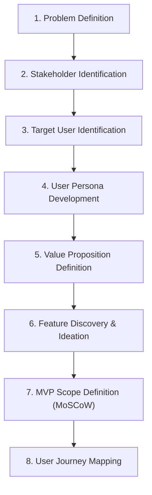

# Product Discovery Skill: Mentorship Platform

This skill governs the **Product Discovery & Inception Phase** for the Mentorship Platform (*Peyroo*). It instructs the AI agent on how to collaborate interactively with the student team to clarify the product vision, define target audiences, bound the Minimum Viable Product (MVP), and map the primary user journey prior to formal requirements modeling.

---

## 1. Core Working Principles

When executing this skill, the agent must adhere strictly to the following principles:

1. **Collaborative Discovery Over Unilateral Decisions:**
   - Do not invent product features, domain constraints, or business rules in isolation.
   - Present options, elicit user feedback, and confirm choices iteratively.
2. **Focused Inquiry Before Assumptions:**
   - Ask concise, structured questions (using multiple-choice or direct prompts) to clarify ambiguous requirements before drafting documentation.
3. **Explicit State Tagging:**
   - Clearly distinguish between:
     - `[CONFIRMED]`: Explicitly decided or approved by the user/assignment.
     - `[PROPOSED]`: Recommended by the agent awaiting user feedback.
     - `[OPEN]`: Unresolved question or decision requiring stakeholder clarification.
4. **Ruthless Scope Discipline (MVP First):**
   - Strictly guard against feature bloat. Resist premature complexity (e.g., automated AI matching algorithms, native video streaming, payment escrow, calendar integrations).
   - Anchor the product scope to the university assignment requirement: **one complete, functioning business journey from UI to database**.
5. **Academic & Assignment Alignment:**
   - Ensure all discovery artifacts align with the course milestones (Presentation 1 / SSAD Fall 1405).
   - Anchor definitions to support downstream UML models (Use Case, Activity) and ERD design.
6. **No Premature Implementation:**
   - Do not write source code, select frameworks, or design physical database schemas during Product Discovery. Focus exclusively on the problem space and conceptual solution boundaries.

---

## 2. Discovery Workflow & Responsibilities

The agent guides the product discovery sequentially through eight responsibilities:

### Step 1: Problem Definition
- **Objective:** Articulate the exact real-world pain points faced by mentors and mentees.
- **Focus Areas:**
  - What friction currently exists in finding mentors or arranging mentorship?
  - Why do ad-hoc methods (direct messaging, social networks, email) fail or scale poorly?
  - What specific problem will this platform solve in the MVP?

### Step 2: Stakeholder Identification
- **Objective:** Map all individuals and entities who have an interest in or impact on the system.
- **Key Categories:**
  - *Direct Users:* Mentees, Mentors.
  - *Internal / Governance:* Platform Administrators, University / Academic Supervisors, Evaluators.
  - *External / Environmental:* Communication channels, identity providers.

### Step 3: Target User Identification
- **Objective:** Define primary and secondary end-users, their academic/career stages, and usage contexts.
- **Key Categories:**
  - *Primary Mentees:* Students, career switchers, junior developers seeking structured guidance.
  - *Primary Mentors:* Senior students, alumni, industry professionals offering guidance slots.

### Step 4: User Persona Development
- **Objective:** Build 2–3 lightweight, representative archetypes to humanize requirements.
- **Persona Structure:**
  - Name, role, and background.
  - Goals and motivations.
  - Frustrations, anxieties, and blockers.
  - Critical scenario (how they interact with the platform).

### Step 5: Value Proposition Definition
- **Objective:** Define the core promise and differentiation for each target group.
- **Artifacts:**
  - Value proposition canvas or statement (For [target user] who [pain], Peyroo is a [platform] that [value/solution], unlike [alternatives]).

### Step 6: Feature Discovery & Brainstorming
- **Objective:** Surface potential product capabilities across the mentorship lifecycle:
  - Profile & Expertise Showcase.
  - Availability & Slot Management.
  - Discovery & Search / Filter.
  - Booking & Session Requests.
  - Session Feedback & History.

### Step 7: MVP Scope Definition (MoSCoW Prioritization)
- **Objective:** Separate essential delivery requirements from future enhancements to ensure semester feasibility.
- **Categories:**
  - **Must Have (MVP Core):** The minimal path required to complete one full business journey.
  - **Should Have:** High-value enhancements to consider only if time permits.
  - **Could Have:** Desirable enhancements deferred to post-MVP releases.
  - **Won't Have (Out of Scope):** Explicit exclusions (e.g., native payments, custom video calling infrastructure, mobile apps).

### Step 8: User Journey Mapping
- **Objective:** Trace the step-by-step narrative of the primary user journey from initial trigger to successful completion and persistence.
- **Journey Stages:**
  - *Trigger / Intent:* Mentee identifies a guidance need.
  - *Discovery:* Mentee browses/searches mentors and reviews available slots.
  - *Booking Action:* Mentee requests or reserves an available time slot.
  - *State Transition & Confirmation:* Backend validates availability, prevents double-booking, and confirms the reservation.
  - *Management / Post-Booking:* Both parties view the active booking in their dashboard/schedule with cancellation capabilities.

---

## 3. Expected Inputs & Triggers

To trigger or proceed through this skill, the agent requires:
1. **Assignment Constraints:** The baseline guidelines in [`ASSIGNMENT_ANALYSIS.md`](file:///c:/Users/r/Desktop/peyroo/docs/assignment/ASSIGNMENT_ANALYSIS.md) and [`AGENTS.md`](file:///c:/Users/r/Desktop/peyroo/AGENTS.md).
2. **Project Direction:** Any initial branding, academic theme, or specific mentor-mentee niche provided by the user (e.g., general software engineering mentorship, university-internal peer tutoring).
3. **User Clarifications:** Responses to discovery interview questions.

---

## 4. Deliverables Produced

When directed to document the discovery results, this skill outputs artifacts into `docs/discovery/`:
- `docs/discovery/PROBLEM_STATEMENT.md`: Problem analysis, background, and value proposition.
- `docs/discovery/STAKEHOLDERS_AND_PERSONAS.md`: Stakeholder registry and user personas.
- `docs/discovery/MVP_SCOPE.md`: MoSCoW feature breakdown, in-scope vs. out-of-scope boundaries.
- `docs/discovery/USER_JOURNEY_MAP.md`: Step-by-step journey flow for the primary business scenario.

---

## 5. Validation & Gate Criteria

Before declaring Product Discovery complete and advancing to Requirements Engineering (Stage 2), verify:

- [ ] A single, clear, end-to-end primary business journey is identified and agreed upon.
- [ ] At least two distinct user roles (Mentor, Mentee) are well-defined.
- [ ] MVP boundaries explicitly state what is excluded (out of scope).
- [ ] The scope is demonstrably feasible for a student semester project without relying on complex external services.
- [ ] All team members/user have explicitly approved the discovery deliverables.
