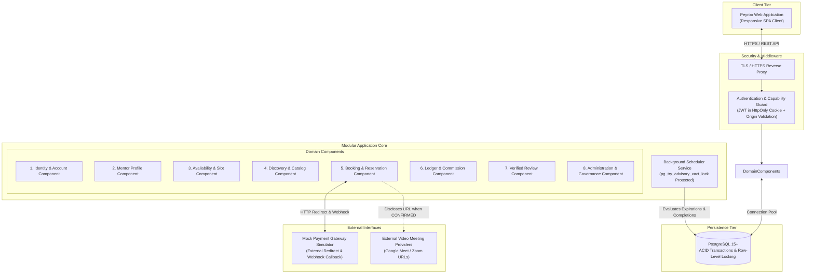

# Peyroo (پیرو) — Mentorship Platform

> **Academic Course:** Software Analysis and Design (SSAD) | Fall 1405  
> **Project Working Title:** Peyroo (پیرو)  
> **Architectural Pattern:** Modular Monolith with Layered Clean Architecture  
> **Status:** Stage 06 (System Design) Approved & Baselined | Preparing for Stage 07 (UI/UX Design)

---

## 1. Executive Summary

**Peyroo** is an academic software engineering project dedicated to designing, analyzing, building, and verifying a modern mentorship platform connecting software industry professionals with junior developers, computer science students, and career switchers.

Inspired by platforms like ADPList and Airbnb, Peyroo replaces chaotic cold outreach, unanswered direct messages, and calendar coordination friction with:
- **Unified Account Capabilities:** A single user identity can seamlessly operate in both **Mentee Mode** and **Mentor Mode**.
- **Standardized Availability Slots:** Mentors publish discrete availability windows (30, 45, or 60 minutes) with custom or default session rates and external meeting links.
- **Mandatory Structured Agendas:** Mentees must define session goals, questions, and repository/portfolio links before booking.
- **ACID Concurrency & 15-Minute Reservation Locks:** Pessimistic row-level locking (`SELECT ... FOR UPDATE`) and PostgreSQL partial unique indexing prevent double-booking race conditions while preserving full historical records.
- **Demonstrated Revenue & Banking Integration:** An integrated **Mock Banking Gateway Simulator** with an auditable payment transaction ledger and automated **10% Peyroo platform commission** calculation.
- **Strict Data Confidentiality:** External video URLs (Google Meet / Zoom) and session agendas are strictly masked and disclosed exclusively to authorized session participants once the booking is in `CONFIRMED` status.

---

## 2. Development Lifecycle & Current Status

This repository strictly follows a formal 9-stage academic software engineering lifecycle. Development proceeds sequentially through defined gates with explicit stakeholder approval:

| Stage | Discipline / Milestone | Status | Key Deliverables & Documentation |
|:---:|---|:---:|---|
| **Stage 01** | **Project Initialization & Setup** | `[APPROVED]` | Repository structure, `.editorconfig`, [`.gitignore`](./.gitignore), [`AGENTS.md`](./AGENTS.md) |
| **Stage 02** | **Assignment Analysis** | `[APPROVED]` | Course rubric & syllabus breakdown: [`ASSIGNMENT_ANALYSIS.md`](./docs/assignment/ASSIGNMENT_ANALYSIS.md) |
| **Stage 03** | **Product Discovery** | `[APPROVED]` | Problem definition, value proposition, personas & scope: [`PRODUCT_VISION.md`](./docs/discovery/PRODUCT_VISION.md) |
| **Stage 04** | **Requirements Engineering (SRS)** | `[APPROVED]` | 29 FRs, 17 NFRs, 10 Use Cases, Acceptance Criteria: [`docs/requirements/`](./docs/requirements/) |
| **Stage 05** | **System Analysis & UML Modeling** | `[APPROVED]` | Domain Model, Use Cases, Class Diagram, 12 Sequence & 7 Activity Diagrams: [`docs/analysis/uml/`](./docs/analysis/uml/) |
| **Stage 06** | **System Design & Architecture** | `[APPROVED]` | Architecture, 6 ADRs, Components, PostgreSQL ERD, REST API, Security: [`docs/design/`](./docs/design/) |
| **Stage 07** | **UI/UX Design & Wireframing** | `[READY TO BEGIN]` | Design system tokens, component wireframes, and clickable prototype specs |
| **Stage 08** | **Implementation & Unit Testing** | *Pending* | Modular codebase, automated integration tests, and presentation demo build |
| **Stage 09** | **Verification, Deployment & Defense** | *Pending* | Public HTTPS deployment, automated test evidence, and engineering defense |

---

## 3. High-Level System Architecture

Peyroo is architected as a **Modular Monolith** organized into 8 highly cohesive domain components. The system enforces a strict 4-layer dependency model (Presentation $\to$ Application $\to$ Domain $\to$ Infrastructure) running within a single unified process for deterministic testing and free-tier cloud deployment feasibility:



---

## 4. Engineering Highlights & Technical Invariants

### 4.1 ACID Concurrency & Partial Unique Indexing
To prevent double-booking race conditions while preserving full historical records of expired or cancelled sessions:
- **Pessimistic Row Locking:** `SELECT ... FOR UPDATE` acquires an exclusive lock on the availability slot row during checkout.
- **Partial Unique Indexing:** The database schema enforces that a slot may have at most **one active booking** at any time, while allowing unlimited terminal historical bookings:
  ```sql
  CREATE UNIQUE INDEX uq_active_booking_per_slot ON bookings (slot_id)
  WHERE status IN ('INITIATED', 'PENDING_PAYMENT', 'CONFIRMED');
  ```

### 4.2 Database-Level Concurrent Slot Overlap Prevention
Prevents mentors from publishing overlapping availability slots even under simultaneous multi-tab requests:
```sql
CREATE EXTENSION IF NOT EXISTS btree_gist;

ALTER TABLE availability_slots
ADD CONSTRAINT no_overlapping_slots_per_mentor
EXCLUDE USING gist (
    mentor_id WITH =,
    tstzrange(start_time, end_time) WITH &&
) WHERE (status != 'CANCELLED');
```

### 4.3 Auditable Financial Transaction Ledger
- Rather than claiming unneeded double-entry accounting overhead, financial records are stored as an **auditable payment transaction ledger**.
- Refunds are modeled as discrete new transactions (`CANCELLATION_REFUND`) linked via `parent_transaction_id` to the original `SESSION_PAYMENT` record.
- **Strict Expiration Precedence:** If a late payment is successfully captured by the bank after a booking has expired, it is recorded as a `COMPLETED` payment followed immediately by an automatic linked `CANCELLATION_REFUND` (net balance $0). Captured payments are never marked as `FAILED`.
- Webhook callbacks are deduplicated via unique `idempotency_key` constraints.

### 4.4 Connection-Pool Safe Background Scheduler
The in-process background worker executes periodic 60-second tasks for 15-minute reservation releases and automated session completions:
- Utilizes PostgreSQL **transaction-level advisory locking** (`pg_try_advisory_xact_lock`), which binds strictly to the transaction block.
- Guarantees zero lock leakage across pooled connections (compatible with PgBouncer and client connection pools) and safe single-leader execution across multi-instance server deployments.

---

## 5. Comprehensive Documentation Map

All software engineering documentation is version-controlled in clean Markdown under [`docs/`](./docs/):

### 5.1 Assignment & Discovery Documentation
- [`docs/assignment/ASSIGNMENT_ANALYSIS.md`](./docs/assignment/ASSIGNMENT_ANALYSIS.md): Comprehensive analysis of course requirements, presentation milestones, grading rubrics, and technical constraints.
- [`docs/discovery/PRODUCT_VISION.md`](./docs/discovery/PRODUCT_VISION.md): Problem definition, stakeholder registry, user personas (Amir & Sara), value proposition, and MoSCoW MVP boundaries.

### 5.2 Requirements Engineering Suite (Stage 04)
- [`docs/requirements/USER_STORIES.md`](./docs/requirements/USER_STORIES.md): MVP definition, MoSCoW prioritized user stories (`US-01` to `US-14` in *"As a [user], I want [action], so that [benefit]"* format), and observable acceptance criteria (Semester Work Plan 1: 9–15 Aban).
- [`docs/requirements/PROJECT_SCOPE.md`](./docs/requirements/PROJECT_SCOPE.md): Formal project boundaries, in-scope vs out-of-scope capabilities, interfaces, and operational constraints.
- [`docs/requirements/STAKEHOLDERS.md`](./docs/requirements/STAKEHOLDERS.md): Unified Account capability model, user roles, and backend RBAC ownership permissions.
- [`docs/requirements/FUNCTIONAL_REQUIREMENTS.md`](./docs/requirements/FUNCTIONAL_REQUIREMENTS.md): 29 unambiguous, testable functional requirements (`FR-001` to `FR-029`) across 10 modules.
- [`docs/requirements/NON_FUNCTIONAL_REQUIREMENTS.md`](./docs/requirements/NON_FUNCTIONAL_REQUIREMENTS.md): 17 measurable quality standards (`NFR-001` to `NFR-017`) for security, privacy, performance, reliability, and usability.
- [`docs/requirements/USE_CASE_SPECIFICATIONS.md`](./docs/requirements/USE_CASE_SPECIFICATIONS.md): 10 formal use case narratives with main, alternative, and exception flows.
- [`docs/requirements/ACCEPTANCE_CRITERIA.md`](./docs/requirements/ACCEPTANCE_CRITERIA.md): Given / When / Then (Gherkin) acceptance criteria for all major functional requirements.
- [`docs/requirements/REQUIREMENTS_TRACEABILITY_MATRIX.md`](./docs/requirements/REQUIREMENTS_TRACEABILITY_MATRIX.md): Bidirectional traceability cross-referencing business objectives, requirements, use cases, and future test cases.

### 5.3 System Analysis & UML Modeling Suite (Stage 05)
- [`docs/analysis/uml/SYSTEM_ANALYSIS.md`](./docs/analysis/uml/SYSTEM_ANALYSIS.md): Analytical foundations, system boundary, and core business invariants.
- [`docs/analysis/uml/DOMAIN_MODEL.md`](./docs/analysis/uml/DOMAIN_MODEL.md): Conceptual domain model diagram, entities, and value objects.
- [`docs/analysis/uml/USE_CASE_DIAGRAM.md`](./docs/analysis/uml/USE_CASE_DIAGRAM.md): Actor hierarchy, system boundaries, and sub-package use case diagrams (`<<include>>` and `<<extend>>`).
- [`docs/analysis/uml/CLASS_DIAGRAM.md`](./docs/analysis/uml/CLASS_DIAGRAM.md): Conceptual class diagram, attributes, operations, multiplicities, and 6 core enumerations.
- [`docs/analysis/uml/SEQUENCE_DIAGRAMS.md`](./docs/analysis/uml/SEQUENCE_DIAGRAMS.md): 12 complete sequence diagrams detailing critical flows, concurrency race conditions, and callbacks.
- [`docs/analysis/uml/ACTIVITY_DIAGRAMS.md`](./docs/analysis/uml/ACTIVITY_DIAGRAMS.md): 7 swimlane activity diagrams modeling workflow branching and exception handling.
- [`docs/analysis/uml/STATE_DIAGRAMS.md`](./docs/analysis/uml/STATE_DIAGRAMS.md): 3 formal state machines (Booking Lifecycle, Availability Slot Lifecycle, Payment Lifecycle).
- [`docs/analysis/uml/UML_TRACEABILITY_MATRIX.md`](./docs/analysis/uml/UML_TRACEABILITY_MATRIX.md): 100% requirements coverage mapping.
- [`docs/analysis/uml/UML_CONSISTENCY_REPORT.md`](./docs/analysis/uml/UML_CONSISTENCY_REPORT.md): Semantic verification and quality audit report.

### 5.4 System Design & Architecture Suite (Stage 06)
- [`docs/design/SYSTEM_DESIGN.md`](./docs/design/SYSTEM_DESIGN.md): Architectural synthesis, 4-layer model, and technical roadmap.
- [`docs/design/ARCHITECTURE_DESIGN.md`](./docs/design/ARCHITECTURE_DESIGN.md): Modular Monolith evaluation, layer boundaries, and quality trade-offs.
- [`docs/design/ARCHITECTURE_DECISIONS.md`](./docs/design/ARCHITECTURE_DECISIONS.md): 6 formal ADRs (Monolith, PostgreSQL Locking, Unified Account, In-Process Scheduler, JWT Cookies, Mock Gateway).
- [`docs/design/COMPONENT_DESIGN.md`](./docs/design/COMPONENT_DESIGN.md): Detailed component decomposition, exported service interfaces, and dependencies.
- [`docs/design/DATABASE_DESIGN.md`](./docs/design/DATABASE_DESIGN.md): Relational schema, formal ERD, table DDLs, partial unique indexes, and concurrency locking scripts.
- [`docs/design/API_DESIGN.md`](./docs/design/API_DESIGN.md): Complete RESTful API contract across 8 modules with request/response schemas and standardized error envelopes.
- [`docs/design/SECURITY_DESIGN.md`](./docs/design/SECURITY_DESIGN.md): Defense-in-depth CSRF/XSS, Argon2id/bcrypt hashing, real-time suspension checks, and meeting link masking.
- [`docs/design/WORKFLOW_AND_TRANSACTION_DESIGN.md`](./docs/design/WORKFLOW_AND_TRANSACTION_DESIGN.md): Concurrency locking, payment vs expiration race condition resolution, and transaction isolation.
- [`docs/design/DEPLOYMENT_DESIGN.md`](./docs/design/DEPLOYMENT_DESIGN.md): Physical deployment topology, containerized hosting feasibility, free-tier limits, and cold-start handling.
- [`docs/design/DESIGN_TRACEABILITY_MATRIX.md`](./docs/design/DESIGN_TRACEABILITY_MATRIX.md): Bidirectional traceability linking requirements to components, database tables, and API operations.
- [`docs/design/DESIGN_VALIDATION_REPORT.md`](./docs/design/DESIGN_VALIDATION_REPORT.md): Formal verification report confirming cross-stage consistency.
- [`docs/design/DESIGN_REVIEW_AND_CORRECTION_REPORT.md`](./docs/design/DESIGN_REVIEW_AND_CORRECTION_REPORT.md): Audit report detailing the 11 audited issues and their architectural resolutions.

---

## 6. Technology Stack Baseline

The technology stack is selected based on academic feasibility, type safety, low operational overhead, and free-tier hosting capability:

| Tier / Function | Selected Technology | Rationale & Trade-Off |
|---|---|---|
| **Programming Language** | **TypeScript (Node.js 20+ LTS)** | End-to-end type safety, shared DTO interfaces between frontend and backend, rich ecosystem. |
| **Backend Runtime** | **Modular Monolith (Express / Fastify / NestJS)** | High performance, lightweight footprint, simple local testing, and clean 4-layer modular structure. |
| **Database Engine** | **PostgreSQL 15+** | Robust ACID transactions, row-level locking (`FOR UPDATE`), range exclusion constraints (`btree_gist`), partial indexing. |
| **Frontend Client** | **Single Page Application (React / Vue + TailwindCSS)** | Modern component-driven UI, responsive design, fast interactive slot selection and checkout. |
| **Authentication** | **Stateless JWT in HttpOnly, Secure Cookies** | Protection against client-side XSS token theft, supported by server-side Origin validation and status lookups. |
| **Background Processing**| **Embedded In-Process Scheduler** | Periodic 60s interval runner with PostgreSQL `pg_try_advisory_xact_lock` for multi-instance safety. |
| **Payment Integration** | **Mock Payment Gateway Simulator** | Simulates external card checkout, redirects, and signed HMAC-SHA256 webhooks without real banking liabilities. |
| **Hosting & Deployment**| **Docker Container on PaaS (Render / Railway / Fly.io)** | HTTPS-enabled public web service running within standard free-tier allocations ($0.00/mo operating cost). |

---

## 7. Development & Contribution Standards

All development strictly follows the repository instructions in [`AGENTS.md`](./AGENTS.md):
- **Branching Strategy:** Main branch remains stable. Features and stages evolve via dedicated staged development branches.
- **Commit Messages:** Adheres to the **Conventional Commits** specification:
  - `feat: ...` for new functional capabilities.
  - `docs: ...` for documentation additions or refinements.
  - `fix: ...` for defect corrections.
  - `refactor: ...` for structural code restructurings without behavior changes.
  - `test: ...` for automated test suites.
  - `chore: ...` for configuration or repository maintenance.
- **Security & Hygiene:** Zero secrets or credentials committed (`.env` files ignored by [`.gitignore`](./.gitignore)); lightweight repository with no large binary assets.
- **Traceability:** Every functional implementation component must trace directly to a documented requirement (`FR-xxx`) and use case (`UC-xxx`).

---

*Academic Software Engineering Project — Software Analysis & Design (SSAD) | Fall 1405 / November 2026*
