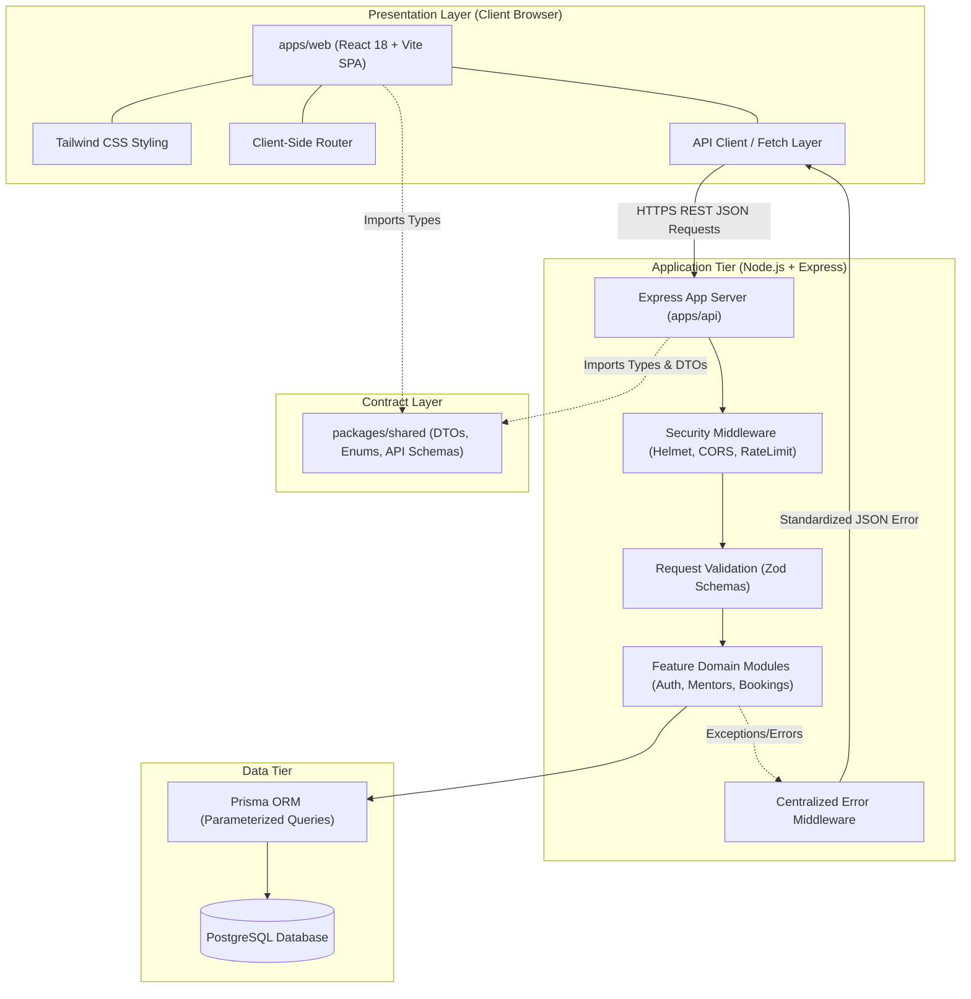

# System Architecture: Peyroo (پیرو)

## 1. Architectural Style: Decoupled Modular Monolith

Peyroo adopts a **Decoupled Modular Monolith** architecture within a unified Git monorepo managed via npm workspaces.

```text
peyroo/
├── apps/
│   ├── web/               # Frontend Application (React + Vite + Tailwind CSS)
│   └── api/               # Backend REST API (Node.js + Express + Zod)
├── packages/
│   └── shared/            # Shared Types, DTOs & Contracts (TypeScript)
├── prisma/                # Database Schema & Migrations
├── docs/                  # Architecture & Requirements Documentation
├── tests/                 # Testing Infrastructure & Guides
├── AGENTS.md              # Persistent Development Rules
└── package.json           # Root Workspace Configuration
```

### Why a Modular Monolith?

- **Unified Tooling**: Single repository with coordinated TypeScript configurations, shared contracts, and synchronized formatting/linting.
- **Maintainable Boundaries**: Avoids the operational overhead, network latency, distributed transactions, and deployment complexity of microservices, while maintaining strict domain separation.
- **Clear Decoupling**: The presentation layer (`apps/web`) and API service layer (`apps/api`) run as isolated processes and communicate exclusively over structured HTTP/JSON REST APIs.

---

## 2. System Architecture Diagram



---

## 3. Layer Responsibilities & Boundaries

### 3.1 Frontend (`apps/web`)

- **Responsibilities**:
  - Render user interface components, views, and responsive layouts.
  - Manage client-side routing, view state, and form interactions.
  - Format presentation data (e.g. converting UTC timestamps to local browser timezone).
  - Issue typed asynchronous requests to the backend REST API.
- **Strict Boundary**:
  - The frontend has **no direct access** to the database or internal ORM models.
  - Frontend authorization checks are strictly for UX (e.g. hiding a button); they never act as security boundaries.

### 3.2 Backend (`apps/api`)

- **Responsibilities**:
  - The **sole authority** for business logic, authentication, authorization, and data integrity.
  - Validate all untrusted incoming input (body, query, params) using Zod.
  - Enforce least-privilege role-based access control.
  - Execute parameterized transactional database operations via Prisma ORM.
  - Centralize error handling and produce consistent, safe HTTP responses.
  - Enforce security headers (Helmet), CORS, and rate limiting.

### 3.3 Shared Package (`packages/shared`)

- **Responsibilities**:
  - Houses platform-wide TypeScript definitions, shared enums, API request/response DTO interfaces, and shared validation constants.
  - Contains zero platform-specific business logic or runtime node/browser dependencies.

### 3.4 Database (`prisma/`)

- **Responsibilities**:
  - Defines the declarative database schema (`schema.prisma`), relation mappings, indexes, and constraints.
  - Generates the typed `@prisma/client`.
  - Manages reversible database migration files.

---

## 4. Communication & REST API Conventions

Communication between `apps/web` and `apps/api` occurs strictly via HTTP REST JSON calls.

- **URL Prefix**: All API routes are namespaced under `/api/v1` (with system endpoints like `/health` at root).
- **Format**: All request bodies and response payloads use UTF-8 JSON.
- **HTTP Verbs**: Standard semantic verbs:
  - `GET`: Idempotent read operations.
  - `POST`: Create operations or state transitions.
  - `PUT` / `PATCH`: Idempotent replacement or partial updates.
  - `DELETE`: Resource removal or soft-deletion.
- **Contract Integrity**:
  Every response adheres to a standard envelope structure:
  ```typescript
  // Successful response
  {
    "success": true,
    "data": { ... }
  }

  // Error response
  {
    "success": false,
    "error": {
      "code": "VALIDATION_ERROR",
      "message": "Human readable error description",
      "details": [ ... ]
    }
  }
  ```

---

## 5. Dependency Direction

Dependencies flow strictly inward:

1. `apps/web` depends on `packages/shared`. (Never imports from `apps/api` or `prisma`).
2. `apps/api` depends on `packages/shared` and the generated `@prisma/client`. (Never imports from `apps/web`).
3. `packages/shared` has zero internal workspace dependencies.
4. Circular dependencies across modules or workspaces are strictly forbidden.

---

## 6. Error Handling Principles

1. **Centralized Catch-All Middleware**: All unhandled exceptions in `apps/api` bubble up to an Express error-handling middleware.
2. **Defensive Sanitization**:
   - In `development` mode, structured error details may be logged for debugging.
   - In `production` mode, internal database messages, stack traces, and system file paths are never exposed to the client. A sanitized generic message (e.g. `INTERNAL_SERVER_ERROR`) is returned with a correlation ID.
3. **Known Operational Errors vs Unknown Program Bugs**:
   - Operational errors (validation failure, unauthorized, resource not found) return the designated 4xx status code and code enum.
   - Unknown exceptions return 500 and trigger internal error logging.

---

## 7. Configuration Management

- **Environment-Based Configuration**: Configuration is injected via environment variables adhering to Twelve-Factor principles.
- **Sanitized Template**: `.env.example` documents every variable name, purpose, and dummy value.
- **Git Exclusions**: Real `.env` and `.env.*` files are explicitly excluded in `.gitignore`.
- **Runtime Validation**: When backend starts, critical environment variables (`PORT`, `DATABASE_URL`, `CORS_ORIGIN`, `NODE_ENV`) are validated using Zod to ensure the application fails fast if configuration is missing or invalid.
