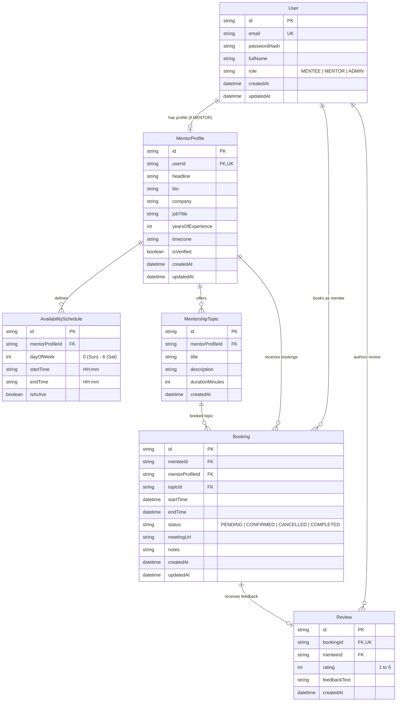

# Database Design & Preliminary Domain Model: Peyroo (پیرو)

> **Status Notice**: This document details the **preliminary and conceptual data domain**. The database schema is not finalized, and no business domain tables or migrations are implemented during this bootstrap phase.

---

## 1. Domain Modeling Philosophy

Peyroo's data domain prioritizes:

- **Strong Referential Integrity**: Foreign keys with appropriate cascading or restricting rules to prevent orphaned records.
- **ACID Compliance**: Relational model powered by PostgreSQL and Prisma ORM to ensure consistent transactional guarantees (especially for session slot bookings to prevent double-booking).
- **Auditability**: Timestamp columns (`createdAt`, `updatedAt`) on core entities.
- **Data Normalization**: Balanced 3NF normalization to avoid update anomalies while allowing efficient queries for mentor catalogs.

---

## 2. Preliminary Conceptual Entities

---

## 3. Potential Entity Descriptions & Integrity Constraints

### 3.1 `User`

- **Purpose**: Represents an authenticated identity in the system.
- **Constraints**:
  - `email`: Unique, lowercased, indexed, non-null.
  - `role`: Enum (`MENTEE`, `MENTOR`, `ADMIN`), default `MENTEE`.
  - `passwordHash`: Non-null string (hashed with Argon2id or bcrypt).

### 3.2 `MentorProfile`

- **Purpose**: Extended professional details for users operating as mentors.
- **Constraints**:
  - `userId`: One-to-one relationship with `User`, unique foreign key, `ON DELETE CASCADE`.
  - `isVerified`: Boolean, default `false`, modifiable only by admins.
  - `timezone`: IANA timezone string (e.g., `Asia/Tehran`, `UTC`, `America/New_York`) to compute slot conversions accurately.

### 3.3 `MentorshipTopic` (Session Types)

- **Purpose**: Topics and session lengths a mentor offers (e.g. Portfolio Review, Career Advice).
- **Constraints**:
  - `mentorProfileId`: Foreign key to `MentorProfile`, `ON DELETE CASCADE`.
  - `durationMinutes`: Integer (e.g., 30, 45, 60), check constraint `durationMinutes > 0`.

### 3.4 `AvailabilitySchedule`

- **Purpose**: Weekly recurring time windows when a mentor is receptive to bookings.
- **Constraints**:
  - `dayOfWeek`: Small integer (0 = Sunday through 6 = Saturday).
  - `startTime` and `endTime`: Valid 24-hour time strings (`HH:mm`) where `startTime < endTime`.

### 3.5 `Booking`

- **Purpose**: A concrete mentorship session reservation between a mentee and mentor.
- **Constraints**:
  - `status`: Enum (`PENDING`, `CONFIRMED`, `CANCELLED`, `COMPLETED`).
  - `startTime` / `endTime`: Valid timestamps where `startTime < endTime`.
  - **Concurrency Guard**: A database exclusion constraint or serializable transaction must prevent overlapping `CONFIRMED` bookings for the same mentor.

### 3.6 `Review`

- **Purpose**: Evaluative feedback left by a mentee upon session completion.
- **Constraints**:
  - `bookingId`: Unique foreign key to `Booking` (at most one review per completed booking).
  - `rating`: Integer constraint `rating BETWEEN 1 AND 5`.

---

## 4. Unresolved Modeling Decisions

The following items are flagged for analysis and design evaluation before writing Prisma migrations:

1. **User Profile Separation vs Single Table Inheritance**:
   - Should Mentees and Mentors share a single `UserProfile` table with optional fields, or keep a separate `MentorProfile` table linked 1-to-1 with `User`?
2. **Specific Date Availability Overrides**:
   - In addition to weekly recurring availability (`AvailabilitySchedule`), should the schema support specific date overrides (e.g., "vacation days" or "blocked dates")?
3. **Session Topics vs Direct Booking**:
   - Can a mentee book generic mentor availability, or must every booking strictly reference a specific `MentorshipTopic`?
4. **Soft Deletion Strategy**:
   - Should cancellation and user deactivation use a `deletedAt` timestamp (soft delete) to preserve historical metrics and review history, or standard status transitions?
5. **Timezone Storage**:
   - Storing all session timestamps in UTC in PostgreSQL (`TIMESTAMPTZ`) while recording the mentor's and mentee's native IANA timezone string for notification and display rendering.
