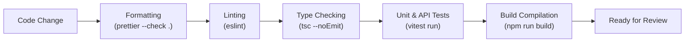

# Testing Strategy & Quality Gates: Peyroo (پیرو)

## 1. Testing Philosophy

The testing strategy follows the standard **Testing Pyramid** adapted for a TypeScript monorepo:

1. **Unit Tests (Base)**: Fast, isolated verification of business rules, validation schemas, utility functions, and domain calculations.
2. **Integration & API Tests (Middle)**: HTTP endpoint tests exercising Express middleware, Zod validation, and database operations in an isolated test database.
3. **Frontend Component Tests (Middle)**: UI rendering, user interaction, and state management tests using React Testing Library.
4. **End-to-End (E2E) Tests (Apex - Future)**: Critical cross-system user flows (e.g., browse mentor -> book slot -> confirmation).

---

## 2. Test Tooling & Runners

| Layer                          | Primary Tool              | Supporting Libraries              | Notes                                                          |
| :----------------------------- | :------------------------ | :-------------------------------- | :------------------------------------------------------------- |
| **Backend Unit & Integration** | **Vitest**                | `supertest`                       | Fast execution, ESM native, TypeScript support out of the box. |
| **Frontend Component Tests**   | **Vitest**                | `@testing-library/react`, `jsdom` | Seamless integration with Vite build tooling.                  |
| **Type Checking**              | **TypeScript (`tsc`)**    | `tsc --noEmit`                    | Strict mode enabled across all packages.                       |
| **Linting & Code Style**       | **ESLint** & **Prettier** | `@typescript-eslint`              | Standardized formatting and AST linting rules.                 |

---

## 3. Test Layers & Implementation Guidelines

### 3.1 Unit Testing

- **Location**: Co-located with source files (e.g., `src/utils/date.test.ts`) or in adjacent `__tests__` folders.
- **Scope**: Pure functions, Zod schema edge cases, formatters, authorization policy helpers.
- **Expectation**: Fast (< 10ms per test), completely deterministic, zero external network or database calls.

### 3.2 Backend API & Integration Testing

- **Location**: `apps/api/test/**/*.test.ts`.
- **Scope**:
  - Verification of HTTP status codes, response envelope format, and header configurations.
  - Verification of Zod validation rejections on invalid request payloads.
  - Verification of authentication middleware guarding protected routes.
- **Tool**: `supertest` sending requests to the Express `app` instance without binding to a physical network port.

### 3.3 Frontend Component Testing

- **Location**: `apps/web/src/**/*.test.tsx`.
- **Scope**:
  - UI component rendering in various states (loading, error, empty, loaded).
  - Accessibility attributes and keyboard interaction.
  - Form validation errors displayed to the user.

---

## 4. Quality Gates & Acceptance Criteria

Before any code is accepted or merged, the following automated checks must execute successfully:

### Mandatory Acceptance Criteria

1. **Zero Type Errors**: `npm run typecheck` across all workspaces must exit with code 0.
2. **Zero Lint Errors**: `npm run lint` must pass with zero errors (warnings must be resolved).
3. **Formatting Compliance**: `npm run format:check` must report that all files conform to Prettier rules.
4. **Passing Tests**: All Vitest test suites must pass. Tests must never be disabled, skipped, or commented out merely to satisfy CI checks.
5. **Clean Build**: `npm run build` must compile both `apps/api` and `apps/web` without errors.

---

## 5. Test Organization Directory (`tests/`)

- Dedicated high-level end-to-end and cross-cutting test configurations reside under `/tests`.
- Workspace-specific unit and integration tests reside directly within their respective workspaces (`apps/api/test`, `apps/web/src`).
- See [tests/README.md](file:///C:/Users/r/Desktop/peyroo/tests/README.md) for shared test fixtures and execution procedures.
