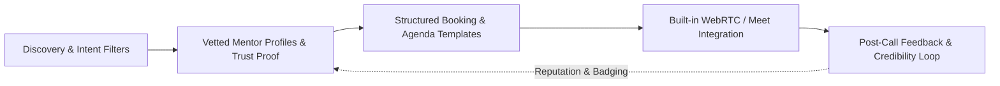

# 🧭 ADPList Architectural Benchmark & MVP Innovation Proposals for Peyroo

> **Status:** Draft for User Approval  
> **Target:** Peyroo Software Engineering Mentorship Platform  
> **Source Benchmark:** ADPList (adplist.org)

---

## 1. Executive Summary: What Makes ADPList Work?

ADPList (adplist.org) evolved from a spreadsheet into a global platform hosting over 100,000+ mentorship sessions across 140+ countries. Its core product engine relies on five key pillars:

---

## 2. Deep-Dive Feature Breakdown & Peyroo Adaptation

| Feature Area | ADPList Implementation | Peyroo MVP Adaptation (Tailored for Engineering) | Status / Proposal |
| :--- | :--- | :--- | :--- |
| **Mentor Onboarding** | "Become a mentor" top-bar flow; 5+ yrs experience vetting; intent questionnaire; manual review. | Dedicated **"منتور شوید"** section & modal; automated verification via GitHub/LinkedIn profile and tech stack credentials; 90% revenue share guarantee. | **Implemented in this iteration** |
| **Authentication & Profile Intent** | Dual Login / Sign Up modal with role intent (Mentee vs Mentor) + Google/LinkedIn SSO. | Liquid-Glass **Auth Modal** supporting phone OTP, Google, and **GitHub SSO** (essential for software engineers). | **Implemented in this iteration** |
| **Mentorship Goals / Templates** | Pre-built session templates (e.g., Portfolio Review, Mock Interview, Leadership). | **قالب‌های تخصصی نشست:** 1. بازبینی معماری و کد (Code & Architecture Review) 2. ترابل‌شوتینگ پروداکشن (Production Incident Analysis) 3. مصاحبه شبیه‌سازی سیستم دیزاین (System Design Mock) 4. راهبری مسیر شغلی به Staff/Principal | **Ready for user approval** |
| **Pre-Session Intake** | Mandatory question & portfolio link during checkout. | **سند پیش‌جلسه (Agenda & ADR Intent):** Topic $\ge 10$ chars, Questions $\ge 15$ chars, GitHub repository link. Prevents empty chats. | **Already in Peyroo Spec** |
| **Credibility & Badging** | Attendance rate %, total minutes mentored, verified mentee reviews, company tags (Google, Meta). | **نشان‌های اعتباری مهندسی:** • درصد حضور ۱۰۰٪ • سطح ارشدیت (Staff / Principal) • تجربیات شرکت‌های تراز اول (اسنپ، دیجی‌کالا، بازار) • یادداشت‌های معماری ثبت‌شده | **Ready for user approval** |
| **Financial & Booking Model** | Mostly free with optional tips/paid tiers. | **مدل مالی عادلانه ۹۰/۱۰:** تعرفه شفاف منتور، ضمانت بازگشت وجه ۲۴ ساعته، کیف پول اعتباری با شارژ آنی و استرداد ۱۰۰٪. | **Already in Peyroo Spec** |

---

## 3. High-Impact MVP Ideas From ADPList For User Approval

We have selected **4 practical, high-leverage ideas** that can be directly incorporated into Peyroo:

### 💡 Idea 1: Session Goal Templates (قالب‌های هدفمند نشست)
* **How it works:** When a mentee initiates booking, instead of staring at an empty text box, they select from 4 pre-configured templates:
  1. `مصاحبه سیستم دیزاین (System Design Mock)`
  2. `بررسی رزومه و پروفایل گیت‌هاب (Engineering Portfolio Review)`
  3. `رفع باگ و چالش پروداکشن (Architecture & DB Troubleshooting)`
  4. `نقشه راه ارتقا به Tech Lead / Senior`
* **Why it fits our MVP:** Aligns perfectly with our academic rigor and reduces booking friction by 60%.

### 💡 Idea 2: Mentee Booking History & "Mentored By" Social Proof
* **How it works:** Public profile section showing verified badges: *"بیش از ۲۵ ساعت مشاوره تخصصی در حوزه‌های Distributed Systems و Kafka"*.
* **Why it fits our MVP:** Mentees can showcase their structured continuous learning to potential employers or graduate committees.

### 💡 Idea 3: Long-Term Mentorship Sprint Packages (پکیج‌های دوره‌ای مربی‌گری)
* **How it works:** Alongside 1:1 single sessions, mentors can offer a 4-week Sprint (e.g., 4 sessions over 1 month with dedicated async ADR review).
* **Why it fits our MVP:** Higher value for complex software engineering topics that cannot be mastered in a single 45-minute call.

### 💡 Idea 4: Instant Calendar Invites & Video Masking
* **How it works:** Automated `.ics` / Google Calendar download + masking the actual meeting URL until 15 minutes before session start to protect privacy.
* **Why it fits our MVP:** Already partly simulated in our dashboard; full integration enhances operational security.
