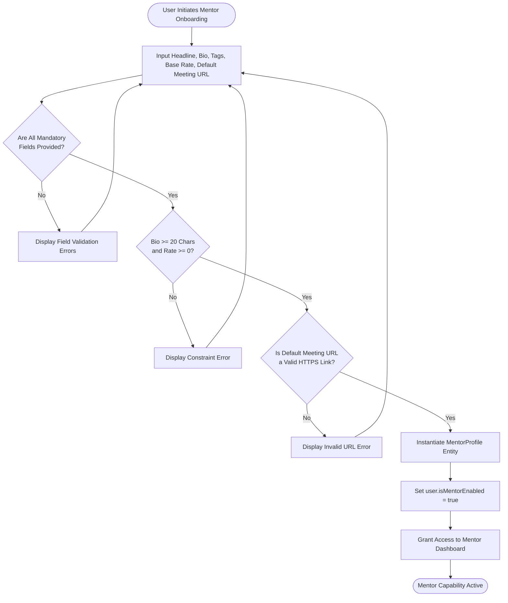
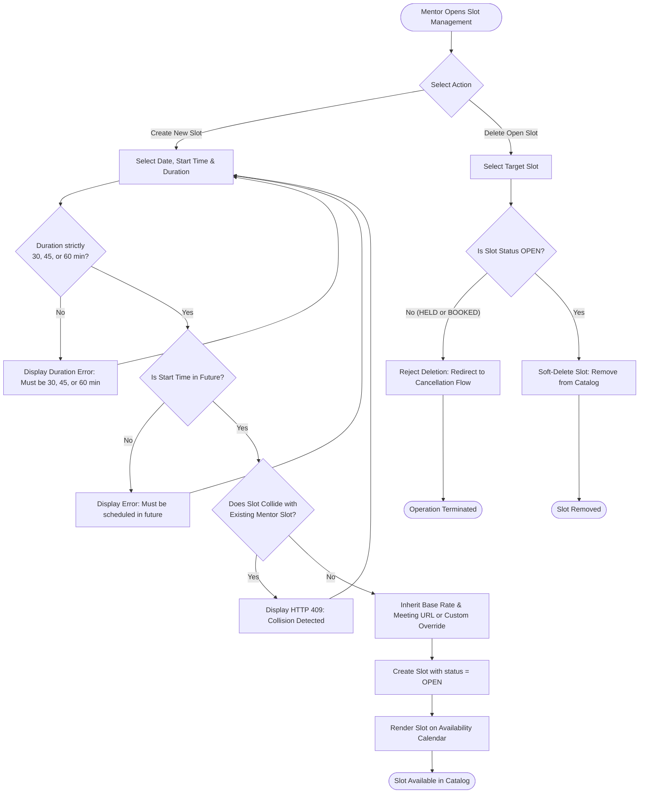
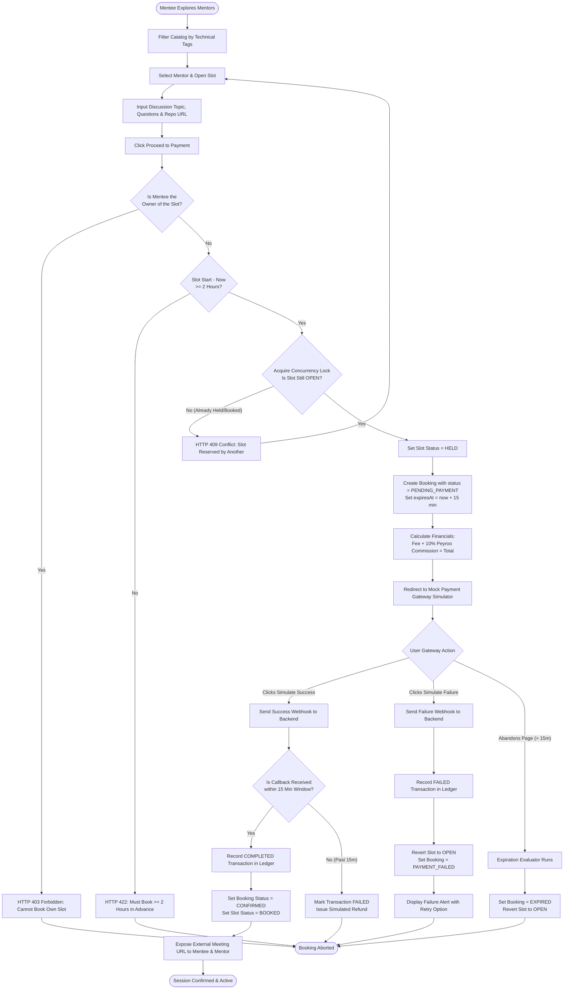
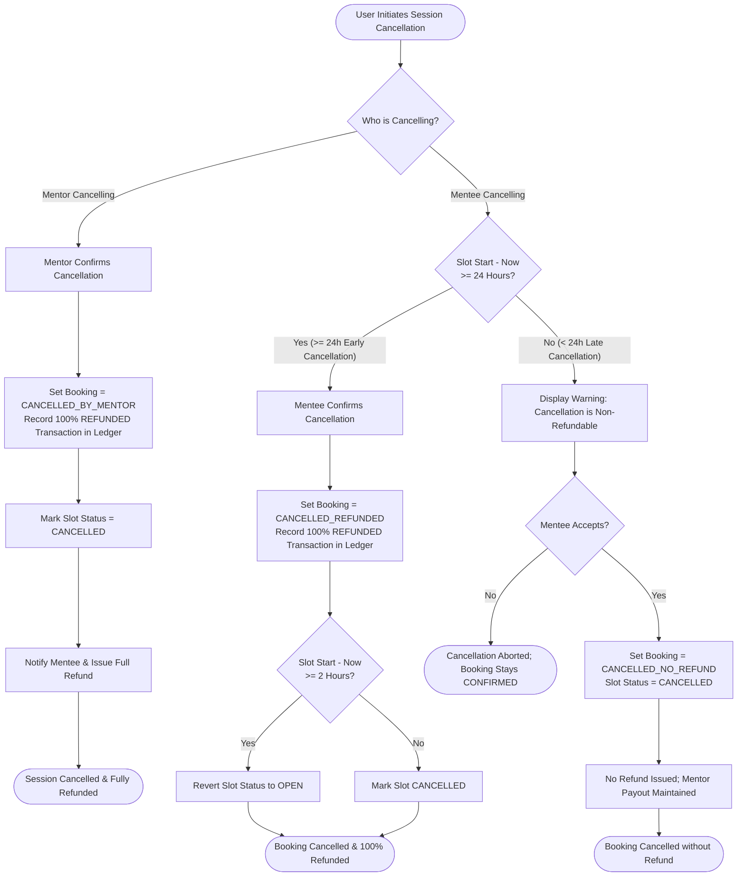
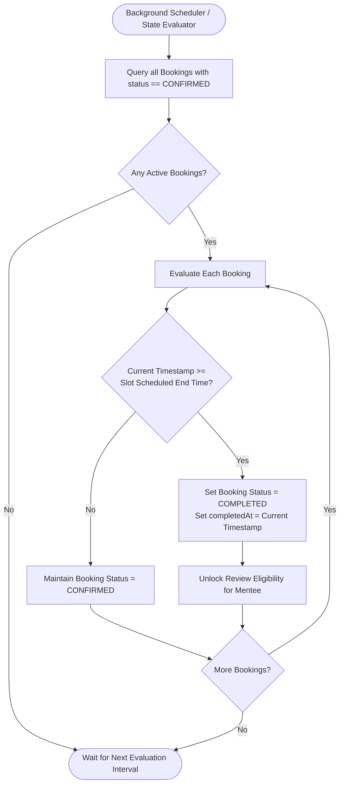
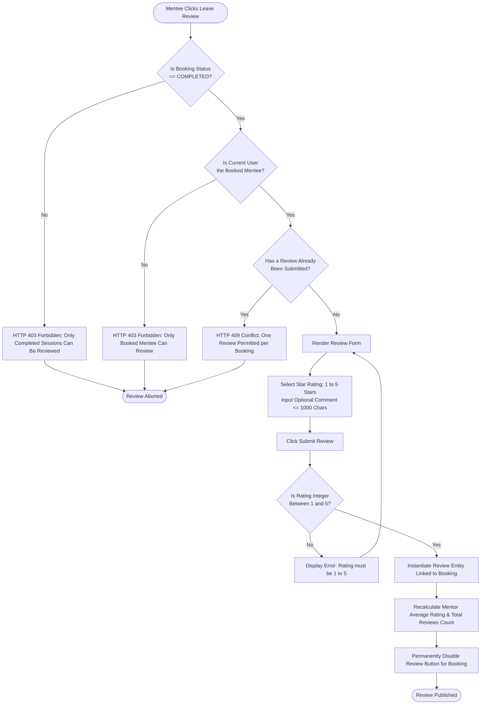
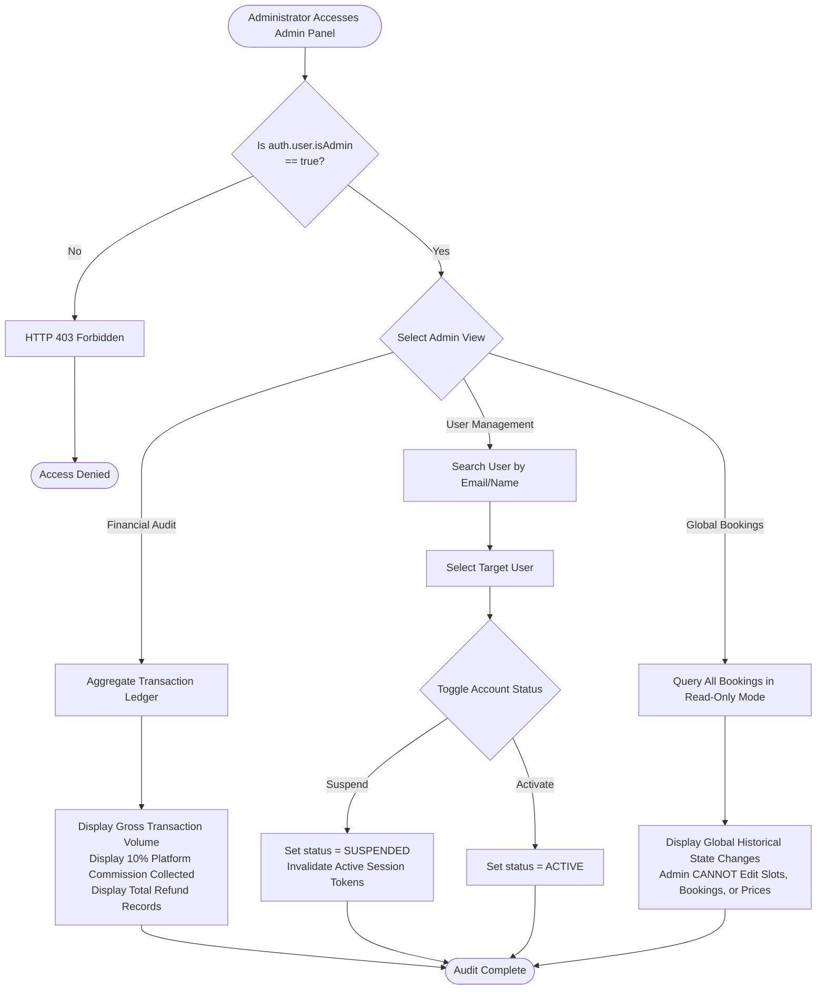

# Activity Diagrams: Peyroo Mentorship Platform

**Project Working Title:** Peyroo (پیرو)  
**Academic Course:** Software Analysis and Design (SSAD) | Fall 1405  
**Document Identifier:** `docs/analysis/uml/ACTIVITY_DIAGRAMS.md`  
**Status:** `[BASELINE - STAGE 05]`  
**Date:** Aban 1405 / November 2026  
**Document Version:** 1.0  

---

## 1. Overview & Diagram Index

This document models the procedural control flow, decision branching, and concurrency synchronization for 7 critical business processes in the **Peyroo Mentorship Platform**:

1. [Workflow 1: Mentor Onboarding & Profile Setup](#workflow-1-mentor-onboarding--profile-setup)
2. [Workflow 2: Availability Slot Management](#workflow-2-availability-slot-management)
3. [Workflow 3: End-to-End Booking & Payment Flow](#workflow-3-end-to-end-booking--payment-flow)
4. [Workflow 4: Session Cancellation & Refund Processing](#workflow-4-session-cancellation--refund-processing)
5. [Workflow 5: Automated Session Completion](#workflow-5-automated-session-completion)
6. [Workflow 6: Verified Post-Session Review Submission](#workflow-6-verified-post-session-review-submission)
7. [Workflow 7: Administrator Moderation & Financial Audit](#workflow-7-administrator-moderation--financial-audit)

---

## Workflow 1: Mentor Onboarding & Profile Setup

---

## Workflow 2: Availability Slot Management

---

## Workflow 3: End-to-End Booking & Payment Flow

---

## Workflow 4: Session Cancellation & Refund Processing

---

## Workflow 5: Automated Session Completion

---

## Workflow 6: Verified Post-Session Review Submission

---

## Workflow 7: Administrator Moderation & Financial Audit

