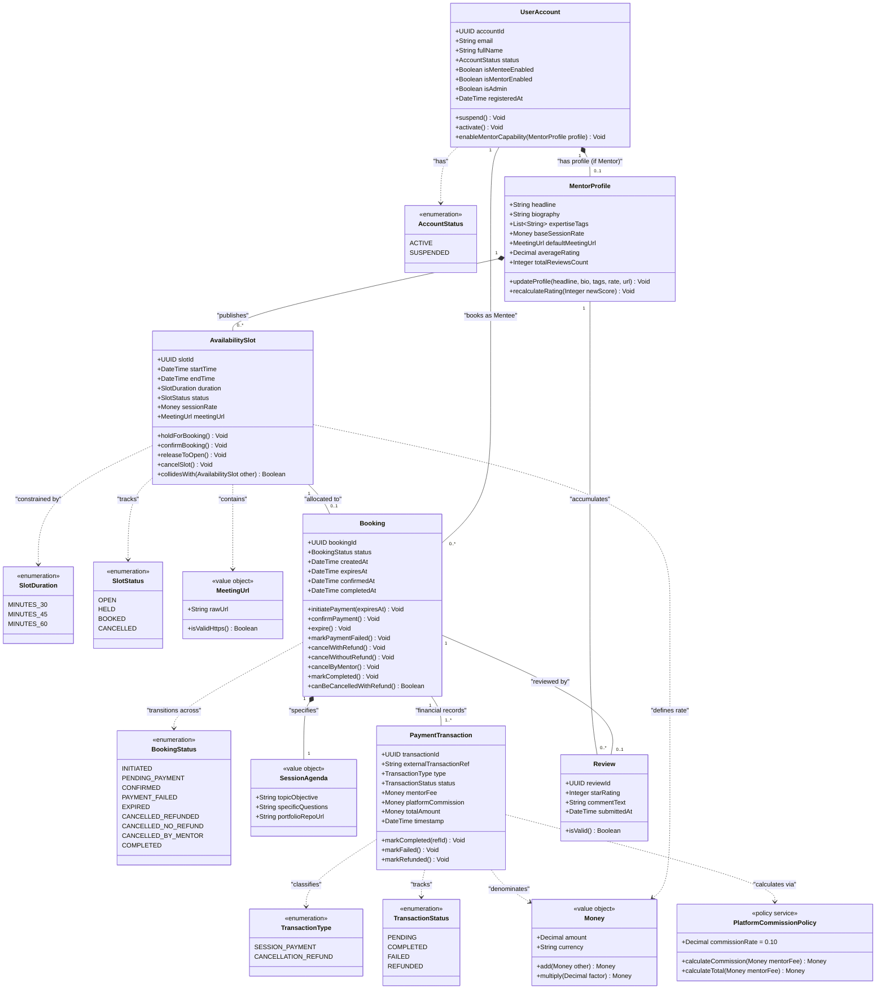

# Conceptual Class Diagram: Peyroo Mentorship Platform

**Project Working Title:** Peyroo (پیرو)  
**Academic Course:** Software Analysis and Design (SSAD) | Fall 1405  
**Document Identifier:** `docs/analysis/uml/CLASS_DIAGRAM.md`  
**Status:** `[BASELINE - STAGE 05]`  
**Date:** Aban 1405 / November 2026  
**Document Version:** 1.0  

---

## 1. Conceptual Class Diagram Overview

This conceptual UML Class Diagram models the essential domain concepts, structural relationships, attributes, operations, and enumerations of the **Peyroo Mentorship Platform**. 

In strict adherence to system analysis principles:
- It excludes physical database constructs (primary keys, foreign keys, table indexes) and framework-specific middleware.
- It models **Mentee** and **Mentor** as active role capabilities anchored to a single `UserAccount`.
- It captures the 10% platform commission logic, 15-minute concurrency holding reservation, and the financial ledger double-entry structure.

---

## 2. Conceptual Class Diagram

---

## 3. Structural Semantics & Multiplicity Explanations

### 3.1 `UserAccount` $\longleftrightarrow$ `MentorProfile` (1 to 0..1 Composition)
- **Multiplicity:** A `UserAccount` can exist purely in Mentee capability (0 profiles). When a user activates Mentor capability, exactly 1 `MentorProfile` is instantiated.
- **Composition Semantics:** The `MentorProfile` cannot exist independently of its parent `UserAccount`. If the account is deactivated or suspended, the mentor capability is suspended simultaneously.

### 3.2 `MentorProfile` $\longleftrightarrow$ `AvailabilitySlot` (1 to 0..\* Composition)
- **Multiplicity:** A mentor may create zero or multiple availability slots.
- **Domain Constraints:** A mentor cannot publish two slots that temporally overlap (`slot.collidesWith(other) == true`). All slots must adhere to `SlotDuration` (30, 45, or 60 minutes).

### 3.3 `AvailabilitySlot` $\longleftrightarrow$ `Booking` (1 to 0..1 Association)
- **Multiplicity:** An `AvailabilitySlot` is initially unbooked (0 bookings). When reserved, exactly 1 `Booking` is associated with it. A slot cannot be shared across multiple simultaneous bookings.

### 3.4 `UserAccount` (as Mentee) $\longleftrightarrow$ `Booking` (1 to 0..\* Association)
- **Multiplicity:** A user acting as a mentee may create multiple bookings over time.
- **Self-Booking Invariant:** The system strictly enforces that `booking.menteeId != booking.slot.mentorId`.

### 3.5 `Booking` $\longleftrightarrow$ `PaymentTransaction` (1 to 1..\* Association)
- **Multiplicity:** Every booking initiates with at least 1 `PaymentTransaction` representing the session payment attempt. If the booking is subsequently cancelled with a refund, a second transaction of type `CANCELLATION_REFUND` is recorded.
- **Audit Preservation:** Financial records are immutable double-entry ledger items and are never overwritten.

### 3.6 `Booking` $\longleftrightarrow$ `Review` (1 to 0..1 Association)
- **Multiplicity:** A booking has zero reviews while in progress. Once `status == COMPLETED`, the mentee may submit at most 1 `Review`.
