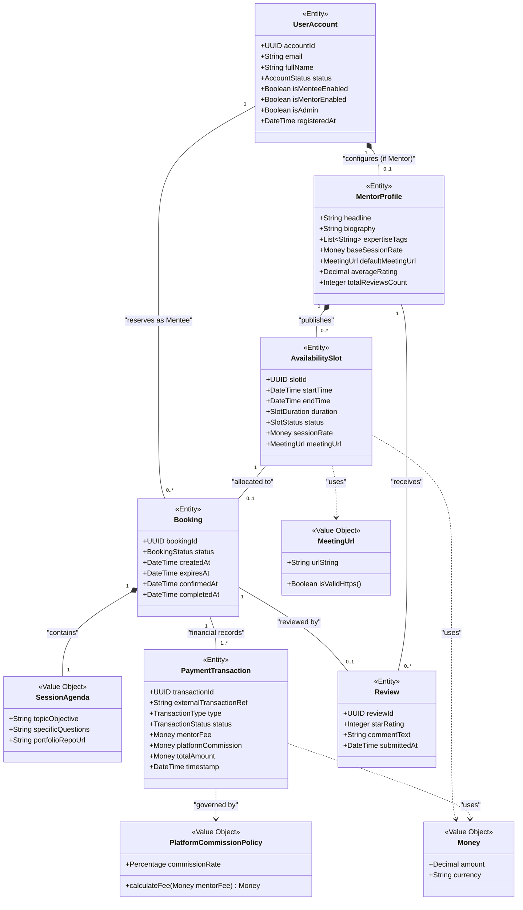

# Domain Model: Peyroo Mentorship Platform

**Project Working Title:** Peyroo (پیرو)  
**Academic Course:** Software Analysis and Design (SSAD) | Fall 1405  
**Document Identifier:** `docs/analysis/uml/DOMAIN_MODEL.md`  
**Status:** `[BASELINE - STAGE 05]`  
**Date:** Aban 1405 / November 2026  
**Document Version:** 1.0  

---

## 1. Domain Concept Taxonomy

In this domain analysis, we distinguish between four fundamental analytical abstractions:
1. **Conceptual Domain Entities:** Core business objects with unique identity, lifecycle states, and domain responsibilities.
2. **Domain Actors:** Human agents or external systems that initiate or participate in domain interactions.
3. **Value Objects:** Immutable concepts defined solely by their structural attributes without independent identity.
4. **External Systems:** Autonomous external services interacting across the system boundary.

---

## 2. Conceptual Domain Model Diagram

---

## 3. Entity Responsibilities & Domain Rules

### 3.1 `UserAccount`
- **Domain Identity:** Represents a registered identity in the system.
- **Responsibilities:**
  - Maintains account lifecycle state (`ACTIVE`, `SUSPENDED`).
  - Manages capability enablement (`isMenteeEnabled`, `isMentorEnabled`).
  - Enforces invariant: Mentee capability is enabled by default upon registration.

### 3.2 `MentorProfile`
- **Domain Identity:** Conceptual capability extension of a `UserAccount` that enables offering mentorship.
- **Responsibilities:**
  - Maintains professional credentials, biography, and technical expertise tags.
  - Specifies base pricing (`baseSessionRate`) and fallback meeting coordinates (`defaultMeetingUrl`).
  - Aggregates rating metrics from verified session reviews.

### 3.3 `AvailabilitySlot`
- **Domain Identity:** A discrete, bookable unit of mentor availability.
- **Responsibilities:**
  - Enforces duration boundaries: strictly 30, 45, or 60 minutes.
  - Enforces collision rules: no temporal overlap with other slots published by the same mentor.
  - Governs state transitions: `OPEN` $\to$ `HELD` $\to$ `BOOKED` $\to$ `CANCELLED`.
  - Holds inherited or overridden meeting URL coordinates.

### 3.4 `Booking`
- **Domain Identity:** The formal legal and operational agreement between a Mentee and a Mentor for a designated slot.
- **Responsibilities:**
  - Enforces self-booking block: `booking.mentee != booking.slot.mentor`.
  - Enforces 2-hour minimum lead-time booking rule.
  - Enforces 15-minute concurrency holding reservation timer (`expiresAt`).
  - Coordinates session completion when slot scheduled end time passes.
  - Enforces cancellation refund rules ($\ge 24$h full refund vs. $< 24$h no refund).

### 3.5 `SessionAgenda` (Value Object)
- **Domain Identity:** The structured preparatory topics and questions provided by the mentee.
- **Responsibilities:**
  - Ensures mentors have clear context before accepting sessions.
  - Immutable once submitted with booking initiation.

### 3.6 `PaymentTransaction`
- **Domain Identity:** An immutable double-entry record of a financial event (initial charge, commission deduction, or refund).
- **Responsibilities:**
  - Tracks transaction states (`PENDING`, `COMPLETED`, `FAILED`, `REFUNDED`).
  - Strictly calculates and records the 10% platform commission fee alongside the mentor fee.
  - Provides auditable financial verification for administrators and academic review.

### 3.7 `Review`
- **Domain Identity:** An evaluative record submitted by a mentee following a session.
- **Responsibilities:**
  - Enforces verification constraint: Can only be created if `booking.status == COMPLETED`.
  - Enforces uniqueness: Exactly one review permitted per booking.
  - Validates star rating integer interval $[1, 5]$.
