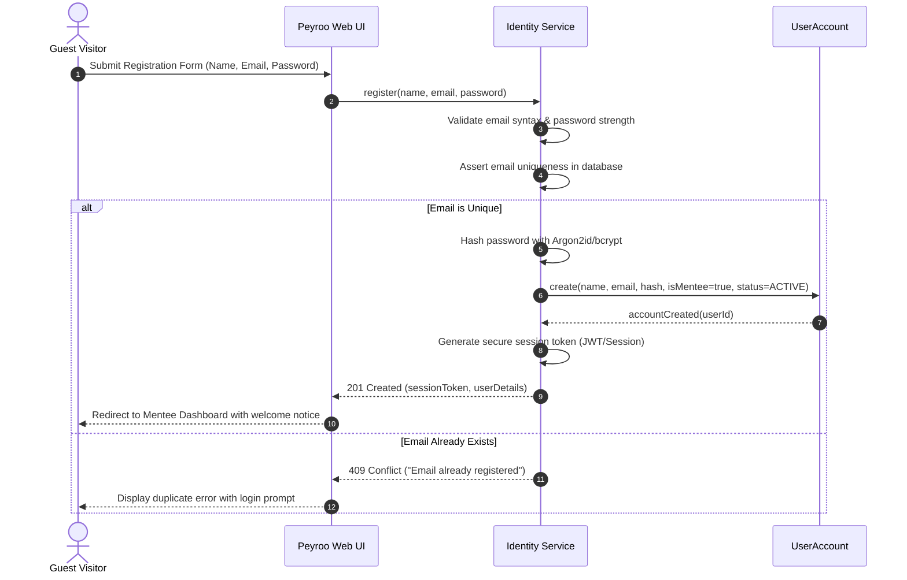
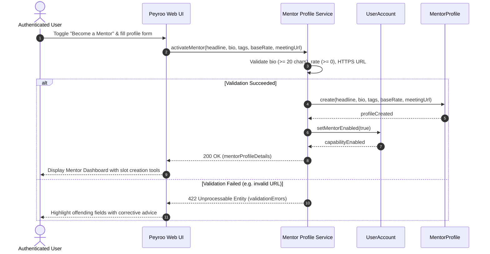
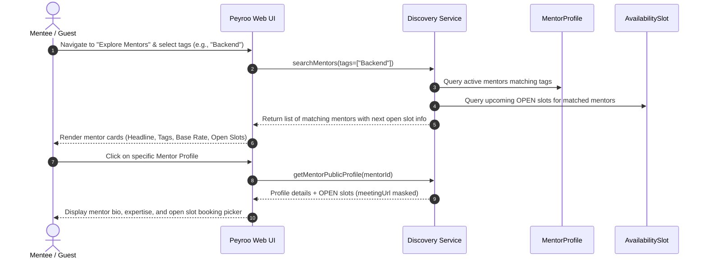
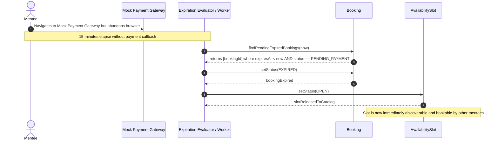
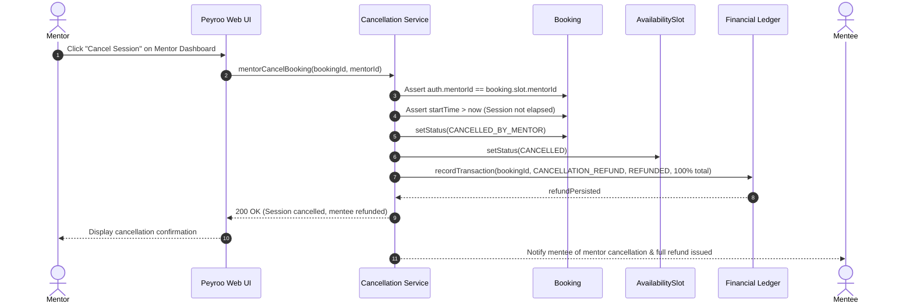
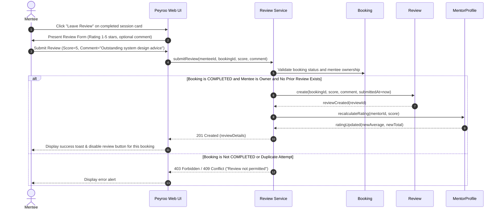
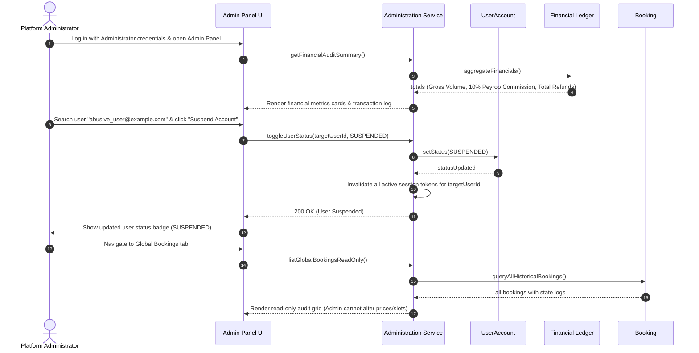

# Sequence Diagrams: Peyroo Mentorship Platform

**Project Working Title:** Peyroo (پیرو)  
**Academic Course:** Software Analysis and Design (SSAD) | Fall 1405  
**Document Identifier:** `docs/analysis/uml/SEQUENCE_DIAGRAMS.md`  
**Status:** `[BASELINE - STAGE 05]`  
**Date:** Aban 1405 / November 2026  
**Document Version:** 1.0  

---

## 1. Overview & Lifeline Conventions

This document specifies the dynamic message flow across the 12 critical system workflows of the **Peyroo Mentorship Platform**. 

### Analytical Lifeline Conventions
- **Actors:** Human users (`Guest`, `Mentee`, `Mentor`, `Administrator`) or external systems (`Mock Payment Gateway`).
- **Logical Boundary:** `Peyroo Client / UI` (Presentation Layer).
- **Logical Control:** `System Coordinator / Application Services` (Domain Orchestration).
- **Domain Entities:** `UserAccount`, `MentorProfile`, `AvailabilitySlot`, `Booking`, `PaymentTransaction`, `Review`.

---

## 2. Sequence Diagram Index

1. [Workflow 1: User Registration & Authentication](#workflow-1-user-registration--authentication)
2. [Workflow 2: Mentor Profile Activation & Management](#workflow-2-mentor-profile-activation--management)
3. [Workflow 3: Mentor Availability Slot Creation](#workflow-3-mentor-availability-slot-creation)
4. [Workflow 4: Mentor Discovery & Profile Viewing](#workflow-4-mentor-discovery--profile-viewing)
5. [Workflow 5: Booking & Payment Initiation (with Concurrency Conflict)](#workflow-5-booking--payment-initiation-with-concurrency-conflict)
6. [Workflow 6: Successful Payment Confirmation & Ledger Persistence](#workflow-6-successful-payment-confirmation--ledger-persistence)
7. [Workflow 7: Payment Expiration & Slot Release (15-Minute Timeout)](#workflow-7-payment-expiration--slot-release-15-minute-timeout)
8. [Workflow 8: Mentee Cancellation & Refund Policy ($\ge 24$h vs. $< 24$h)](#workflow-8-mentee-cancellation--refund-policy-ge-24h-vs--24h)
9. [Workflow 9: Mentor Cancellation & Full Automatic Refund](#workflow-9-mentor-cancellation--full-automatic-refund)
10. [Workflow 10: Automatic Time-Based Session Completion](#workflow-10-automatic-time-based-session-completion)
11. [Workflow 11: Verified Post-Session Review Submission](#workflow-11-verified-post-session-review-submission)
12. [Workflow 12: Administrator User Suspension & Financial Audit](#workflow-12-administrator-user-suspension--financial-audit)

---

## Workflow 1: User Registration & Authentication



---

## Workflow 2: Mentor Profile Activation & Management



---

## Workflow 3: Mentor Availability Slot Creation

```mermaid
sequenceDiagram
    autonumber
    actor Mentor as Mentor
    participant UI as Peyroo Web UI
    participant SlotMgr as Slot Service
    participant Profile as MentorProfile
    participant Slot as AvailabilitySlot

    Mentor->>UI: Click "Add Slot" (Select Date, Time, Duration: 30/45/60m)
    UI->>Profile: Fetch default meetingUrl & baseRate
    Profile-->>UI: defaults (rate, defaultMeetingUrl)
    Mentor->>UI: Confirm slot creation
    UI->>SlotMgr: createSlot(mentorId, startTime, duration, rate, meetingUrl)
    SlotMgr->>SlotMgr: Validate duration in {30, 45, 60} & startTime in future
    SlotMgr->>SlotMgr: Check temporal collision against existing mentor slots
    alt No Temporal Overlap
        SlotMgr->>Slot: create(mentorId, startTime, endTime, rate, meetingUrl, status=OPEN)
        Slot-->>SlotMgr: slotCreated(slotId)
        SlotMgr-->>UI: 201 Created (slotDetails)
        UI-->>Mentor: Render new OPEN slot on mentor calendar
    else Overlap Detected
        SlotMgr-->>UI: 409 Conflict ("Slot collides with existing slot")
        UI-->>Mentor: Display collision alert; suggest alternative times
    end
```

---

## Workflow 4: Mentor Discovery & Profile Viewing



---

## Workflow 5: Booking & Payment Initiation (with Concurrency Conflict)

```mermaid
sequenceDiagram
    autonumber
    actor Mentee1 as Mentee 1
    actor Mentee2 as Mentee 2
    participant UI as Peyroo Web UI
    participant BookingMgr as Booking Coordinator
    participant Slot as AvailabilitySlot
    participant Booking as Booking
    participant Ledger as Commission Service

    Note over Mentee1,Mentee2: Both mentees attempt to book the SAME open slot concurrently
    Mentee1->>UI: Submit Agenda & click "Book Slot"
    Mentee2->>UI: Submit Agenda & click "Book Slot" (slight microsecond delta)

    UI->>BookingMgr: initiateBooking(slotId, mentee1Id, agenda1)
    UI->>BookingMgr: initiateBooking(slotId, mentee2Id, agenda2)

    BookingMgr->>Slot: Acquire Concurrency Lock & check status
    Note over Slot,BookingMgr: Mentee 1's request acquires the lock first
    Slot->>Slot: Assert status == OPEN
    Slot->>Slot: setStatus(HELD)
    BookingMgr->>BookingMgr: Assert mentee1Id != mentorId (Self-Booking Invariant)
    BookingMgr->>BookingMgr: Assert (startTime - now) >= 2 hours (Notice Invariant)
    BookingMgr->>Ledger: calculateCommission(sessionRate)
    Ledger-->>BookingMgr: breakdown (MentorFee, Commission=10%, Total)
    BookingMgr->>Booking: create(slotId, mentee1Id, agenda1, PENDING_PAYMENT, expiresAt=now+15m)
    Booking-->>BookingMgr: bookingCreated(booking1Id)
    BookingMgr-->>UI: 201 Created (booking1Id, totalAmount, redirectUrl)
    UI-->>Mentee1: Redirect to Mock Payment Gateway

    Note over Slot,BookingMgr: Mentee 2's request evaluates the locked slot
    BookingMgr->>Slot: Check status for Mentee 2
    Slot-->>BookingMgr: Status is HELD (Not OPEN)
    BookingMgr-->>UI: 409 Conflict ("Slot is no longer available")
    UI-->>Mentee2: Display collision notification; prompt to select another slot
```

---

## Workflow 6: Successful Payment Confirmation & Ledger Persistence

```mermaid
sequenceDiagram
    autonumber
    actor Mentee as Mentee
    participant Bank as Mock Payment Gateway
    participant PaymentHook as Payment Webhook API
    participant Booking as Booking
    participant Slot as AvailabilitySlot
    participant Ledger as Financial Ledger
    actor Mentor as Mentor

    Mentee->>Bank: Review order (Mentor Fee + 10% Commission) & enter card
    Mentee->>Bank: Click "Simulate Successful Payment"
    Bank->>PaymentHook: POST /api/payments/callback (txRef, bookingId, status=SUCCESS)
    PaymentHook->>Booking: Validate booking status and expiration window
    alt Callback within 15-Minute Expiration Window
        PaymentHook->>Ledger: recordTransaction(bookingId, txRef, SESSION_PAYMENT, COMPLETED, amounts)
        Ledger-->>PaymentHook: transactionPersisted
        PaymentHook->>Booking: setStatus(CONFIRMED, confirmedAt=now)
        Booking->>Slot: setStatus(BOOKED)
        PaymentHook-->>Bank: 200 OK (Payment Verified)
        Bank-->>Mentee: Redirect to /bookings/{id}/confirmation
        Mentee->>PaymentHook: Fetch confirmed booking details
        PaymentHook-->>Mentee: Return confirmation receipt & reveal meetingUrl
        PaymentHook-->>Mentor: Session appears in Mentor Schedule with mentee agenda
    else Callback Arrives Past 15 Minutes (Edge Case: Expired)
        PaymentHook->>Booking: Check status -> Found EXPIRED
        PaymentHook->>Ledger: recordTransaction(bookingId, txRef, SESSION_PAYMENT, FAILED)
        PaymentHook->>Bank: 400 Bad Request ("Reservation expired; payment refunded")
        Bank-->>Mentee: Display expiration alert & trigger simulated refund
    end
```

---

## Workflow 7: Payment Expiration & Slot Release (15-Minute Timeout)



---

## Workflow 8: Mentee Cancellation & Refund Policy ($\ge 24$h vs. $< 24$h)

```mermaid
sequenceDiagram
    autonumber
    actor Mentee as Mentee
    participant UI as Peyroo Web UI
    participant CancelService as Cancellation Service
    participant Booking as Booking
    participant Slot as AvailabilitySlot
    participant Ledger as Financial Ledger

    Mentee->>UI: Click "Cancel Session" on Dashboard
    UI->>CancelService: requestCancellation(bookingId, menteeId)
    CancelService->>Booking: getBookingDetails(bookingId)
    Booking-->>CancelService: booking (startTime, status=CONFIRMED, totalAmount)

    alt Cancellation >= 24 Hours Before Start Time (Full Refund)
        CancelService->>Booking: setStatus(CANCELLED_REFUNDED)
        CancelService->>Ledger: recordTransaction(bookingId, CANCELLATION_REFUND, REFUNDED, 100% amount)
        Ledger-->>CancelService: refundLogged
        CancelService->>Slot: setStatus(OPEN) (if slot start >= 2h away)
        CancelService-->>UI: 200 OK (Refund confirmed, receipt generated)
        UI-->>Mentee: Display cancellation confirmation & full refund receipt
    else Cancellation < 24 Hours Before Start Time (Non-Refundable)
        CancelService->>UI: Prompt confirmation: "Under 24h: Non-refundable. Proceed?"
        Mentee->>UI: Confirm cancellation without refund
        UI->>CancelService: confirmNonRefundableCancellation(bookingId)
        CancelService->>Booking: setStatus(CANCELLED_NO_REFUND)
        CancelService->>Slot: setStatus(CANCELLED) (Cannot be rebooked)
        Note over Ledger: No refund transaction generated; mentor compensation preserved
        CancelService-->>UI: 200 OK (Booking cancelled, non-refundable)
        UI-->>Mentee: Display cancellation summary (No refund issued)
    end
```

---

## Workflow 9: Mentor Cancellation & Full Automatic Refund



---

## Workflow 10: Automatic Time-Based Session Completion

```mermaid
sequenceDiagram
    autonumber
    participant Scheduler as Background Lifecycle Evaluator
    participant Booking as Booking
    participant Slot as AvailabilitySlot

    Scheduler->>Booking: findActiveConfirmedBookings()
    Booking-->>Scheduler: list of CONFIRMED bookings
    loop For each confirmed booking
        Scheduler->>Slot: getEndTime(slotId)
        Slot-->>Scheduler: endTime
        alt current_time >= slot.endTime
            Scheduler->>Booking: setStatus(COMPLETED, completedAt=now)
            Booking-->>Scheduler: bookingCompleted
            Note over Booking: Session is marked COMPLETED; review eligibility is now unlocked for Mentee
        else current_time < slot.endTime
            Note over Scheduler: Session still active or upcoming; no status change
        end
    end
```

---

## Workflow 11: Verified Post-Session Review Submission



---

## Workflow 12: Administrator User Suspension & Financial Audit


