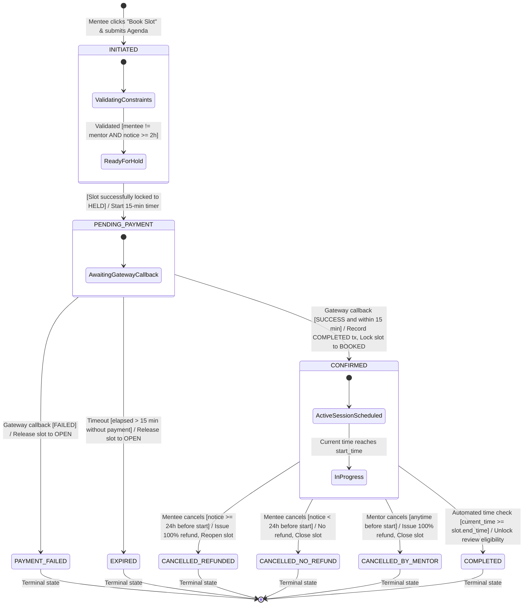
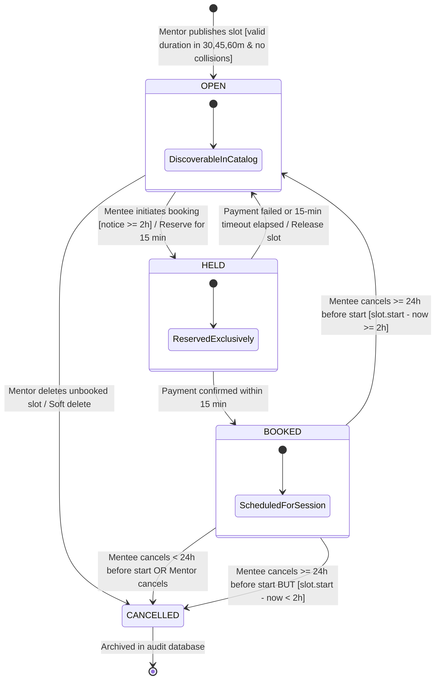
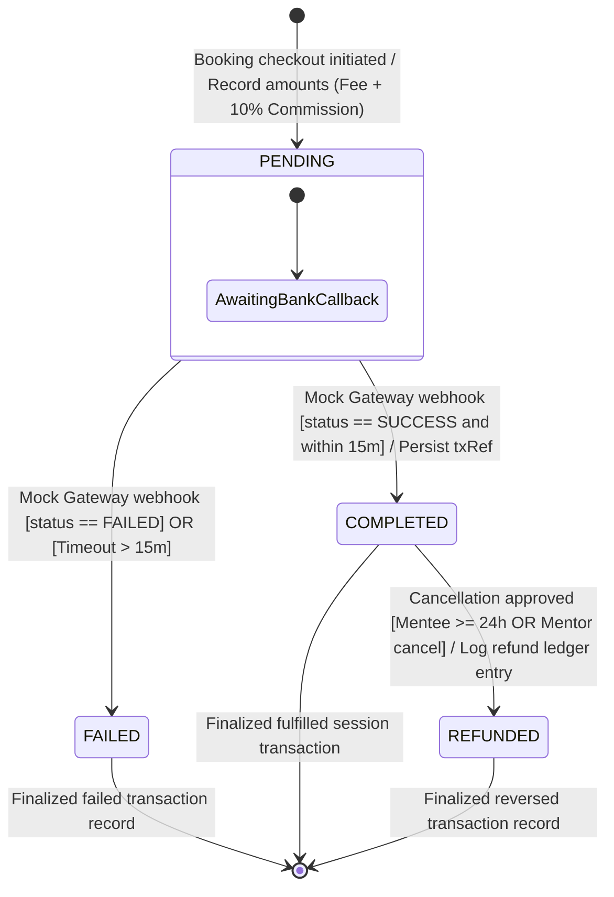

# State Machine Diagrams: Peyroo Mentorship Platform

**Project Working Title:** Peyroo (پیرو)  
**Academic Course:** Software Analysis and Design (SSAD) | Fall 1405  
**Document Identifier:** `docs/analysis/uml/STATE_DIAGRAMS.md`  
**Status:** `[BASELINE - STAGE 05]`  
**Date:** Aban 1405 / November 2026  
**Document Version:** 1.0  

---

## 1. Overview & State Disambiguation

This document defines formal UML State Machine Diagrams for the three independent dynamic lifecycles within the **Peyroo Mentorship Platform**:
1. **Booking Lifecycle:** Represents the transactional reservation contract between Mentee and Mentor.
2. **Availability Slot Lifecycle:** Represents the temporal availability of a mentor's schedule slot.
3. **Payment Transaction Lifecycle:** Represents the immutable financial ledger record.

> [!IMPORTANT]
> **State Disambiguation:** Slot states (`OPEN`, `HELD`, `BOOKED`, `CANCELLED`), Booking states (`INITIATED`, `PENDING_PAYMENT`, `CONFIRMED`, `COMPLETED`, `CANCELLED_*`), and Payment states (`PENDING`, `COMPLETED`, `FAILED`, `REFUNDED`) are structurally distinct and must not be conflated.

---

## 2. Booking State Machine Diagram

### 2.1 Booking State Descriptions
| Booking State | Description | Invariants & Exit Guards |
|---|---|---|
| `INITIATED` | Booking request created; validating advance notice and self-booking rules. | Transient state; transitions within milliseconds. |
| `PENDING_PAYMENT` | Slot is held exclusively for 15 minutes; awaiting payment gateway callback. | Expiration timer `expiresAt = now + 15 min`. |
| `CONFIRMED` | Payment verified; slot permanently booked; external meeting URL revealed. | Meeting link visible to participants only. |
| `PAYMENT_FAILED` | Explicit payment simulation failure received. Slot reverted to `OPEN`. | Terminal state; non-destructive audit log kept. |
| `EXPIRED` | 15-minute reservation timer elapsed without payment callback. Slot reverted to `OPEN`. | Terminal state. |
| `CANCELLED_REFUNDED` | Cancelled by mentee $\ge 24$ hours in advance; 100% refund logged. | Terminal state. |
| `CANCELLED_NO_REFUND` | Cancelled by mentee $< 24$ hours in advance; no refund; mentor credited. | Terminal state. |
| `CANCELLED_BY_MENTOR` | Cancelled by mentor at any time; automatic 100% refund logged. | Terminal state. |
| `COMPLETED` | Scheduled session end time has elapsed; mentee review unlocked. | Terminal state. |

---

## 3. Availability Slot State Machine Diagram

### 3.1 Availability Slot State Descriptions
| Slot State | Description | Transition Triggers |
|---|---|---|
| `OPEN` | Visible in catalog and available for booking by any mentee. | Initiates on mentor creation; reverts from `HELD` on timeout/failure; reverts from `BOOKED` on $\ge 24$h mentee cancellation. |
| `HELD` | Temporarily locked during active checkout; invisible to other mentees. | Transitions to `BOOKED` on payment success or back to `OPEN` on payment abort/expiration. |
| `BOOKED` | Concurrency lock sealed; allocated to a single confirmed session. | Transitions to `OPEN` or `CANCELLED` upon cancellation workflows. |
| `CANCELLED` | Slot deleted by mentor or locked following late cancellation/mentor cancellation. | Archived non-destructively for historical reporting. |

---

## 4. Payment Transaction State Machine Diagram

### 4.1 Payment Transaction State Descriptions
| Transaction State | Description | Financial Invariant |
|---|---|---|
| `PENDING` | Transaction initiated in ledger; awaiting gateway callback. | $\text{Total} = \text{MentorFee} + \text{Commission}$ |
| `COMPLETED` | Verified payment callback received; funds recorded as received. | $\text{PeyrooRevenue} = \text{Commission}$ ($10\%$) |
| `FAILED` | Payment declined or aborted by user; zero funds received. | $\text{TotalCollected} = \$0.00$ |
| `REFUNDED` | Cancellation refund issued; compensatory debit ledger entry logged. | $\text{NetPayment} = \$0.00$ |
