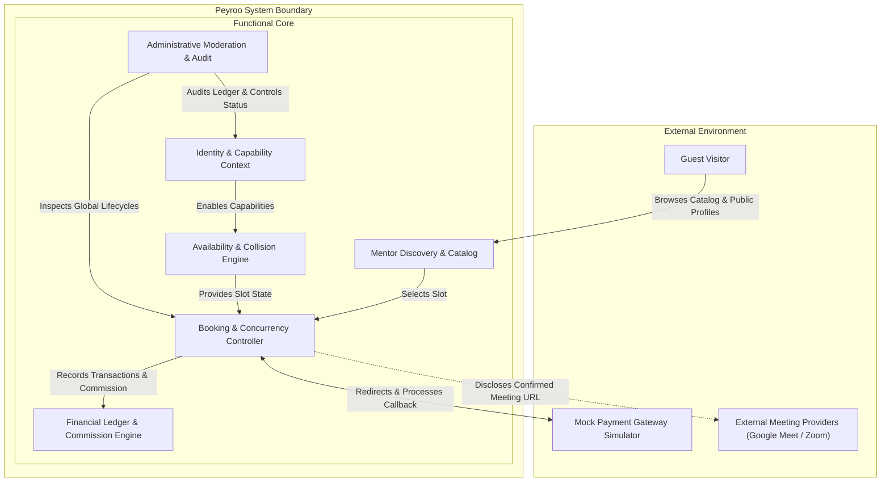

# System Analysis & Modeling Specification: Peyroo Mentorship Platform

**Project Working Title:** Peyroo (پیرو)  
**Academic Course:** Software Analysis and Design (SSAD) | Fall 1405  
**Document Identifier:** `docs/analysis/uml/SYSTEM_ANALYSIS.md`  
**Status:** `[BASELINE - STAGE 05]`  
**Date:** Aban 1405 / November 2026  
**Document Version:** 1.0  

---

## 1. Executive Summary & Modeling Objectives

This document establishes the overarching **System Analysis and Modeling Specification** for the **Peyroo Mentorship Platform** (Stage 05). System analysis bridges the gap between the approved Software Requirements Specification (Stage 04) and downstream architectural and detailed design (Stage 06).

The objective is to capture the structural, functional, and behavioral essence of the system using standard **OMG UML 2.x** notation without committing to physical database schemas, framework-specific libraries, or implementation-level source code.

---

## 2. Analytical Foundations & System Boundary

Peyroo operates as an ADPList-inspired mentorship platform connecting software industry professionals with junior engineers, students, and career switchers.

### 2.1 Boundary Characteristics
- **Unified Identity Boundary:** User accounts maintain independent capabilities (`isMenteeEnabled`, `isMentorEnabled`). Both roles can be active concurrently for a single identity.
- **External Video Interface Boundary:** Peyroo does **not** stream native video/audio. Static meeting URLs provided by mentors are maintained as value objects, disclosed strictly to confirmed session participants.
- **Payment Interface Boundary:** Interacts with an external Mock Payment Gateway simulator via redirect tokens and asynchronous callback webhooks, enforcing state verification and ledger integrity.

---

## 3. Core Business Invariants & Analysis Constraints

The system models in Stage 05 strictly enforce the following verified business invariants:

1. **Self-Booking Invariant:**  
   $$\forall b \in \text{Bookings}: b.\text{mentee\_id} \neq b.\text{slot.mentor\_id}$$
   A user is structurally prevented from booking their own availability slot.

2. **Temporal Slot Collision Invariant:**  
   $$\forall s_1, s_2 \in \text{Slots}(\text{mentor}): (s_1 \neq s_2) \implies (s_1.\text{end\_time} \le s_2.\text{start\_time} \lor s_1.\text{start\_time} \ge s_2.\text{end\_time})$$
   A mentor cannot have overlapping availability slots.

3. **Booking Lead-Time Invariant:**  
   $$t_{\text{booking\_attempt}} \le s.\text{start\_time} - 2\text{ hours}$$
   All bookings must occur at least 2 hours prior to scheduled session start.

4. **15-Minute Reservation Invariant:**  
   A slot in `HELD` state transitions to `BOOKED` upon successful payment callback or reverts to `OPEN` if $\Delta t > 15\text{ minutes}$ without confirmed payment.

5. **Financial Commission Invariant:**  
   $$\text{TotalPaid} = \text{MentorFee} + (\text{MentorFee} \times 0.10)$$
   $$\text{MentorPayout} = \text{MentorFee}$$
   $$\text{PlatformRevenue} = \text{MentorFee} \times 0.10$$

6. **Cancellation & Refund Asymmetry:**  
   - Mentee cancellation $\ge 24\text{h}$: Full refund ($100\%$).
   - Mentee cancellation $< 24\text{h}$: Non-refundable ($0\%$), mentor credited.
   - Mentor cancellation anytime: Full refund ($100\%$) to mentee.

7. **Audit Preservation Invariant:**  
   No physical records (`DELETE FROM`) of slots, bookings, or ledger transactions may occur. All cancellations and refund events are represented via state mutations.

---

## 4. Stage 05 Artifact Suite Structure

The system analysis models are cataloged across dedicated documents under `docs/analysis/uml/`:

| Document | Primary Focus | Key UML Diagrams Included |
|---|---|---|
| **[`DOMAIN_MODEL.md`](file:///c:/Users/r/Desktop/peyroo/docs/analysis/uml/DOMAIN_MODEL.md)** | Conceptual domain entities, associations, and domain rules | Conceptual Domain Model Diagram |
| **[`USE_CASE_DIAGRAM.md`](file:///c:/Users/r/Desktop/peyroo/docs/analysis/uml/USE_CASE_DIAGRAM.md)** | Actor goals, system boundaries, and functional packages | High-Level & Detailed Use Case Diagrams |
| **[`USE_CASE_SPECIFICATIONS.md`](file:///c:/Users/r/Desktop/peyroo/docs/analysis/uml/USE_CASE_SPECIFICATIONS.md)** | Formal narrative specifications for all 10 major use cases | Use Case Tabular Specifications |
| **[`CLASS_DIAGRAM.md`](file:///c:/Users/r/Desktop/peyroo/docs/analysis/uml/CLASS_DIAGRAM.md)** | Domain classes, attributes, operations, and multiplicities | Conceptual Class Diagram, Enumerations |
| **[`SEQUENCE_DIAGRAMS.md`](file:///c:/Users/r/Desktop/peyroo/docs/analysis/uml/SEQUENCE_DIAGRAMS.md)** | Dynamic interaction across 12 critical system workflows | 12 UML Sequence Diagrams |
| **[`ACTIVITY_DIAGRAMS.md`](file:///c:/Users/r/Desktop/peyroo/docs/analysis/uml/ACTIVITY_DIAGRAMS.md)** | Workflow logic, branching, decision diamonds, and concurrency | 7 Swimlane Activity Diagrams |
| **[`STATE_DIAGRAMS.md`](file:///c:/Users/r/Desktop/peyroo/docs/analysis/uml/STATE_DIAGRAMS.md)** | Discrete lifecycles for Booking, Slot, and Payment Transaction | 3 UML State Machine Diagrams |
| **[`UML_TRACEABILITY_MATRIX.md`](file:///c:/Users/r/Desktop/peyroo/docs/analysis/uml/UML_TRACEABILITY_MATRIX.md)** | Bidirectional mapping to Stage 04 Requirements | Comprehensive Traceability Table |
| **[`UML_CONSISTENCY_REPORT.md`](file:///c:/Users/r/Desktop/peyroo/docs/analysis/uml/UML_CONSISTENCY_REPORT.md)** | Internal consistency checks, model validation, and signoff | Consistency & Defensibility Report |
