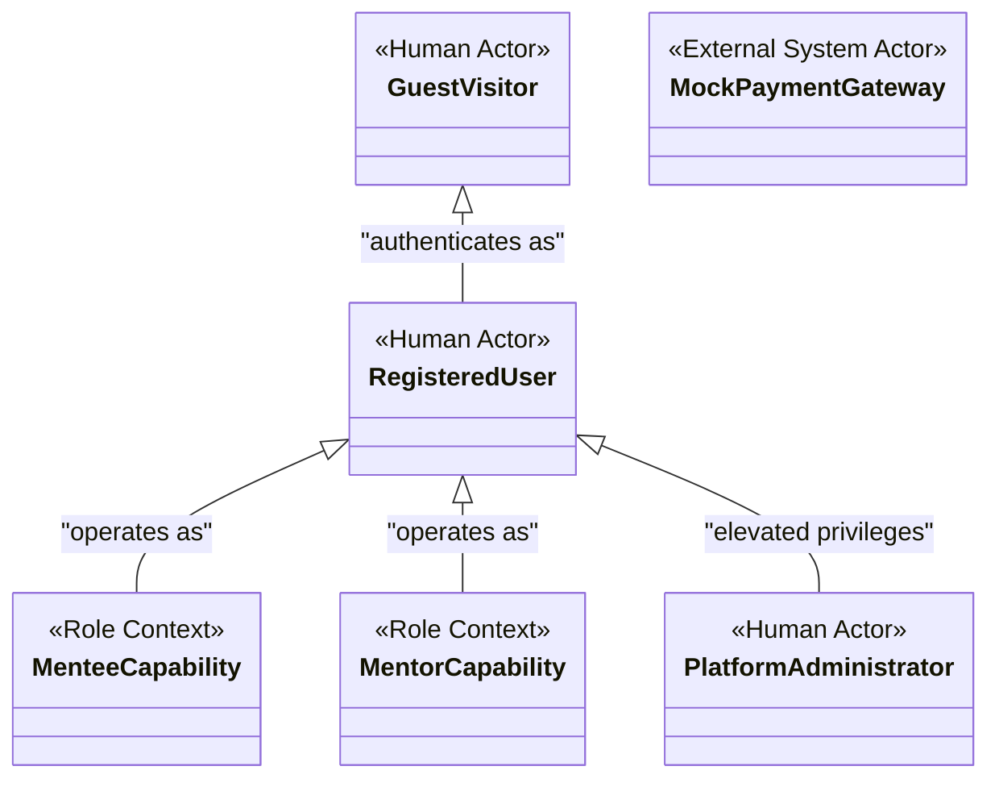
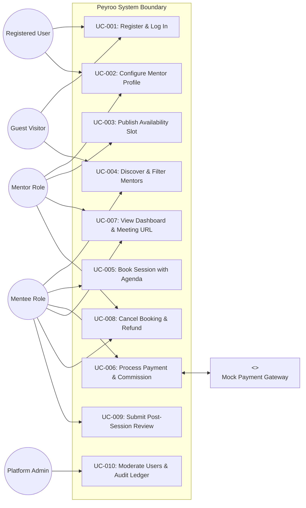

# Use Case Diagram: Peyroo Mentorship Platform

**Project Working Title:** Peyroo (پیرو)  
**Academic Course:** Software Analysis and Design (SSAD) | Fall 1405  
**Document Identifier:** `docs/analysis/uml/USE_CASE_DIAGRAM.md`  
**Status:** `[BASELINE - STAGE 05]`  
**Date:** Aban 1405 / November 2026  
**Document Version:** 1.0  

---

## 1. Actor Hierarchy & Capability Architecture

In Peyroo, **Mentee** and **Mentor** are functional capabilities of a single `Registered User`. A user can act in either capability without maintaining multiple accounts. The `Platform Administrator` is a specialized role with administrative governance privileges.



---

## 2. High-Level System Use Case Diagram

The following diagram captures the complete system boundary, primary use cases, and interactions across all actors:



---

## 3. Detailed Subsystem Use Case Diagrams

### 3.1 Booking & Financial Transaction Subsystem
This subsystem illustrates the detailed functional dependencies, including mandatory `<<include>>` and conditional `<<extend>>` relationships governing concurrency, 15-minute lock expiration, and commission calculation:

```mermaid
flowchart TD
    Mentee((Mentee))
    Bank["<<External System>>\nMock Payment Gateway"]

    subgraph Booking & Payment Boundary
        UC_Book["UC-005: Book Session"]
        UC_Agenda["Submit Structured Agenda"]
        UC_Lock["Acquire Concurrency Slot Lock (15 min)"]
        UC_Calc["Calculate 10% Platform Commission"]
        UC_Pay["UC-006: Process Payment Callback"]
        UC_RecordLedger["Record Immutable Ledger Entry"]
        UC_Release["Release Slot on Expiration / Failure"]
        UC_Confirm["Transition Booking to CONFIRMED"]
    end

    Mentee --> UC_Book
    UC_Book -.->|<<include>>| UC_Agenda
    UC_Book -.->|<<include>>| UC_Lock
    UC_Book -.->|<<include>>| UC_Calc

    UC_Book --> UC_Pay
    UC_Pay <--> Bank
    UC_Pay -.->|<<include>>| UC_RecordLedger

    UC_Pay -.->|<<extend>>\n(On Success)| UC_Confirm
    UC_Pay -.->|<<extend>>\n(On Failure or Timeout >15m)| UC_Release
```

### 3.2 Cancellation & Refund Subsystem
This subsystem models the asymmetry between Mentee and Mentor cancellation policies:

```mermaid
flowchart TD
    Mentee((Mentee))
    Mentor((Mentor))

    subgraph Cancellation Boundary
        UC_CancelMentee["Cancel Session as Mentee"]
        UC_CancelMentor["Cancel Session as Mentor"]
        UC_FullRefund["Issue 100% Refund Transaction"]
        UC_NoRefund["Mark CANCELLED_NO_REFUND (Credit Mentor)"]
        UC_ReopenSlot["Revert Slot to OPEN"]
        UC_CloseSlot["Mark Slot CANCELLED (Soft-Delete)"]
    end

    Mentee --> UC_CancelMentee
    Mentor --> UC_CancelMentor

    UC_CancelMentee -.->|<<extend>>\n(If >= 24h before start)| UC_FullRefund
    UC_CancelMentee -.->|<<extend>>\n(If >= 24h before start)| UC_ReopenSlot
    UC_CancelMentee -.->|<<extend>>\n(If < 24h before start)| UC_NoRefund
    UC_CancelMentee -.->|<<extend>>\n(If < 24h before start)| UC_CloseSlot

    UC_CancelMentor -.->|<<include>>| UC_FullRefund
    UC_CancelMentor -.->|<<include>>| UC_CloseSlot
```

### 3.3 Dashboard, Privacy & Verified Review Subsystem

```mermaid
flowchart LR
    Mentee((Mentee))
    Mentor((Mentor))

    subgraph Session Management & Privacy Boundary
        UC_Dash["UC-007: View Session Dashboard"]
        UC_Meet["Access External Meeting URL"]
        UC_Review["UC-009: Submit Post-Session Review"]
    end

    Mentee --> UC_Dash
    Mentor --> UC_Dash

    UC_Dash -.->|<<extend>>\n(Condition: Status == CONFIRMED)| UC_Meet
    Mentee --> UC_Review
    UC_Review -.->|<<extend>>\n(Condition: Status == COMPLETED)| UC_Dash
```
