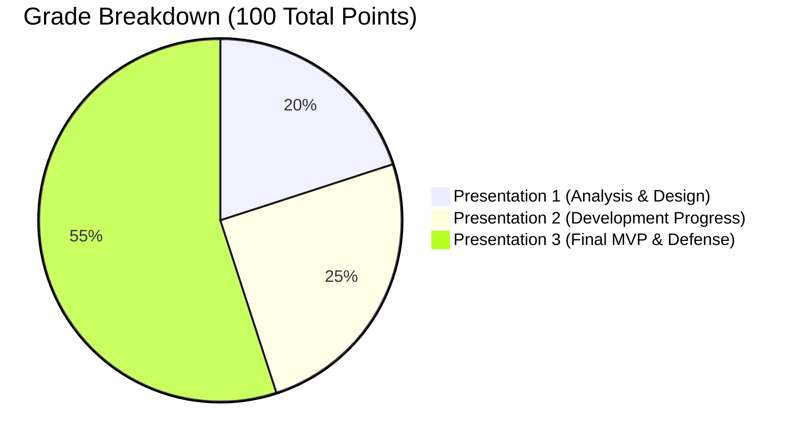

# Academic Assignment Analysis: Mentorship Platform (Peyroo)

**Course:** Software Analysis and Design (SSAD) | Fall 1405  
**Document Analyzed:** `Software_Engineering_Semester_Project_Final.pdf`  
**Status:** Requirements Baseline & Feasibility Analysis  
**Date:** Aban 1405 / November 2026  

---

## Executive Summary

The semester project requires designing, analyzing, building, testing, deploying, and defending a **Minimum Viable Product (MVP)** for a web application. The core philosophy emphasizes:
- Solving one complete, real user business journey from UI to database.
- Academic rigor in requirements, modeling (UML), architecture trade-offs, and automated testing.
- Autonomous AI assistance is permitted, but students are graded on deep individual understanding, justification of design choices, and architectural defense.
- Evaluation is milestone-driven across three formal presentations totaling **100 points** (20 / 25 / 55).

---

## Requirement Classification Schema

Every identified item is categorized into one of three distinct classes:
1. **[EXPLICIT]**: Stated directly in the syllabus and project specification.
2. **[INTERPRETATION]**: Logical deduction or standard software engineering practice implied by the explicit constraints.
3. **[AMBIGUOUS / UNSPECIFIED]**: Open items requiring team consensus or course staff clarification.

---

## 1. Project Submission Requirements

### Explicitly Stated Requirements [EXPLICIT]
- **Submission Package:** Each team submits exactly one package per review through the official course channel.
- **Repository Link:** A shared Git repository containing:
  - A clean `README.md` documenting setup, run, test, and deployment steps.
  - Required diagrams and analysis artifacts.
  - API list / contract.
  - Clickable prototype link.
- **Exact Git Reference:** The exact Git commit hash or release tag being presented must be specified.
- **Test Evidence:** Brief test evidence must accompany code milestones (P2 and P3).
- **Live Deployment URL:** A functional HTTPS URL at a domain or approved subdomain for P3 (and P2 if available).
- **Contribution Note:** A concise statement documenting each team member’s specific contributions and identifying any unfinished work.
- **No Extraneous Reports:** No standalone essays or external slide binders are needed if repository documentation is clear and complete.

### Reasonable Interpretations [INTERPRETATION]
- Markdown files hosted directly in GitHub (`docs/`) satisfy the repository documentation requirement without generating separate external PDF reports.
- Git commit logs should reflect individual member contributions through proper author emails and atomic commits.
- Git tags (e.g., `v0.1.0-p1`, `v0.2.0-p2`, `v1.0.0-final`) should be used to lock presentation states.

### Ambiguous or Unspecified Requirements [AMBIGUOUS]
- **Specific Submission Channel:** The official submission portal (e.g., LMS, Quera, GitHub Classroom, Google Form, or email) is to be announced by course staff.
- **Format of Test Evidence:** Whether test evidence requires exported test runner logs, CI/CD pipeline badges, or recorded console outputs.

---

## 2. Required Analysis and Design Artifacts

### Explicitly Stated Requirements [EXPLICIT]
- **Product Scope & MVP Boundaries:** Explicit definition of target user groups, the problem solved, what is included in the MVP, and what features are deliberately excluded.
- **Prioritized User Stories:** Written strictly in standard agile format:
  > `"As a [user], I want [action], so that [benefit]."`
- **Observable Acceptance Criteria:** Clear criteria covering success paths, failure scenarios, and authorization/ownership validation for each story.
- **Scope Prioritization:** MoSCoW categorization:
  - **Must Have:** Core essential features required for the MVP.
  - **Should Have:** Useful but non-essential features.
  - **Could Have:** Optional future extras.
- **Four Required Design Views:**
  1. **UML Use Case Diagram:** Showing primary actors (human and external systems) and MVP interactions.
  2. **UML Activity Diagram:** Detailing a critical workflow including decision diamonds and failure/alternative branches.
  3. **System Architecture Diagram:** Showing frontend, API/backend, database, external services, and communication protocols.
  4. **Entity-Relationship Diagram (ERD) / Data Model:** Depicting entities/tables, primary keys (PK), foreign keys (FK), cardinalities (`1`, `0..*`, `0..1`), constraints, and record ownership.
- **Clickable UI Prototype:** High-fidelity interactive prototype created in Figma, Subframe, or equivalent, illustrating the main journey, login, success states, and error handling. (Pixel-perfect graphics not required).
- **API Contract:** Structured catalog listing HTTP method, URL path, request payload/input parameters, expected response structure, and explicit error status codes/messages.
- **Architectural & Technology Rationale:** Objective justification of selected architectural patterns, database choice, hosting platform, estimated hosting costs, and free-tier operational limits.

### Reasonable Interpretations [INTERPRETATION]
- Mermaid syntax embedded within Markdown files under `docs/analysis/` and `docs/design/` serves as an ideal format for version-controlled UML and architecture diagrams.
- The API contract can be documented as a comprehensive Markdown table in `docs/design/api/`, with optional OpenAPI (Swagger) specifications if desired.
- In the context of *Peyroo* (Mentorship Platform), the core business journey revolves around **finding a mentor, booking a structured mentorship session, receiving session confirmation, and managing/viewing the mentorship appointment**.

### Ambiguous or Unspecified Requirements [AMBIGUOUS]
- **Prototype Tool Approval:** Tools other than Figma or Subframe (e.g., Penpot) are permitted under "or equivalent", but should be confirmed if non-standard.

---

## 3. Mandatory UML & Design Diagrams

### Explicitly Stated Requirements [EXPLICIT]
| Diagram Type | Status | Required Content |
|---|---|---|
| **UML Use Case Diagram** | **MANDATORY** | Main actors (users or external systems) and MVP actions. |
| **UML Activity Diagram** | **MANDATORY** | Workflow steps, decision branching, and failure/alternative paths. |
| **System Architecture Diagram** | **MANDATORY** | Presentation, backend/API, database, external integrations, protocol flow. |
| **ERD / Data Model** | **MANDATORY** | Persistent entities, PK/FK relationships, cardinalities, ownership rules. |
| **Class Diagrams** | **NOT MANDATORY** | Explicitly stated as optional / non-essential for review. |
| **Sequence Diagrams** | **NOT MANDATORY** | Explicitly stated as optional / non-essential for review. |
| **State Machine Diagrams** | **NOT MANDATORY** | Explicitly stated as optional / non-essential for review. |
| **C4 Notation** | **NOT MANDATORY** | Formal C4 modeling is not required; standard system diagrams suffice. |

### Reasonable Interpretations [INTERPRETATION]
- While Sequence and State Machine diagrams are not mandatory, creating a lightweight Sequence diagram for complex authentication or booking verification flows can provide strong supporting material for the individual engineering defense.

---

## 4. Functional and Non-Functional Documentation Requirements

### Explicitly Stated Requirements [EXPLICIT]
- **Core Business Journey:** Must support one complete functional business journey (e.g., booking, requesting, registering, submitting, managing a record). A login screen or decorative dashboard alone will receive zero credit for this requirement.
- **Authentication:** Working login and logout with persistent session state.
- **Authorization & Ownership [Backend Enforced]:** Backend-validated permission rules ensuring users can only read/mutate records they own or are authorized to access. Frontend UI button-hiding alone is explicitly disqualified.
- **Reliable Data Persistence:** Stored data must persist across page refreshes, browser re-openings, and independent client sessions.
- **Definition of Done (DoD):** Every feature must satisfy:
  1. Expected behavior and critical error paths function properly.
  2. Frontend, API, and database work in full integration.
  3. Important tests pass and the team understands all introduced changes.
- **Hosting & Financial Transparency:** Must document expected hosting costs, limits against projected usage, and constraints of any free-tier infrastructure.

### Reasonable Interpretations [INTERPRETATION]
- For non-functional requirements (NFRs), the documentation should specify:
  - Security (password hashing, token expiration, CORS policies, SQL injection protection).
  - Usability (clear validation errors, responsive forms, feedback toasts).
  - Availability & Performance (realistic expectation under free-tier deployment limits).

### Ambiguous or Unspecified Requirements [AMBIGUOUS]
- **Specific NFR Metrics:** No formal numerical performance, latency, or uptime SLAs are mandated.

---

## 5. Implementation Requirements and Restrictions

### Explicitly Stated Requirements & Permissions [EXPLICIT]
- **Working Web Application:** Must be accessible as a web app.
- **No Prescribed Stack:** No specific programming language, framework, database engine, authentication vendor, cloud host, or AI model is mandated.
- **Framework Listing $\neq$ Architecture:** Simply naming a framework (e.g., "Next.js" or "Django") is unacceptable; teams must articulate component responsibilities and data flow.
- **Authentication Libraries:** Allowed and encouraged to use mature open-source authentication packages or managed services (e.g., JWT libraries, Auth.js, Firebase Auth, Supabase Auth); building custom cryptography or session algorithms from scratch is discouraged.
- **Infrastructure Restrictions:** Advanced infrastructure (microservices, Kubernetes, message queues, distributed caches) is **optional** and should only be introduced if solving a concrete, justifiable bottleneck. Monolithic or clean multi-layer modular designs are fully acceptable.
- **Automated Testing:** Must include automated tests verifying:
  - Application/business logic (unit level).
  - API endpoints and backend authorization rules, including negative/failure cases (integration level).
  - Primary user journey verification (manual or automated end-to-end).
  - No numerical test coverage percentage is prescribed.
- **Deployment:** The application must be deployed publicly over **HTTPS** at a recognized domain or approved subdomain (e.g., Vercel, Netlify, Render, Railway, Fly.io, or VPS).

### Explicit Rules on AI Usage [EXPLICIT]
- AI tools and coding agents are **expressly permitted** for design, code generation, testing, and debugging.
- Using AI does **not** penalize student grades.
- **Strict Accountability:** Students must personally execute, test, and understand all submitted code.
- Feature count, lines of code, and artificial complexity do not earn credit.
- During presentation defense, students will be individually interrogated on code paths and architectural choices.

---

## 6. Evaluation Criteria and Grading Structure

Total Semester Grade: **100 Points**

### Presentation 1: Analysis and Design Review (20 Points)
*Format: 8-minute presentation + 4-minute Q&A*
- **Product and User Stories (8 pts):** Clarity of problem definition, MVP scope boundaries, user story structure, and rigorous acceptance criteria.
- **Diagrams & System/Database Design (7 pts):** Quality and correctness of Use Case, Activity, System Architecture, and ERD models.
- **Prototype, API, and Technology Choices (5 pts):** Interactive prototype quality, completeness of API list, and objective justification of tech/hosting choices.

### Presentation 2: Development Progress Review (25 Points)
*Format: 7-minute live demo + 5-minute Q&A*
- **Working Product and Integration (10 pts):** Live demonstration of UI connected to backend API and database, with at least one complete real feature functioning end-to-end.
- **Authentication and Authorization (8 pts):** Working login/logout and verified backend-enforced access control/ownership rejection.
- **Tests, Progress Explanation, and Understanding (7 pts):** Execution of automated test suite (including negative failure cases) and forward-looking task roadmap.

### Presentation 3: Final MVP and Engineering Defense (55 Points)
*Format: 12-minute demo + 6-minute individual defense*
- **Working MVP (20 pts):** Complete Must-Have scope, seamless main business journey, error recovery, persistent data integrity.
- **Quality and Tests (12 pts):** Comprehensive test evidence covering critical paths and permissions.
- **Deployment (8 pts):** Public HTTPS deployment, performance under actual hosting constraints, and documented deployment steps.
- **Clear Current Documentation (8 pts):** Up-to-date repository documentation matching the delivered implementation.
- **Individual Understanding (7 pts):** Individual defense of technical mechanics (tracing UI action $\to$ API call $\to$ backend logic $\to$ database operation $\to$ automated test $\to$ production deployment).

---

## 7. Submission Schedule & Deadlines

All dates are in the **Jalali calendar year 1405** (Iran Standard Time, UTC+03:30).

| Milestone | Activity / Scope | Submission Cutoff | Defense Date | Points |
|---|---|---|---|---|
| **P1 Prep** | MVP definition, stories, 4 design views, prototype, API contract, hosting plan | 24 Aban 1405 @ 23:59 | 25–26 Aban 1405 (16–17 Nov 2026) | **20** |
| **P2 Prep** | Setup, database, auth/authz, 1st end-to-end feature, integration tests | 22 Azar 1405 @ 23:59 | 23–24 Azar 1405 (14–15 Dec 2026) | **25** |
| **Sprint** | Complete Must-Have features | 17 Dey 1405 (Target) | — | — |
| **Code Freeze**| Fixes, deployment, final test passes, doc sync | 30 Dey 1405 | — | — |
| **P3 Submission**| Final verification, deployment lock, repository package | 3 Bahman 1405 @ 18:00 | 5–6 Bahman 1405 (25–26 Jan 2027) | **55** |

---

## 8. Alignment with *Peyroo* (Mentorship Platform)

To ensure full compliance with the course syllabus while maintaining optimal project scope:
1. **Defined Core Business Journey:**
   - **Discovery:** Mentee browses/searches mentor profiles and availability slots.
   - **Booking:** Mentee submits a session booking request for an open slot.
   - **Confirmation & State:** Backend validates availability and prevents double-booking; status transitions to booked/confirmed.
   - **Management:** Both mentor and mentee can view and manage their upcoming sessions with strict ownership authorization.
2. **Explicit Non-MVP Exclusions (Out of Scope for MVP):**
   - In-app payment gateways and escrow processing.
   - Real-time video conferencing (integrates via meeting link generation or external URLs).
   - Complex recurring calendar sync (Google/Outlook integration).
   - Push notifications and native mobile applications.
3. **Traceability Path:**
   - User Stories $\to$ Use Case / Activity Diagrams $\to$ REST API Specification $\to$ Relational Schema (ERD) $\to$ Automated Tests $\to$ HTTPS Deployed MVP.

---

> [!NOTE]
> This analysis has been compiled into [`docs/assignment/ASSIGNMENT_ANALYSIS.md`](file:///c:/Users/r/Desktop/peyroo/docs/assignment/ASSIGNMENT_ANALYSIS.md). No design, prototyping, or coding will occur until formal review and approval.
