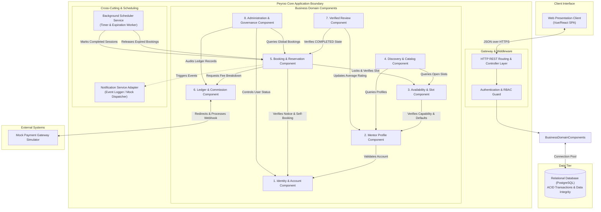

# Component and Subsystem Design: Peyroo Mentorship Platform

**Project Working Title:** Peyroo (پیرو)  
**Academic Course:** Software Analysis and Design (SSAD) | Fall 1405  
**Document Identifier:** `docs/design/COMPONENT_DESIGN.md`  
**Status:** `[BASELINE - STAGE 06]`  
**Date:** Aban 1405 / November 2026  
**Document Version:** 1.0  

---

## 1. Component Architecture Overview

In alignment with the **Modular Monolith** architecture (ADR-001), the Peyroo backend is organized into 8 highly cohesive domain components. Each component encapsulates its internal state, business rules, and database repository, interacting with sibling components exclusively via well-defined public TypeScript/service interfaces.

---

## 2. High-Level Component Diagram

---

## 3. Component Specifications & Interfaces

### 3.1 `Identity & Account Component`
- **Responsibilities:**
  - User registration, password hashing (Argon2id/bcrypt), and credential verification.
  - Session token generation (JWT/session cookie) and revocation on logout.
  - Account lifecycle management (`ACTIVE`, `SUSPENDED`).
  - Account capability flags (`isMenteeEnabled`, `isMentorEnabled`, `isAdmin`).
- **Exported Public Interface (`IIdentityService`):**
  - `getUserById(userId: UUID): Promise<UserAccount>`
  - `verifyActiveUser(userId: UUID): Promise<boolean>`
  - `setAccountStatus(userId: UUID, status: AccountStatus): Promise<void>`
  - `toggleMentorCapability(userId: UUID, enabled: boolean): Promise<void>`
- **Dependencies:** Persistence Repository (`user_accounts` table).

### 3.2 `Mentor Profile Component`
- **Responsibilities:**
  - Mentor onboarding, professional headline, biography, and technical expertise tags.
  - Mentor default session pricing and fallback external meeting link configuration.
  - Aggregation of mentor review counts and average rating calculations.
- **Exported Public Interface (`IMentorProfileService`):**
  - `getProfileByUserId(userId: UUID): Promise<MentorProfile>`
  - `createOrUpdateProfile(userId: UUID, data: MentorProfileDTO): Promise<MentorProfile>`
  - `recalculateRating(mentorId: UUID, newRatingScore: number): Promise<void>`
- **Dependencies:** `IdentityComponent`, Persistence Repository (`mentor_profiles` table).

### 3.3 `Availability & Slot Component`
- **Responsibilities:**
  - Mentor availability slot creation with strict standard durations (30, 45, or 60 minutes).
  - Validation against temporal collisions for the same mentor (`slot_A.start < slot_B.end AND slot_A.end > slot_B.start`).
  - Slot status lifecycle (`OPEN`, `HELD`, `BOOKED`, `CANCELLED`).
  - Slot inheritance and per-slot override of external meeting links.
- **Exported Public Interface (`ISlotService`):**
  - `createSlot(mentorId: UUID, data: CreateSlotDTO): Promise<AvailabilitySlot>`
  - `lockSlotForBooking(slotId: UUID, transactionClient: DBClient): Promise<AvailabilitySlot>`
  - `releaseSlotToOpen(slotId: UUID): Promise<void>`
  - `confirmSlotBooking(slotId: UUID, transactionClient: DBClient): Promise<void>`
  - `cancelSlot(slotId: UUID): Promise<void>`
- **Dependencies:** `MentorProfileComponent`, Persistence Repository (`availability_slots` table).

### 3.4 `Discovery & Catalog Component`
- **Responsibilities:**
  - Querying and aggregating active mentors who possess upcoming `OPEN` availability slots.
  - Multi-tag filtering by technical domain (e.g., "Backend", "Frontend", "DevOps").
  - Data projection: Strips out private external meeting links before exposing catalog records to the public.
- **Exported Public Interface (`ICatalogService`):**
  - `searchMentors(tags?: string[], page?: number, limit?: number): Promise<PaginatedMentors>`
  - `getMentorPublicDetails(mentorId: UUID): Promise<PublicMentorDetails>`
- **Dependencies:** `MentorProfileComponent`, `SlotComponent`.

### 3.5 `Booking & Reservation Component`
- **Responsibilities:**
  - Enforcement of self-booking invariant (`mentee_id != mentor_profile.user_id` resolving the actual user account associated with the mentor profile).
  - Enforcement of 2-hour advance notice invariant (`slot.start_time - now >= 2 hours`).
  - Coordination of 15-minute concurrency reservation timer (`expires_at = now + 15 min`).
  - Processing payment confirmation callbacks and transitioning bookings to `CONFIRMED`.
  - Automated session completion when slot end time has passed.
  - Enforcement of mentee and mentor cancellation and refund rules ($\ge 24$h full refund vs. $< 24$h no refund).
- **Exported Public Interface (`IBookingService`):**
  - `initiateBooking(menteeId: UUID, slotId: UUID, agenda: AgendaDTO): Promise<BookingCheckoutDetails>`
  - `confirmBookingPayment(bookingId: UUID, txRef: string): Promise<Booking>`
  - `expireAbandonedBooking(bookingId: UUID): Promise<void>`
  - `cancelBookingByMentee(bookingId: UUID, menteeId: UUID): Promise<CancellationResult>`
  - `cancelBookingByMentor(bookingId: UUID, mentorId: UUID): Promise<CancellationResult>`
  - `markBookingCompleted(bookingId: UUID): Promise<void>`
- **Dependencies:** `SlotComponent`, `IdentityComponent`, `LedgerComponent`, `Notifier`.

### 3.6 `Ledger & Commission Component`
- **Responsibilities:**
  - Automated price breakdown calculation: Mentor Session Fee + 10% Peyroo Platform Commission = Total Amount.
  - Managing communication with the external Mock Payment Gateway simulator (initiating checkout, processing signed callbacks).
  - Recording auditable payment ledger records (`SESSION_PAYMENT`, `CANCELLATION_REFUND`) with linked `parent_transaction_id` on refunds.
  - Enforcing callback idempotency via `external_tx_ref` / `idempotency_key` deduplication.
  - Handling late captured payments by logging them as `COMPLETED` followed by an immediate linked `CANCELLATION_REFUND` (never marking captured payments as `FAILED`).
  - Tracking transaction states (`PENDING`, `COMPLETED`, `FAILED`, `REFUNDED`).
- **Exported Public Interface (`ILedgerService`):**
  - `calculatePricing(sessionRate: Money): FeeBreakdown`
  - `recordPaymentInitiation(bookingId: UUID, amounts: FeeBreakdown, idempotencyKey: string): Promise<PaymentTransaction>`
  - `finalizePaymentSuccess(bookingId: UUID, txRef: string): Promise<PaymentTransaction>`
  - `handleLateCapturedPayment(bookingId: UUID, txRef: string, amounts: FeeBreakdown): Promise<{ payment: PaymentTransaction; refund: PaymentTransaction }>`
  - `recordPaymentFailure(bookingId: UUID): Promise<PaymentTransaction>`
  - `recordRefund(bookingId: UUID, parentTxId: UUID, refundAmount: Money): Promise<PaymentTransaction>`
  - `getFinancialAuditMetrics(): Promise<FinancialSummaryDTO>`
- **Dependencies:** Mock Payment Gateway Adapter, Persistence Repository (`payment_transactions` table).

### 3.7 `Verified Review Component`
- **Responsibilities:**
  - Validation of review eligibility: `booking.status == COMPLETED` and `booking.mentee_id == auth.user_id`.
  - Enforcement of single-review constraint (exactly 1 review per booking).
  - Validation of 1–5 star rating integer constraint and optional feedback comment ($\le 1000$ chars).
  - Triggering mentor aggregate rating recalculation.
- **Exported Public Interface (`IReviewService`):**
  - `submitReview(menteeId: UUID, bookingId: UUID, rating: number, comment?: string): Promise<Review>`
  - `getMentorReviews(mentorId: UUID, page?: number): Promise<PaginatedReviews>`
- **Dependencies:** `BookingComponent`, `MentorProfileComponent`, Persistence Repository (`reviews` table).

### 3.8 `Administration & Governance Component`
- **Responsibilities:**
  - Platform governance: View all registered users and toggle account status (`ACTIVE` $\leftrightarrow$ `SUSPENDED`).
  - Financial auditing: View total platform gross volume, total 10% commission revenue, and refund logs.
  - Global booking inspection: Read-only audit access to all system bookings and historical lifecycle states.
  - Strict constraint enforcement: Prohibited from creating slots, booking sessions, or altering mentor rates.
- **Exported Public Interface (`IAdminService`):**
  - `listAllUsers(query: UserSearchQuery): Promise<PaginatedUsers>`
  - `toggleUserSuspension(adminId: UUID, targetUserId: UUID, suspend: boolean): Promise<void>`
  - `getSystemFinancialLedger(filter: LedgerFilter): Promise<PaginatedTransactions>`
  - `getGlobalBookingsAudit(filter: BookingAuditFilter): Promise<PaginatedBookings>`
- **Dependencies:** `IdentityComponent`, `LedgerComponent`, `BookingComponent`.
