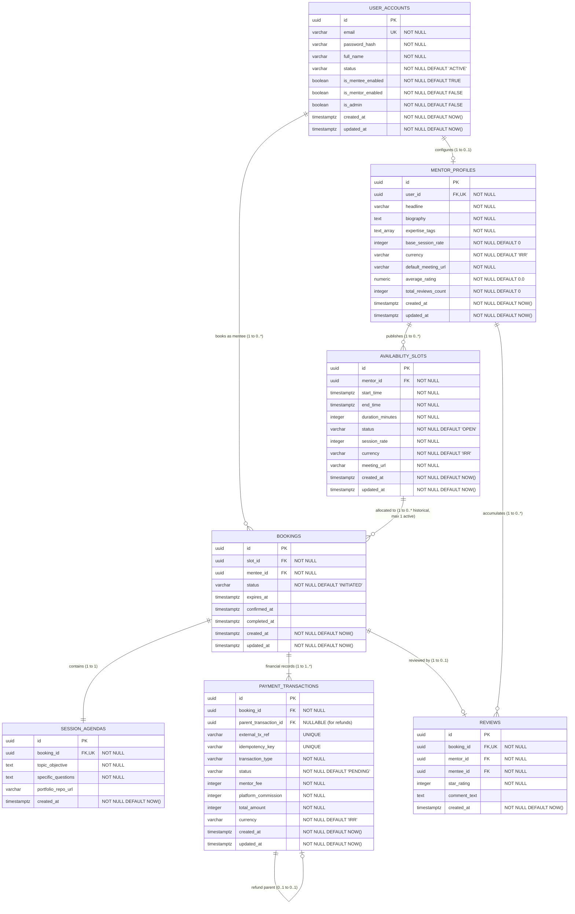

# Database Design & Relational Schema: Peyroo Mentorship Platform

**Project Working Title:** Peyroo (پیرو)  
**Academic Course:** Software Analysis and Design (SSAD) | Fall 1405  
**Document Identifier:** `docs/design/DATABASE_DESIGN.md`  
**Status:** `[BASELINE - STAGE 06]`  
**Date:** Aban 1405 / November 2026  
**Document Version:** 1.0  

---

## 1. Overview & Data Architecture Principles

This document provides the formal **Logical and Physical Database Design** for the **Peyroo Mentorship Platform** using PostgreSQL (or compatible SQL relational database).

The schema strictly implements:
1. **Relational Data Integrity:** Foreign keys, non-null constraints, domain `CHECK` constraints, and unique indexes to enforce invariants at the storage layer.
2. **State Disambiguation:** Complete separation between Slot States (`OPEN`, `HELD`, `BOOKED`, `CANCELLED`), Booking States (`INITIATED`, `PENDING_PAYMENT`, `CONFIRMED`, `COMPLETED`, `CANCELLED_*`), and Payment Transaction States (`PENDING`, `COMPLETED`, `FAILED`, `REFUNDED`).
3. **Pessimistic Concurrency & Partial Uniqueness:** Employs PostgreSQL partial unique indexing to allow historical bookings on re-opened slots while strictly forbidding multiple active bookings. Uses atomic `SELECT ... FOR UPDATE` row locks during slot reservation to structurally prevent double-booking.
4. **Auditable Payment Transaction Ledger (Not Double-Entry):** The financial ledger records discrete, auditable payment and refund transactions. It does not claim formal double-entry accounting (which requires balanced debit/credit ledgers across a chart of accounts); instead, it models an immutable payment log where every refund explicitly references its parent payment transaction via `parent_transaction_id` with idempotency controls.
5. **Database-Level Exclusion Constraints for Slot Overlap:** Enforces slot collision prevention at the database engine level via PostgreSQL `btree_gist` exclusion constraints, preventing TOCTOU (Time-of-Check to Time-of-Use) race conditions during concurrent slot publishing.

---

## 2. Entity-Relationship Diagram (ERD)



---

## 3. Relational Table Specifications & Constraints

### 3.1 Table: `user_accounts`
Stores unified identity records for all platform users.

```sql
CREATE TABLE user_accounts (
    id UUID PRIMARY KEY DEFAULT gen_random_uuid(),
    email VARCHAR(255) NOT NULL UNIQUE,
    password_hash VARCHAR(255) NOT NULL,
    full_name VARCHAR(100) NOT NULL,
    status VARCHAR(20) NOT NULL DEFAULT 'ACTIVE',
    is_mentee_enabled BOOLEAN NOT NULL DEFAULT TRUE,
    is_mentor_enabled BOOLEAN NOT NULL DEFAULT FALSE,
    is_admin BOOLEAN NOT NULL DEFAULT FALSE,
    created_at TIMESTAMPTZ NOT NULL DEFAULT NOW(),
    updated_at TIMESTAMPTZ NOT NULL DEFAULT NOW(),
    CONSTRAINT chk_user_status CHECK (status IN ('ACTIVE', 'SUSPENDED')),
    CONSTRAINT chk_email_format CHECK (email ~* '^[A-Za-z0-9._%+-]+@[A-Za-z0-9.-]+\.[A-Za-z]{2,}$')
);

CREATE INDEX idx_users_email ON user_accounts (email);
CREATE INDEX idx_users_status ON user_accounts (status);
```

### 3.2 Table: `mentor_profiles`
Maintains mentor capability attributes, expertise tags, and aggregated rating metrics.

```sql
CREATE TABLE mentor_profiles (
    id UUID PRIMARY KEY DEFAULT gen_random_uuid(),
    user_id UUID NOT NULL UNIQUE REFERENCES user_accounts(id) ON DELETE RESTRICT,
    headline VARCHAR(150) NOT NULL,
    biography TEXT NOT NULL,
    expertise_tags TEXT[] NOT NULL,
    base_session_rate INTEGER NOT NULL DEFAULT 0,
    currency VARCHAR(10) NOT NULL DEFAULT 'IRR',
    default_meeting_url VARCHAR(500) NOT NULL,
    average_rating NUMERIC(3, 2) NOT NULL DEFAULT 0.00,
    total_reviews_count INTEGER NOT NULL DEFAULT 0,
    created_at TIMESTAMPTZ NOT NULL DEFAULT NOW(),
    updated_at TIMESTAMPTZ NOT NULL DEFAULT NOW(),
    CONSTRAINT chk_bio_length CHECK (LENGTH(biography) >= 20),
    CONSTRAINT chk_base_rate_non_negative CHECK (base_session_rate >= 0),
    CONSTRAINT chk_meeting_url_https CHECK (default_meeting_url ~* '^https://.*$'),
    CONSTRAINT chk_avg_rating_range CHECK (average_rating >= 0.00 AND average_rating <= 5.00)
);

CREATE INDEX idx_mentor_profiles_user_id ON mentor_profiles (user_id);
CREATE INDEX idx_mentor_profiles_tags ON mentor_profiles USING GIN (expertise_tags);
```

### 3.3 Table: `availability_slots`
Stores discrete mentor availability time slots.

```sql
-- PostgreSQL extension required for scalar + range exclusion constraints
CREATE EXTENSION IF NOT EXISTS btree_gist;

CREATE TABLE availability_slots (
    id UUID PRIMARY KEY DEFAULT gen_random_uuid(),
    mentor_id UUID NOT NULL REFERENCES mentor_profiles(id) ON DELETE RESTRICT,
    start_time TIMESTAMPTZ NOT NULL,
    end_time TIMESTAMPTZ NOT NULL,
    duration_minutes INTEGER NOT NULL,
    status VARCHAR(20) NOT NULL DEFAULT 'OPEN',
    session_rate INTEGER NOT NULL,
    currency VARCHAR(10) NOT NULL DEFAULT 'IRR',
    meeting_url VARCHAR(500) NOT NULL,
    created_at TIMESTAMPTZ NOT NULL DEFAULT NOW(),
    updated_at TIMESTAMPTZ NOT NULL DEFAULT NOW(),
    CONSTRAINT chk_slot_duration CHECK (duration_minutes IN (30, 45, 60)),
    CONSTRAINT chk_slot_time_order CHECK (end_time > start_time),
    CONSTRAINT chk_slot_status CHECK (status IN ('OPEN', 'HELD', 'BOOKED', 'CANCELLED')),
    CONSTRAINT chk_slot_rate_non_negative CHECK (session_rate >= 0),
    CONSTRAINT chk_slot_meeting_url_https CHECK (meeting_url ~* '^https://.*$'),
    -- Database-level exclusion constraint: prevents concurrent overlapping slots for the same mentor
    CONSTRAINT no_overlapping_slots_per_mentor EXCLUDE USING gist (
        mentor_id WITH =,
        tstzrange(start_time, end_time) WITH &&
    ) WHERE (status != 'CANCELLED')
);

CREATE INDEX idx_slots_mentor_time ON availability_slots (mentor_id, start_time, end_time);
CREATE INDEX idx_slots_status_start ON availability_slots (status, start_time);
```
> [!NOTE]
> **Concurrent Overlap Defense:** A simple application-level `SELECT COUNT(*)` followed by `INSERT` has a Time-of-Check to Time-of-Use (TOCTOU) race condition under concurrent requests. The `EXCLUDE USING gist` constraint guarantees collision prevention atomically at the database engine level. If `btree_gist` is not supported on a specific lightweight engine (e.g. SQLite), an application-level transaction lock (`pg_advisory_xact_lock` per mentor ID) is used as an architectural alternative.

### 3.4 Table: `bookings`
Coordinates the transaction contract between a Mentee and a Mentor.

```sql
CREATE TABLE bookings (
    id UUID PRIMARY KEY DEFAULT gen_random_uuid(),
    slot_id UUID NOT NULL REFERENCES availability_slots(id) ON DELETE RESTRICT,
    mentee_id UUID NOT NULL REFERENCES user_accounts(id) ON DELETE RESTRICT,
    status VARCHAR(30) NOT NULL DEFAULT 'INITIATED',
    expires_at TIMESTAMPTZ,
    confirmed_at TIMESTAMPTZ,
    completed_at TIMESTAMPTZ,
    created_at TIMESTAMPTZ NOT NULL DEFAULT NOW(),
    updated_at TIMESTAMPTZ NOT NULL DEFAULT NOW(),
    CONSTRAINT chk_booking_status CHECK (
        status IN (
            'INITIATED',
            'PENDING_PAYMENT',
            'CONFIRMED',
            'PAYMENT_FAILED',
            'EXPIRED',
            'CANCELLED_REFUNDED',
            'CANCELLED_NO_REFUND',
            'CANCELLED_BY_MENTOR',
            'COMPLETED'
        )
    )
);

-- Partial Unique Index: Strictly enforces AT MOST ONE active booking per slot
-- Allows unlimited historical terminal bookings (EXPIRED, CANCELLED_*, COMPLETED) on the same slot_id
CREATE UNIQUE INDEX uq_active_booking_per_slot ON bookings (slot_id)
WHERE status IN ('INITIATED', 'PENDING_PAYMENT', 'CONFIRMED');

CREATE INDEX idx_bookings_mentee ON bookings (mentee_id);
CREATE INDEX idx_bookings_slot ON bookings (slot_id);
CREATE INDEX idx_bookings_status_expires ON bookings (status, expires_at);
```

#### Active vs. Historical Booking State Definitions
- **Active Booking States (`INITIATED`, `PENDING_PAYMENT`, `CONFIRMED`):** Represent an active hold or confirmed appointment. The partial unique index `uq_active_booking_per_slot` prevents any second booking from entering an active state for the same slot.
- **Historical / Terminal Booking States (`EXPIRED`, `PAYMENT_FAILED`, `CANCELLED_REFUNDED`, `CANCELLED_NO_REFUND`, `CANCELLED_BY_MENTOR`, `COMPLETED`):** Preserved permanently for auditing. Because they are excluded from `uq_active_booking_per_slot`, an expired reservation or a slot reopened after $\ge 24$h mentee cancellation can be booked again without violating uniqueness.

### 3.5 Table: `session_agendas`
Maintains the structured preparatory agenda submitted by the mentee.

```sql
CREATE TABLE session_agendas (
    id UUID PRIMARY KEY DEFAULT gen_random_uuid(),
    booking_id UUID NOT NULL UNIQUE REFERENCES bookings(id) ON DELETE CASCADE,
    topic_objective TEXT NOT NULL,
    specific_questions TEXT NOT NULL,
    portfolio_repo_url VARCHAR(500),
    created_at TIMESTAMPTZ NOT NULL DEFAULT NOW(),
    CONSTRAINT chk_topic_length CHECK (LENGTH(topic_objective) >= 10),
    CONSTRAINT chk_questions_length CHECK (LENGTH(specific_questions) >= 15)
);

CREATE INDEX idx_agendas_booking_id ON session_agendas (booking_id);
```

### 3.6 Table: `payment_transactions`
Auditable payment transaction ledger recording initial session payments and linked refund transactions.

```sql
CREATE TABLE payment_transactions (
    id UUID PRIMARY KEY DEFAULT gen_random_uuid(),
    booking_id UUID NOT NULL REFERENCES bookings(id) ON DELETE RESTRICT,
    parent_transaction_id UUID REFERENCES payment_transactions(id) ON DELETE RESTRICT,
    external_tx_ref VARCHAR(100) UNIQUE,
    idempotency_key VARCHAR(100) UNIQUE,
    transaction_type VARCHAR(30) NOT NULL,
    status VARCHAR(20) NOT NULL DEFAULT 'PENDING',
    mentor_fee INTEGER NOT NULL,
    platform_commission INTEGER NOT NULL,
    total_amount INTEGER NOT NULL,
    currency VARCHAR(10) NOT NULL DEFAULT 'IRR',
    created_at TIMESTAMPTZ NOT NULL DEFAULT NOW(),
    updated_at TIMESTAMPTZ NOT NULL DEFAULT NOW(),
    CONSTRAINT chk_tx_type CHECK (transaction_type IN ('SESSION_PAYMENT', 'CANCELLATION_REFUND')),
    CONSTRAINT chk_tx_status CHECK (status IN ('PENDING', 'COMPLETED', 'FAILED', 'REFUNDED')),
    CONSTRAINT chk_tx_amounts CHECK (mentor_fee >= 0 AND platform_commission >= 0 AND total_amount = mentor_fee + platform_commission),
    CONSTRAINT chk_refund_parent CHECK (
        (transaction_type = 'CANCELLATION_REFUND' AND parent_transaction_id IS NOT NULL) OR
        (transaction_type = 'SESSION_PAYMENT')
    )
);

CREATE INDEX idx_transactions_booking_id ON payment_transactions (booking_id);
CREATE INDEX idx_transactions_parent ON payment_transactions (parent_transaction_id);
CREATE INDEX idx_transactions_status ON payment_transactions (status);
CREATE INDEX idx_transactions_external_ref ON payment_transactions (external_tx_ref);
CREATE INDEX idx_transactions_idempotency ON payment_transactions (idempotency_key);
```

#### Financial Model & Idempotency Rules
1. **Initial Charge Record:** Created as `SESSION_PAYMENT` in `PENDING` state. Upon verified payment callback, updated to `COMPLETED` with `external_tx_ref` recorded.
2. **Refund Record:** When a cancellation results in a refund ($\ge 24$h mentee cancellation or anytime mentor cancellation), a **new independent transaction row** is inserted with `transaction_type = 'CANCELLATION_REFUND'`, `status = 'REFUNDED'`, and `parent_transaction_id` pointing to the original `SESSION_PAYMENT` transaction. The original payment record is left unchanged.
3. **Callback Idempotency:** The Mock Banking Gateway sends an `idempotency_key` or `external_tx_ref`. If a callback arrives for an already processed reference, the unique constraint or service-level check recognizes the duplicate, logs the duplicate attempt, and immediately returns HTTP 200 without creating duplicate ledger entries or mutating state twice.
4. **Late Captured Payment & Automatic Refund (Policy Option A):** If a payment callback confirms that funds were successfully captured after a booking has already transitioned to `EXPIRED`, the payment record is saved with status `COMPLETED` (`SESSION_PAYMENT`). **A captured payment is never marked as FAILED.** Simultaneously, a separate linked `CANCELLATION_REFUND` row is inserted with status `REFUNDED` and `parent_transaction_id` referencing the captured payment. The booking remains `EXPIRED` and the slot remains available for other users, maintaining perfect zero-balance audit reconciliation.
```

### 3.7 Table: `reviews`
Verified post-session feedback submitted by mentees.

```sql
CREATE TABLE reviews (
    id UUID PRIMARY KEY DEFAULT gen_random_uuid(),
    booking_id UUID NOT NULL UNIQUE REFERENCES bookings(id) ON DELETE RESTRICT,
    mentor_id UUID NOT NULL REFERENCES mentor_profiles(id) ON DELETE RESTRICT,
    mentee_id UUID NOT NULL REFERENCES user_accounts(id) ON DELETE RESTRICT,
    star_rating INTEGER NOT NULL,
    comment_text TEXT,
    created_at TIMESTAMPTZ NOT NULL DEFAULT NOW(),
    CONSTRAINT chk_star_rating CHECK (star_rating >= 1 AND star_rating <= 5),
    CONSTRAINT chk_comment_length CHECK (comment_text IS NULL OR LENGTH(comment_text) <= 1000)
);

CREATE INDEX idx_reviews_mentor_id ON reviews (mentor_id);
CREATE INDEX idx_reviews_booking_id ON reviews (booking_id);
```

---

## 4. Transaction Isolation & Concurrency SQL Mechanics

### 4.1 Atomic 15-Minute Reservation Transaction (`SELECT FOR UPDATE`)
To guarantee that two mentees cannot book the exact same slot concurrently:

```sql
BEGIN TRANSACTION ISOLATION LEVEL READ COMMITTED;

-- 1. Acquire exclusive row lock on target slot
SELECT s.id, s.mentor_id, s.start_time, s.session_rate, s.meeting_url, s.status, mp.user_id AS mentor_user_id
FROM availability_slots s
JOIN mentor_profiles mp ON mp.id = s.mentor_id
WHERE s.id = :slotId
FOR UPDATE OF s;

-- 2. Verify constraints:
-- a) Self-booking check: mentee_id (user_accounts.id) != mentor_user_id (user_accounts.id)
--    If :menteeId = mentor_user_id THEN ROLLBACK; -> HTTP 403 Forbidden ("Cannot book own slot")
-- b) Status check: status must be 'OPEN'
--    If status != 'OPEN' THEN ROLLBACK; -> HTTP 409 Conflict ("Slot no longer available")
-- c) Advance notice check: (start_time - NOW()) >= INTERVAL '2 hours'
--    If notice < 2h THEN ROLLBACK; -> HTTP 422 Unprocessable Entity ("Notice < 2h")

-- 3. Transition slot status to HELD
UPDATE availability_slots
SET status = 'HELD', updated_at = NOW()
WHERE id = :slotId;

-- 4. Create booking record in PENDING_PAYMENT state
INSERT INTO bookings (slot_id, mentee_id, status, expires_at)
VALUES (:slotId, :menteeId, 'PENDING_PAYMENT', NOW() + INTERVAL '15 minutes')
RETURNING id;

-- 5. Create agenda record
INSERT INTO session_agendas (booking_id, topic_objective, specific_questions, portfolio_repo_url)
VALUES (:bookingId, :topic, :questions, :repoUrl);

-- 6. Insert initial ledger record
INSERT INTO payment_transactions (booking_id, transaction_type, status, mentor_fee, platform_commission, total_amount, idempotency_key)
VALUES (:bookingId, 'SESSION_PAYMENT', 'PENDING', :mentorFee, :commission, :total, :idempotencyKey);

COMMIT;
```

### 4.2 Automated 15-Minute Expiration Batch Query
Executed periodically by the background scheduler to release abandoned reservations:

```sql
-- Step 1: Find and expire overdue reservations
WITH expired_bookings AS (
    UPDATE bookings
    SET status = 'EXPIRED', updated_at = NOW()
    WHERE status = 'PENDING_PAYMENT' AND expires_at <= NOW()
    RETURNING id, slot_id
)
-- Step 2: Release associated slots back to OPEN
UPDATE availability_slots
SET status = 'OPEN', updated_at = NOW()
WHERE id IN (SELECT slot_id FROM expired_bookings);
```
