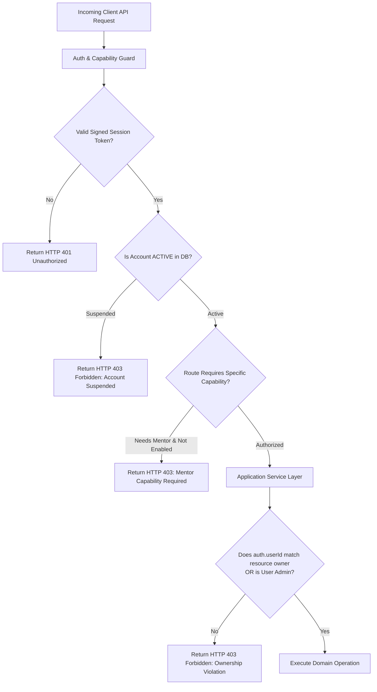

# Security Architecture & Access Control Design: Peyroo Mentorship Platform

**Project Working Title:** Peyroo (پیرو)  
**Academic Course:** Software Analysis and Design (SSAD) | Fall 1405  
**Document Identifier:** `docs/design/SECURITY_DESIGN.md`  
**Status:** `[BASELINE - STAGE 06]`  
**Date:** Aban 1405 / November 2026  
**Document Version:** 1.0  

---

## 1. Overview & Threat Modeling

This specification details the **Security and Access Control Architecture** designed for the **Peyroo Mentorship Platform**. 

The security design addresses critical risks identified in academic and web application threat models:
1. **Broken Object-Level Authorization (BOLA / IDOR):** Malicious mentees or mentors attempting to inspect or modify sessions, agendas, or meeting links owned by other users.
2. **Double-Booking & Race-Condition Exploitation:** Exploiting parallel checkout requests to secure an open slot without payment.
3. **Privilege Escalation:** Regular users attempting to access administrator financial ledgers or suspend peers.
4. **Credential Theft & Session Hijacking:** XSS exfiltration of tokens and brute-force password guessing.
5. **Payment Callback Spoofing:** Forging payment confirmation callbacks to mark unpaid sessions as `CONFIRMED`.

---

## 2. Authentication & Identity Protection

### 2.1 Password Hashing Architecture
- **Algorithm:** Passwords must be hashed using **Argon2id** (memory cost $\ge 19$ MiB, iterations $\ge 2$, parallelism $\ge 1$) or **bcrypt** with a salt work factor of $\ge 10$.
- **Design Rule:** Password hashing occurs exclusively within the `IdentityService` before invoking the repository. Plaintext passwords must never be logged, transmitted in error messages, or written to temporary cache storage.

### 2.2 Session Token Transport & Comprehensive Web Protection
- **Token Mechanism:** Stateless JSON Web Tokens (JWT) or signed session identifiers.
- **Transport Security:** Tokens are transmitted to the browser within an **`HttpOnly`, `Secure`, `SameSite=Lax` cookie**.
- **Defense-in-Depth Analysis (Beyond HttpOnly & Lax):**
  - *XSS Defense:* While `HttpOnly` flags prevent malicious JavaScript from reading the raw cookie bytes, an attacker with arbitrary script execution could still execute forged requests through the user's browser. Therefore, rigorous input sanitization, output encoding, and a strict Content Security Policy (CSP) remain mandatory complementary defenses.
  - *CSRF Defense:* `SameSite=Lax` provides strong protection against cross-site POST submissions, but browsers may permit top-level GET navigations. The API reinforces this with:
    1. **Origin & Referer Header Verification:** The server strictly asserts that the `Origin` or `Referer` header matches the whitelisted frontend domain for all state-mutating requests (`POST`, `PUT`, `PATCH`, `DELETE`).
    2. **Custom Request Header Enforcement:** The client SPA transmits a custom header (`X-Requested-With: PeyrooApp`) on all API calls, which browsers refuse to send cross-origin without prior CORS preflight approval.
- **Token Invalidation & Real-Time Suspension Enforcement:**
  - Stateless JWT expiration (lifetime: 24 hours) alone cannot revoke a token if an administrator suspends an abusive user.
  - To enforce immediate revocation (`FR-027`), the authentication middleware performs an atomic validation of the account's operational status (`SELECT status FROM user_accounts WHERE id = :userId`). If `status == 'SUSPENDED'`, the request is rejected immediately with HTTP 403 Forbidden regardless of unexpired token claims.

---

## 3. Capability-Based Authorization & Ownership Verification

### 3.1 Backend-Enforced Authorization Hierarchy
Authorization is validated at two distinct checkpoints in the backend pipeline:
1. **Checkpoint 1 — Authentication & Capability Guard (Middleware Layer):**  
   Validates session token signature, extracts user identity, and verifies operational capability (e.g., asserts `user.isMentorEnabled == true` before permitting access to slot creation routes).
2. **Checkpoint 2 — Entity Ownership Guard (Application Service Layer):**  
   Asserts that the authenticated principal is the direct owner or authorized participant of the target resource:

### 3.2 Granular Ownership Enforcement Rules
- **Availability Slots:** Only the mentor whose user account owns the profile (`auth.user_id == mentor_profile.user_id` where `mentor_profile.id == slot.mentor_id`) may modify or delete a slot.
- **Session Bookings:** Mutations (such as cancellation) require `auth.user_id == booking.mentee_id` or `auth.user_id == mentor_profile.user_id`.
- **Self-Booking Prohibition:** System resolves the mentor profile's user account and asserts `auth.user_id != mentor_profile.user_id` during booking initiation (comparing user account to user account, not mentee account to mentor profile ID).
- **Admin Boundaries:** Administrator privileges (`auth.user.isAdmin == true`) grant read-only access to global bookings and user suspension controls, but explicitly prohibit altering mentor rates or booking sessions.

---

## 4. Privacy Design: Meeting Link & Agenda Confidentiality

### 4.1 Strict Masking of External Meeting URLs
Meeting links (Google Meet / Zoom URLs) constitute sensitive personal contact information:
- **Catalog & Public Profile Masking:** Public APIs (`/api/mentors`, `/api/mentors/:id`, `/api/slots`) must completely omit or return `null` for the `meeting_url` field.
- **Access Rule:** The `meeting_url` attribute is disclosed **strictly and exclusively** when:
  $$\text{booking.status} == \text{'CONFIRMED'} \quad \text{AND} \quad \text{auth.user\_id} \in \{\text{booking.mentee\_id}, \text{mentor\_profile.user\_id}\}$$

### 4.2 Agenda Confidentiality
Mentee session agendas, project links, and questions are accessible only to the mentee, the booked mentor, and platform administrators for moderation purposes. Unrelated third parties receive HTTP 403 Forbidden.

---

## 5. Webhook Signature Verification for Payment Callbacks

To prevent malicious actors from forging payment success callbacks (`POST /api/payments/callback`) and confirming unpaid bookings:

1. **Shared Secret Key:** A cryptographic secret (`WEBHOOK_SIGNING_SECRET`) is shared between the Mock Payment Gateway and the Peyroo backend.
2. **HMAC-SHA256 Signature:** The gateway signs the callback payload and transmits the signature in an HTTP header:
   $$\text{Signature} = \text{HMAC-SHA256}(\text{PayloadBytes}, \text{WEBHOOK\_SIGNING\_SECRET})$$
3. **Constant-Time Verification:** The backend computes the expected HMAC over the raw request body and verifies it using **constant-time equality comparison** (`crypto.timingSafeEqual`) to eliminate timing attack vectors. Callbacks with invalid or missing signatures are rejected with HTTP 401 Unauthorized.

---

## 6. Input Validation & Injection Immunity

1. **Declarative Schema Validation:** Every incoming request body and query parameter is validated against strict declarative schemas (Zod / Joi). Unrecognized fields are stripped; type mismatches return HTTP 400 Bad Request with field-level diagnostics.
2. **Parameterized Database Queries:** 100% of database interactions are executed using parameterized SQL statements or an ORM query builder. Direct string concatenation into SQL statements is prohibited, neutralizing SQL injection threats (`NFR-004`).
3. **Cross-Site Scripting (XSS) Sanitization:** Text inputs (biographies, agendas, review comments) are sanitized and entity-encoded before rendering in web client interfaces.

---

## 7. Audit Logging & Non-Destructive Storage

1. **Non-Destructive Audit Trail:** In compliance with `NFR-010`, cancellations and financial adjustments are modeled via status transitions and immutable ledger inserts. Physical `DELETE` operations on historical bookings, slots, or transactions are disabled at the repository layer.
2. **Security Event Logging:** The system logs security events (failed login attempts, invalid webhook signatures, ownership check rejections, and administrative account suspensions) with client IP addresses and ISO-8601 timestamps for administrative inspection.
