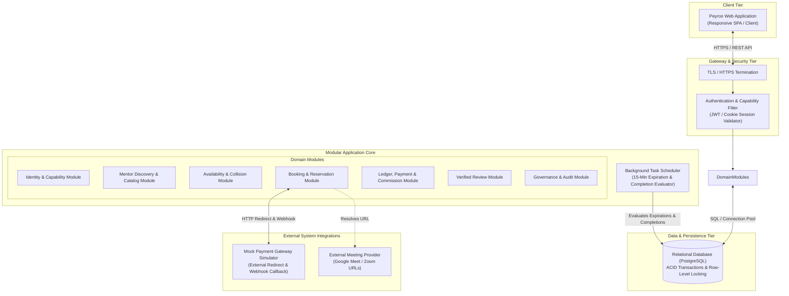

# System Design Specification: Peyroo Mentorship Platform

**Project Working Title:** Peyroo (پیرو)  
**Academic Course:** Software Analysis and Design (SSAD) | Fall 1405  
**Document Identifier:** `docs/design/SYSTEM_DESIGN.md`  
**Status:** `[BASELINE - STAGE 06]`  
**Date:** Aban 1405 / November 2026  
**Document Version:** 1.0  

---

## 1. Executive Overview & Design Objectives

This **System Design Specification** transitions the **Peyroo Mentorship Platform** from analytical problem models (Stage 04 Requirements & Stage 05 UML Analysis) into an implementation-ready, technically sound architectural solution.

The primary objective is to define a pragmatic, highly maintainable, and academically defensible system design that guarantees:
1. **One Full End-to-End Business Journey:** Seamless execution from mentor discovery $\to$ 15-minute slot reservation $\to$ Mock Banking Gateway payment with 10% platform commission $\to$ confirmed booking $\to$ authenticated dashboard meeting URL access.
2. **ACID Transaction & Concurrency Integrity:** Elimination of double-booking race conditions through pessimistic row-level database locking (`SELECT ... FOR UPDATE`) or serializable transactions.
3. **Explicit Capability-Based Security:** Backend-enforced authorization asserting user role capabilities (Mentor vs. Mentee) and strict resource ownership on every data mutation.
4. **Implementation Feasibility & Operational Transparency:** High architectural cohesion, low coupling, zero unwarranted microservice overhead, and a verified deployment footprint compatible with standard free-tier hosting limits.

---

## 2. Design Principles & Architectural Guidelines

In strict accordance with `AGENTS.md` and the SSAD Fall 1405 project syllabus:

1. **Modular Monolith over Microservices:**  
   The platform is organized into distinct, highly decoupled domain modules within a single unified codebase. This eliminates network serialization latency, distributed transaction failure modes, and distributed tracing complexity while preserving clean domain boundaries.
2. **Separation of Concerns (SoC):**  
   Strict 4-layer architectural hierarchy:  
   $$\text{Presentation Layer (Controllers)} \longrightarrow \text{Application Layer (Services)} \longrightarrow \text{Domain Layer (Models)} \longrightarrow \text{Persistence Layer (Repositories)}$$
   No database queries or raw SQL leak into controllers or presentation templates.
3. **Pessimistic Concurrency for Reservations:**  
   Slot availability and reservation locks are handled at the database level using atomic transactions. A slot transitioning from `OPEN` to `HELD` locks the database record to prevent parallel collision.
4. **Defense-in-Depth Privacy:**  
   Meeting links and sensitive session agendas are withheld at the query/serialization layer unless the requesting authenticated principal matches `booking.mentee_id` or `mentor_profile.user_id` and the booking status is `CONFIRMED`.
5. **Auditable Financial Transaction Ledger:**  
   Financial records are logged as discrete payment and refund transactions (`SESSION_PAYMENT`, `CANCELLATION_REFUND`) linked via `parent_transaction_id` with callback idempotency, preserving complete transaction history without claiming unneeded double-entry accounting complexity.

---

## 3. High-Level Architectural Synthesis

---

## 4. Stage 06 Document Roadmap

The system design deliverables are structured across 11 dedicated specifications in `docs/design/`:

| Document | Purpose & Architectural Scope |
|---|---|
| **[`SYSTEM_DESIGN.md`](file:///c:/Users/r/Desktop/peyroo/docs/design/SYSTEM_DESIGN.md)** | Executive overview, design principles, high-level synthesis, and document roadmap. |
| **[`ARCHITECTURE_DESIGN.md`](file:///c:/Users/r/Desktop/peyroo/docs/design/ARCHITECTURE_DESIGN.md)** | Selected pattern (Modular Monolith), architectural layers, cross-layer communications, and quality evaluation. |
| **[`ARCHITECTURE_DECISIONS.md`](file:///c:/Users/r/Desktop/peyroo/docs/design/ARCHITECTURE_DECISIONS.md)** | Formal Architecture Decision Records (ADRs 001–006) capturing trade-offs, rationale, and consequences. |
| **[`COMPONENT_DESIGN.md`](file:///c:/Users/r/Desktop/peyroo/docs/design/COMPONENT_DESIGN.md)** | Detailed component decomposition, module responsibilities, internal interfaces, and Mermaid component diagrams. |
| **[`DATABASE_DESIGN.md`](file:///c:/Users/r/Desktop/peyroo/docs/design/DATABASE_DESIGN.md)** | Logical data model, formal ERD, table definitions, foreign keys, unique constraints, index plans, and transaction locking. |
| **[`API_DESIGN.md`](file:///c:/Users/r/Desktop/peyroo/docs/design/API_DESIGN.md)** | Exhaustive RESTful API specification, query parameters, request/response bodies, status codes, and error schemas. |
| **[`SECURITY_DESIGN.md`](file:///c:/Users/r/Desktop/peyroo/docs/design/SECURITY_DESIGN.md)** | Identity architecture, password hashing, session tokens, RBAC ownership enforcement, and meeting URL masking. |
| **[`WORKFLOW_AND_TRANSACTION_DESIGN.md`](file:///c:/Users/r/Desktop/peyroo/docs/design/WORKFLOW_AND_TRANSACTION_DESIGN.md)** | Concurrency transaction design, 15-min expiration mechanics, race condition analysis, and completion triggers. |
| **[`DEPLOYMENT_DESIGN.md`](file:///c:/Users/r/Desktop/peyroo/docs/design/DEPLOYMENT_DESIGN.md)** | Physical deployment topology, runtime containers, background scheduler execution, HTTPS, and hosting cost analysis. |
| **[`DESIGN_TRACEABILITY_MATRIX.md`](file:///c:/Users/r/Desktop/peyroo/docs/design/DESIGN_TRACEABILITY_MATRIX.md)** | Complete mapping from Requirements (`FR`/`NFR`) to Components, Database Tables, and API Endpoints. |
| **[`DESIGN_VALIDATION_REPORT.md`](file:///c:/Users/r/Desktop/peyroo/docs/design/DESIGN_VALIDATION_REPORT.md)** | Comprehensive consistency verification against Stage 04 Requirements and Stage 05 UML models. |
