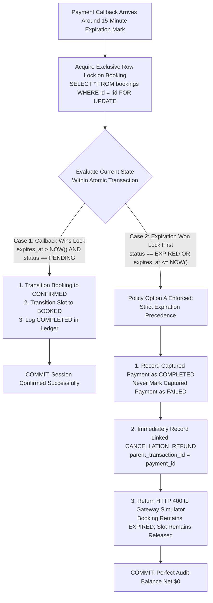

# Workflow and Transaction Design: Peyroo Mentorship Platform

**Project Working Title:** Peyroo (پیرو)  
**Academic Course:** Software Analysis and Design (SSAD) | Fall 1405  
**Document Identifier:** `docs/design/WORKFLOW_AND_TRANSACTION_DESIGN.md`  
**Status:** `[BASELINE - STAGE 06]`  
**Date:** Aban 1405 / November 2026  
**Document Version:** 1.0  

---

## 1. Overview & Transactional Consistency Principles

This specification details the technical mechanisms, database transaction boundaries, locking behaviors, and consistency guarantees governing the 10 critical workflows in the **Peyroo Mentorship Platform**.

### Core Consistency Guarantees
- **Atomicity:** All multi-table updates (e.g., booking creation + slot hold + ledger insert) execute within atomic database transactions. Any failure rolls back all mutations completely.
- **Isolation:** Slot reservation utilizes **Row-Level Exclusive Locking (`SELECT ... FOR UPDATE`)** under `READ COMMITTED` or `SERIALIZABLE` isolation to guarantee slot exclusivity without deadlocks.
- **Strict Precedence on Race Conditions:** Deterministic resolution rules for competing checkout requests and payment vs. expiration timeouts.

---

## 2. Critical Workflows & Transaction Specifications

### Workflow 1: Slot Creation & Overlap Prevention
- **Participating Components:** `SlotComponent`, `MentorProfileComponent`.
- **Concurrency Problem:** A simple application-level `SELECT COUNT(*)` followed by `INSERT` suffers from a Time-of-Check to Time-of-Use (TOCTOU) race condition if a mentor submits concurrent slot creation requests across multiple browser tabs.
- **Database-Level Protection:**
  1. **Primary Defense (PostgreSQL Exclusion Constraint):**
     ```sql
     -- Enforced at engine level using GiST range indexing
     CONSTRAINT no_overlapping_slots_per_mentor EXCLUDE USING gist (
         mentor_id WITH =,
         tstzrange(start_time, end_time) WITH &&
     ) WHERE (status != 'CANCELLED');
     ```
  2. **Alternative Defense (Transaction-Level Advisory Lock):**
     If exclusion constraints are unsupported on a lightweight test engine, an explicit transactional advisory lock is acquired per mentor during creation:
     ```sql
     BEGIN;
     -- Acquire transaction-scoped advisory lock on mentor's UUID hash
     SELECT pg_advisory_xact_lock(hashtext(:mentorId::text));
     
     -- Check overlap safely
     SELECT COUNT(*) FROM availability_slots 
     WHERE mentor_id = :mentorId 
       AND status != 'CANCELLED'
       AND start_time < :newEndTime 
       AND end_time > :newStartTime;
     -- If COUNT > 0, ROLLBACK & return HTTP 409 Conflict; else INSERT.
     COMMIT;
     ```

---

### Workflow 2: Concurrency-Protected Booking Initiation (15-Minute Reservation)
- **Problem Statement:** Two mentees (User A and User B) simultaneously submit a booking request for the exact same open slot.
- **Corrected Self-Booking Validation:** The mentee user account (`bookings.mentee_id`, FK to `user_accounts.id`) is validated against the actual user account owning the mentor profile (`mentor_profiles.user_id`), NOT against `availability_slots.mentor_id` (which is a FK to `mentor_profiles.id`).
- **Transaction Boundary & Row-Level Lock:**

```mermaid
sequenceDiagram
    autonumber
    actor MenteeA as Mentee A
    actor MenteeB as Mentee B
    participant API as Booking Coordinator
    participant DB as PostgreSQL Database

    Note over MenteeA,MenteeB: Parallel Booking Requests Initiated
    MenteeA->>API: POST /api/bookings (slotId, agendaA)
    MenteeB->>API: POST /api/bookings (slotId, agendaB)

    Note over API,DB: Tx A Begins First (Microsecond Advantage)
    API->>DB: BEGIN TRANSACTION;
    API->>DB: SELECT s.*, mp.user_id AS mentor_user_id FROM availability_slots s JOIN mentor_profiles mp ON mp.id = s.mentor_id WHERE s.id = :slotId FOR UPDATE OF s;
    Note over DB: Row locked exclusively for Tx A

    Note over API,DB: Tx B Begins and Attempts to Read
    API->>DB: BEGIN TRANSACTION;
    API->>DB: SELECT s.*, mp.user_id AS mentor_user_id FROM availability_slots s JOIN mentor_profiles mp ON mp.id = s.mentor_id WHERE s.id = :slotId FOR UPDATE OF s;
    Note over DB: Tx B BLOCKS awaiting Tx A's lock release

    API->>DB: Verify menteeA_id != mentor_user_id (Self-Booking Invariant)
    API->>DB: Verify slot is OPEN and notice >= 2h (PASS)
    API->>DB: UPDATE availability_slots SET status = 'HELD' WHERE id = :slotId;
    API->>DB: INSERT INTO bookings (slot_id, mentee_id, status='PENDING_PAYMENT', expires_at=NOW()+15m);
    API->>DB: INSERT INTO session_agendas (...);
    API->>DB: INSERT INTO payment_transactions (...);
    API->>DB: COMMIT;
    Note over DB: Tx A commits. Lock released. Slot is now HELD.
    API-->>MenteeA: 201 Created (Redirect to Mock Payment Gateway)

    Note over DB: Tx B unblocks and reads slot
    DB-->>API: Returns slot record (status is now HELD)
    API->>API: Check: slot status == 'OPEN'? (FALSE, status is HELD)
    API->>DB: ROLLBACK;
    API-->>MenteeB: 409 Conflict ("Slot is no longer available; please choose another slot")
```

---

### Workflow 3: Payment Confirmation Callback & Ledger Finalization
- **Trigger:** Webhook callback from Mock Payment Gateway (`POST /api/payments/callback`).
- **Transaction Scope:**
  ```sql
  BEGIN;
  -- Lock booking row
  SELECT * FROM bookings WHERE id = :bookingId FOR UPDATE;
  
  -- Precedence check: assert booking is in PENDING_PAYMENT and NOT expired
  IF booking.status != 'PENDING_PAYMENT' OR booking.expires_at <= NOW() THEN
      -- Record failed transaction, trigger simulated refund, ROLLBACK or COMMIT failure.
  ELSE
      -- Update booking to CONFIRMED
      UPDATE bookings SET status = 'CONFIRMED', confirmed_at = NOW() WHERE id = :bookingId;
      -- Update slot to BOOKED
      UPDATE availability_slots SET status = 'BOOKED' WHERE id = booking.slot_id;
      -- Record COMPLETED transaction in ledger
      UPDATE payment_transactions SET status = 'COMPLETED', external_tx_ref = :txRef WHERE booking_id = :bookingId;
  END IF;
  COMMIT;
  ```

---

### Workflow 4: The Payment vs. Expiration Race Condition & Edge Cases

A critical distributed system edge case occurs when a mentee completes payment at the Mock Payment Gateway at the exact 15-minute boundary while the background expiration scheduler is executing.



#### 4.1 Approved Business Decision: Strict Expiration Precedence with Linked Refund
The platform enforces **Policy Option A (Strict Expiration Precedence)**:

- If the 15-minute expiration worker has already transitioned the booking to `EXPIRED` (and released the slot back to `OPEN`):
  1. **Accurate Payment Recording:** Because the gateway successfully captured the mentee's funds, the incoming transaction is recorded in `payment_transactions` with `status = 'COMPLETED'` (`transaction_type = 'SESSION_PAYMENT'`). **A captured payment is never marked as FAILED**, preserving true financial accounting and reconciliation against bank statements.
  2. **Immediate Linked Refund:** Within the exact same atomic transaction, the system immediately inserts a separate linked refund record (`transaction_type = 'CANCELLATION_REFUND'`, `status = 'REFUNDED'`, `parent_transaction_id = payment.id`, `total_amount = payment.total_amount`).
  3. **Slot Integrity:** The booking remains `EXPIRED` and the slot remains available for other users, strictly eliminating double-booking hazards.
  4. **Client Feedback:** The gateway callback response returns HTTP 400 with an explicit explanation: `"Reservation expired; payment was captured and immediately refunded."`

#### 4.2 Edge Case & Gateway Integration Handling
1. **Duplicate Callback Arrival (Idempotency):**  
   If the Mock Payment Gateway retries a webhook callback, the backend queries by `external_tx_ref` or `idempotency_key`. If already processed, the API returns HTTP 200 OK with the existing status immediately, performing zero mutations on the database.
2. **Explicit Failed Payment Callback:**  
   If the mentee cancels at the gateway or card processing fails, the gateway sends `status = 'FAILED'`. In this scenario (where no funds were captured), the transaction is recorded as `status = 'FAILED'`, the booking transitions to `PAYMENT_FAILED`, and the slot immediately reverts to `OPEN`.
3. **Gateway Timeout / Abandoned Checkout:**  
   If the mentee abandons the checkout page or the gateway hangs, no callback arrives. When 15 minutes elapse, the background scheduler evaluates the expiration timestamp and automatically releases the slot.
4. **Audit Trail Balance:**  
   By recording late captured payments as `COMPLETED` followed by a linked `REFUNDED` entry, the financial ledger maintains a net zero balance ($\text{Captured} - \text{Refunded} = 0$) while preserving proof of the mentee's transaction attempt.

---

### Workflow 5: 15-Minute Abandonment & Expiration Release
- **Trigger:** Scheduled background evaluator executing every 60 seconds.
- **SQL Batch Execution:**
  ```sql
  BEGIN;
  WITH expired AS (
      UPDATE bookings
      SET status = 'EXPIRED', updated_at = NOW()
      WHERE status = 'PENDING_PAYMENT' 
        AND expires_at <= NOW()
      RETURNING id, slot_id
  )
  UPDATE availability_slots
  SET status = 'OPEN', updated_at = NOW()
  WHERE id IN (SELECT slot_id FROM expired);
  COMMIT;
  ```

---

## 3. Background Scheduler Reliability & Distributed Safety

To ensure that the in-process background scheduler (ADR-004) operates reliably without introducing external message brokers (Redis/RabbitMQ) and remains **100% safe with connection pooling (e.g. PgBouncer)** and multiple server instances:

1. **Transaction-Level Advisory Locking (`pg_try_advisory_xact_lock`):**  
   Session-level locks (`pg_try_advisory_lock`) are bound to physical database connections. When connection poolers (like PgBouncer in transaction mode or application pools) reuse or switch connections, session locks risk becoming orphaned or misassigned.  
   To prevent this, the scheduler acquires a **Transaction-Level Advisory Lock** (`pg_try_advisory_xact_lock`), which is strictly bound to the lifetime of the transaction block:
   ```sql
   BEGIN;
   -- Attempt non-blocking transaction-scoped lock on scheduler key hash
   SELECT pg_try_advisory_xact_lock(hashtext('peyroo_background_scheduler')) AS lock_acquired;
   
   -- If lock_acquired is FALSE: Another instance or thread is executing; exit immediately.
   -- If lock_acquired is TRUE: Proceed with idempotent batch queries:
   
   -- 1. Expire abandoned reservations
   WITH expired AS (
       UPDATE bookings
       SET status = 'EXPIRED', updated_at = NOW()
       WHERE status = 'PENDING_PAYMENT' AND expires_at <= NOW()
       RETURNING slot_id
   )
   UPDATE availability_slots SET status = 'OPEN', updated_at = NOW()
   WHERE id IN (SELECT slot_id FROM expired);
   
   -- 2. Complete elapsed sessions
   UPDATE bookings
   SET status = 'COMPLETED', completed_at = NOW(), updated_at = NOW()
   WHERE status = 'CONFIRMED'
     AND slot_id IN (SELECT id FROM availability_slots WHERE end_time <= NOW());
   
   COMMIT;
   -- Lock is automatically and reliably released upon COMMIT or ROLLBACK
   ```
2. **Safety with Connection Pooling & Multi-Instances:**  
   Because `pg_try_advisory_xact_lock` automatically releases upon `COMMIT` or `ROLLBACK`, it is completely immune to connection pooling reuse issues and guarantees that only one application replica executes the task per evaluation interval.
3. **Idempotent Batch Queries:**  
   Both expiration and completion queries are state-guarded (`WHERE status = 'PENDING_PAYMENT'` and `WHERE status = 'CONFIRMED'`). Rows can only transition once, guaranteeing that duplicate triggers cause zero side effects.
4. **Application Restart & Overdue Recovery:**  
   The scheduler is inherently self-healing. Upon application restart or recovery from a server crash, the query inspects absolute wall-clock timestamps (`expires_at <= NOW()`), instantly catching up all pending expirations and completions that occurred during downtime.

---

### Workflow 6: Mentee Cancellation Workflows ($\ge 24$h vs. $< 24$h)
- **Early Cancellation ($\ge 24$ Hours Notice):**
  - Asserts `slot.start_time - NOW() >= INTERVAL '24 hours'`.
  - Atomically transitions booking status to `CANCELLED_REFUNDED`.
  - Inserts a new refund ledger row: `transaction_type = 'CANCELLATION_REFUND'`, `status = 'REFUNDED'`, `parent_transaction_id = original_payment_id`, `total_amount = original_total`.
  - Reverts slot status to `OPEN` (if slot start is still $\ge 2$ hours in the future).
- **Late Cancellation ($< 24$ Hours Notice):**
  - Mentee is notified that cancellation is non-refundable.
  - Upon confirmation, updates booking status to `CANCELLED_NO_REFUND`.
  - Slot status is updated to `CANCELLED` (cannot be rebooked).
  - No refund transaction is generated; mentor compensation is preserved.

---

### Workflow 7: Mentor Cancellation Workflow (Anytime Before Session)
- Asserts that session scheduled start time has not passed.
- Atomically updates booking status to `CANCELLED_BY_MENTOR`.
- Updates slot status to `CANCELLED` (archived non-destructively).
- Inserts a 100% full refund ledger entry: `transaction_type = 'CANCELLATION_REFUND'`, `status = 'REFUNDED'`, `parent_transaction_id = original_payment_id`.
- Triggers notification to mentee.

---

### Workflow 8: Automated Session Completion
- **Trigger:** Scheduled background evaluator executing periodically.
- **SQL Batch Execution:**
  ```sql
  UPDATE bookings
  SET status = 'COMPLETED', completed_at = NOW(), updated_at = NOW()
  WHERE status = 'CONFIRMED'
    AND slot_id IN (
        SELECT id FROM availability_slots 
        WHERE end_time <= NOW()
    );
  ```
- **Postcondition:** Mentees viewing completed sessions in their dashboard have review submission unlocked.

---

### Workflow 9: Verified Review Submission
- **Preconditions Checked in Transaction:**
  1. `booking.status == 'COMPLETED'`.
  2. `booking.mentee_id == auth.user_id`.
  3. `NOT EXISTS (SELECT 1 FROM reviews WHERE booking_id = :bookingId)`.
- **Atomic Operations:**
  1. Insert into `reviews` (booking_id, mentor_id, mentee_id, star_rating, comment_text).
  2. Recalculate and update `mentor_profiles`:
     ```sql
     UPDATE mentor_profiles
     SET average_rating = (SELECT AVG(star_rating) FROM reviews WHERE mentor_id = :mentorId),
         total_reviews_count = (SELECT COUNT(*) FROM reviews WHERE mentor_id = :mentorId),
         updated_at = NOW()
     WHERE id = :mentorId;
     ```
