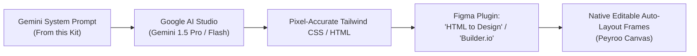

# Google AI (Gemini) Prompt Engineering Kit for Figma Design

> **Project:** Peyroo (پیرو) — Mentorship Platform  
> **Target Figma File:** [`https://www.figma.com/design/ukkaM4uP7bLipB7BPZrKAU`](https://www.figma.com/design/ukkaM4uP7bLipB7BPZrKAU)  
> **Design Theme:** *Oceanic Precision* (`#0A1128` Space Navy, `#0284C7` Cerulean Sky, `#10B981` Electric Emerald)  
> **Document Identifier:** `docs/design/ui/FIGMA_PROMPT_ENGINEERING_KIT.md`  
> **Status:** `[APPROVED & BASELINED]`  

---

## 1. Overview & Tool Pipeline

This engineering kit empowers **Alireza Abasi** to use Google account AI models (Gemini 1.5 Pro / Flash in [Google AI Studio](https://aistudio.google.com/) or Antigravity) to generate high-fidelity, responsive screens that import seamlessly into native, editable Figma Auto-Layout frames.

### Recommended Pipeline


---

## 2. Global Gemini System Prompt (Copy into Google AI Studio)

```markdown
You are a Principal UI/UX Designer & Senior Frontend Engineer designing the web interface for Peyroo (پیرو), an academic mentorship platform connecting software engineers with junior mentees.

Design Guidelines:
- Palette: "Oceanic Precision" (Dark Theme Native)
  - Canvas: #0A1128 (Space Navy)
  - Card/Surface: #0F172A (Deep Slate)
  - Raised Surface: #1E293B (Elevated Card)
  - Borders: #334155
  - Interactive Action: #0284C7 (Cerulean Sky, hover: #0369A1)
  - Punch CTA / Success: #10B981 (Electric Emerald, hover: #059669, glow: rgba(16, 185, 129, 0.25))
  - Warnings/Hold: #F59E0B (Amber)
  - Errors: #EF4444 (Crimson)
- Typography:
  - UI/Headings: Plus Jakarta Sans (or Inter/system-ui)
  - Timestamps, Rates, IDs: JetBrains Mono (monospace, bold)
- Layout Constraints:
  - Standard desktop canvas: 1440px wide, container max-w-7xl (1280px).
  - 8px grid spacing, rounded-xl (12px) cards, rounded-lg (8px) buttons and inputs.
  - Full WCAG AA contrast compliance (minimum 4.5:1 on text, white text on emerald punch).

Output Format:
- Return clean, semantic HTML5 with Tailwind CSS classes.
- Use explicit inline styles for brand hex codes if standard Tailwind colors deviate.
- Clean nested structure that converts 1:1 into Figma Auto-Layout groups.
```

---

## 3. Screen-by-Screen Prompts & Blueprints

---

### Screen 1: Hero Landing & Featured Mentor Discovery (`/`)

#### Gemini Prompt:
```markdown
Generate the Hero Landing Page for Peyroo.
Components to include:
1. Navigation Bar:
   - Brand logo: "Peyroo (پیرو)" with small emerald dot.
   - Links: "Find Mentors", "How It Works", "Pricing", "Become a Mentor".
   - Auth buttons: "Log In" (Ghost) and "Get Started" (Emerald Punch CTA: #10B981).
2. Hero Section:
   - Ambient mesh background gradient (Space Navy #0A1128 with subtle emerald and cerulean glows).
   - Display Headline: "Master Software Engineering Through 1-on-1 Mentorship."
   - Subtitle: "Direct access to senior backend architects, systems engineers, and tech leads. Book verified time slots with clear agendas—zero cold outreach chaos."
   - Search & Filter Bar: Input for "Search by skill (e.g. Go, Distributed Systems, React)" + Search button (#10B981).
   - Quick Filter Chips: ["All", "Backend", "Distributed Systems", "Frontend", "System Design", "DevOps", "AI/ML"].
3. Trust / Metric Badges:
   - "15-Minute Guaranteed Concurrency Lock" | "Transparent 10% Platform Commission" | "100% Refund Guarantee (24h Notice)".
```

---

### Screen 2: Mentor Catalog with Multi-Tag Filter (`/mentors`)

#### Gemini Prompt:
```markdown
Generate the Mentor Catalog & Search Results Page for Peyroo.
Components to include:
1. Filter Sidebar / Top Bar:
   - Search input field.
   - Filter tags (multi-select): Backend (active, Cerulean #0284C7), Frontend, Go, Python, React, Cloud/DevOps.
   - Rate slider ($0 - $100/session) and Duration filter (30m, 45m, 60m).
2. Mentor Card Grid (3 columns):
   - Card Surface: #0F172A, border #334155, rounded-xl.
   - Mentor Avatar with green online pulse.
   - Mentor Name: "Sara Rad" + Headline: "Senior Distributed Systems Engineer @ TechCorp".
   - Bio snippet (2 lines).
   - Expertise Badges: ["Go", "Distributed Systems", "Kubernetes"].
   - Session Rate: "$25.00 / 45-min session" in JetBrains Mono.
   - Next Open Slot Badge: "Next slot: Tomorrow, 18:00".
   - Action Button: "View Profile & Book" (Secondary Cerulean button: #0284C7).
```

---

### Screen 3: Mentor Public Profile & Availability Slot Grid (`/mentors/:id`)

#### Gemini Prompt:
```markdown
Generate the Mentor Public Profile Page for Peyroo.
Components to include:
1. Mentor Hero Header:
   - Large avatar, verified mentor badge, name "Sara Rad", headline, GitHub and LinkedIn links.
   - Stat boxes: "4.9/5 Rating (38 Reviews)" | "45-min standard session" | "Base Rate: $25.00".
2. Left Column (About & Experience):
   - Biography detailing 8+ years in cloud infrastructure and high-throughput microservices.
   - Mentoring topics: Code architecture reviews, mock technical interviews, production incident postmortems.
3. Right Column (Interactive Availability Calendar & Slots):
   - Week view (Mon - Sun).
   - Availability Slot Pills (Status: Available, border #334155, text #F8FAFC).
   - Selected Slot Pill: #0C4A6E background, #0284C7 border, with checkmark icon.
   - Action Trigger: "Reserve Slot & Enter Agenda" (Emerald Punch CTA: #10B981).
   - Security Notice: "Meeting link (Google Meet) will be revealed upon payment confirmation."
```

---

### Screen 4: Booking Drawer & Mandatory Structured Agenda (`/bookings/new`)

#### Gemini Prompt:
```markdown
Generate the Session Booking Modal / Drawer for Peyroo.
Components to include:
1. Modal Container:
   - Raised surface #1E293B, border #334155, rounded-2xl, backdrop blur over Space Navy canvas.
   - Header: "Book Mentorship Session with Sara Rad" + Close icon.
   - Summary Banner: "Friday, Nov 20, 2026 • 18:00 – 18:45 (45 min) • $25.00".
2. Mandatory Agenda Form:
   - Field 1: "Discussion Topic / Primary Objective" (Input, placeholder: "e.g., Kafka Consumer Group lag troubleshooting in production", min 10 chars).
   - Field 2: "Specific Questions & Context" (Textarea, placeholder: "What exact roadblocks are you facing?", min 15 chars).
   - Field 3: "Relevant Project Links" (Optional input, placeholder: "https://github.com/username/project").
3. Holding Notice Banner:
   - Amber warning box (#78350F25 with #F59E0B border): "Your slot will be reserved for 15 minutes once you click Proceed."
4. Action Buttons:
   - "Cancel" (Ghost) and "Proceed to Payment ($27.50)" (Emerald Punch CTA: #10B981).
```

---

### Screen 5: Mock Banking Gateway Checkout Simulator (`/mock-gateway/checkout`)

#### Gemini Prompt:
```markdown
Generate the Mock Banking Gateway Simulator Page for Peyroo.
Components to include:
1. Gateway Header:
   - "Peyroo Mock Banking Gateway — Sandbox Simulator".
   - Security badge: "ACID Transaction & Concurrency Verification Mode".
2. Itemized Financial Breakdown Card (#0F172A):
   - Mentor Session Fee: $25.00
   - Peyroo Platform Commission (10%): $2.50
   - Total Amount Due: $27.50 (in bold JetBrains Mono #10B981).
   - 15-Minute Countdown Timer: "14:48 remaining to complete payment" (Amber #F59E0B pulse).
3. Mock Card Input Form:
   - Card Number, Expiration (MM/YY), CVV, Cardholder Name (pre-filled with sandbox test data).
4. Academic Presentation Test Triggers (Dual Action Buttons):
   - Green Button (#10B981): "Simulate Successful Payment (Test Positive Flow)"
   - Red Button (#EF4444): "Simulate Failed Payment (Test Negative / Rejection Flow)"
   - Gray Link: "Cancel and Return to Peyroo"
```

---

### Screen 6: Booking Confirmation & Revealed Meeting Link (`/bookings/:id/confirmation`)

#### Gemini Prompt:
```markdown
Generate the Booking Confirmation Screen for Peyroo.
Components to include:
1. Success Banner:
   - Emerald checkmark icon (#10B981) + "Booking Successfully Confirmed!"
   - Booking ID: "#BK-10492" in JetBrains Mono.
2. Confidential Meeting Access Card (Highlighted Container):
   - Green-tinted container (#064E3B30 with #10B981 border).
   - Label: "Your Private Video Meeting Room"
   - Video URL Box: "https://meet.google.com/abc-defg-hij" with "Copy Link" and "Join Call" buttons.
   - Privacy footnote: "Disclosed exclusively to you (Mentee) and Sara Rad (Mentor)."
3. Session Details & Receipt:
   - Mentor: Sara Rad | Date: Friday, Nov 20, 2026 @ 18:00 – 18:45.
   - Total Paid: $27.50 (Invoice Download link).
   - Submitted Agenda preview.
   - 24-Hour Cancellation Policy Badge: "Free cancellation with 100% refund available until Nov 19 @ 18:00."
4. Navigation:
   - Button: "View in Mentee Dashboard" (#0284C7).
```

---

### Screen 7: Dual-Mode Session Dashboard (`/dashboard`)

#### Gemini Prompt:
```markdown
Generate the Mentee/Mentor Unified Dashboard for Peyroo.
Components to include:
1. Header Bar:
   - User Avatar + Welcome "Amir Hosseini"
   - Mode Toggle Pill: [ "Mentee Mode" (Active) | "Mentor Mode" ]
2. Session Tabs:
   - ["Upcoming Sessions (1)", "Past Sessions (4)", "Cancelled (0)"]
3. Active Session Card:
   - Status badge: "CONFIRMED" (Green #10B981).
   - Mentor Name, Avatar, Date & Time countdown ("In 3 days").
   - Meeting Link: "Join Google Meet" (#10B981 button).
   - Agenda Preview accordion.
   - Action dropdown: "Cancel Booking" (Triggers 24h refund modal).
4. Completed Session Card (from Past Sessions tab):
   - Status badge: "COMPLETED".
   - Review prompt: "Rate your session with Sara Rad" (5 interactive stars + "Write Review" button).
```

---

## 4. How to Import Code into Figma in 10 Seconds

1. Copy the HTML/Tailwind snippet generated by Gemini.
2. In Figma, press `Ctrl + /` (or `Cmd + /`) and search for **"html.to.design"** (or **"Builder.io"**).
3. Paste the code or preview URL.
4. Click **Import** $\to$ Figma converts every `div`, text element, button, and image into clean, editable Figma Auto-Layout layers!
