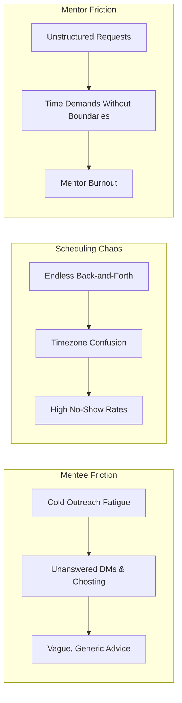
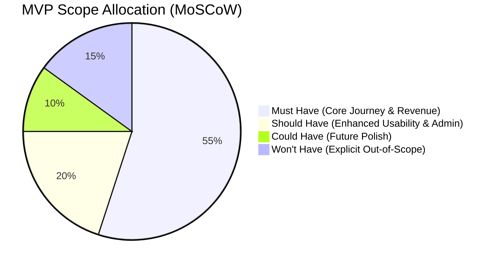
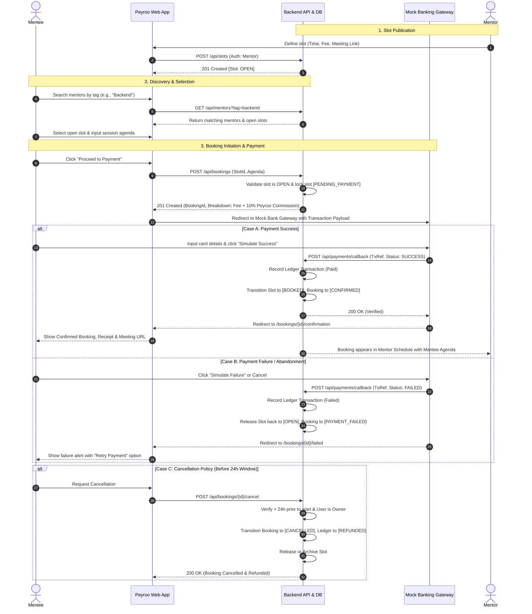

# Product Vision & Discovery Document: Peyroo Mentorship Platform

**Project Working Title:** Peyroo (پیرو)  
**Academic Course:** Software Analysis and Design (SSAD) | Fall 1405  
**Stage:** Stage 1 — Discovery & Inception  
**Status:** `[FINALIZED - PENDING USER SIGNOFF]`  
**Date:** Aban 1405 / November 2026  
**Document Reference:** `docs/discovery/PRODUCT_VISION.md`  

---

## Table of Contents
1. [Executive Summary & Vision Statement](#1-executive-summary--vision-statement)
2. [Problem Definition & Industry Friction](#2-problem-definition--industry-friction)
3. [Stakeholder Registry & Target User Personas](#3-stakeholder-registry--target-user-personas)
4. [Value Proposition](#4-value-proposition)
5. [Business Model & Revenue Architecture](#5-business-model--revenue-architecture)
6. [Feature Discovery & MoSCoW MVP Scoping](#6-feature-discovery--moscow-mvp-scoping)
7. [Primary User Journey & State Transitions](#7-primary-user-journey--state-transitions)
8. [Course Milestone Alignment & Traceability](#8-course-milestone-alignment--traceability)
9. [Product Discovery Decisions Registry](#9-product-discovery-decisions-registry)

---

## 1. Executive Summary & Vision Statement

### 1.1 Vision Statement
> **For** aspiring junior software engineers, computer science students, and career switchers who struggle with unresponsive cold outreach and unstructured advice,  
> **Peyroo** is a dedicated web-based mentorship platform  
> **that** connects mentees with vetted industry professionals through transparent availability booking, structured agendas, and integrated session compensation.  
> **Unlike** chaotic LinkedIn DMs, unstructured Telegram groups, or complex corporate coaching suites,  
> **Peyroo** delivers a streamlined, single-session booking journey with total mentor schedule autonomy, clear agendas, and a built-in mock banking payment flow that proves business viability.

### 1.2 Core Philosophy
In alignment with the academic software engineering curriculum (SSAD Fall 1405), Peyroo is designed around the principle of **one complete, functioning business journey from UI to database**:
- Strict backend-enforced authorization and data ownership.
- Concurrency-safe slot reservation preventing double-booking.
- Immutable financial ledger tracking session fees and platform commission.
- Full architectural transparency and defense-ready engineering documentation.

---

## 2. Problem Definition & Industry Friction

### 2.1 The Problem Space: Tech & Software Engineering Mentorship
Acquiring practical, career-defining guidance in the software engineering sector is fundamentally broken when relying on ad-hoc channels (LinkedIn messages, Twitter/X, Discord, Telegram, or personal email).

### 2.2 Friction Points Faced by Target Roles

1. **Cold Outreach Asymmetry & Response Anxiety (Mentee Pain):**
   - Junior developers send dozens of cold messages asking for vague help ("Can you be my mentor?").
   - Response rates are below 5%, creating discouragement and career stagnation.
2. **Mentor Inundation & Lack of Boundaries (Mentor Pain):**
   - Experienced engineers receive frequent, open-ended requests without clear scopes or agendas.
   - Mentors lack a lightweight way to volunteer occasional free time without entering indefinite, burdensome commitments.
3. **Scheduling Breakdown (Operational Pain):**
   - Negotiating meeting times across social channels requires multiple messages and frequently ends in double-booking or no-shows.
4. **Lack of Economic Incentive / Viability (Platform Pain):**
   - Free-only volunteer programs suffer high attrition. Without clear compensation for mentor time and platform commission, the ecosystem is unsustainable.

---

## 3. Stakeholder Registry & Target User Personas

### 3.1 Stakeholder Registry
The system serves four principal stakeholders:

| Stakeholder | Category | Role & Primary Interest | Impact on System Design |
|---|---|---|---|
| **Mentee** | Primary End-User | Junior developers/students seeking targeted technical reviews, resume critiques, and career advice. | Requires clear discovery filters, slot selection, agenda submission, and receipt access. |
| **Mentor** | Primary End-User | Mid/Senior software engineers offering guidance slots within their schedule boundaries. | Requires availability management, topic customization, session rate control, and mentee agenda preview. |
| **Platform Administrator** | Internal Governance | System operator monitoring platform health, user status, and audit logs. | Requires role-based access control (RBAC), user deactivation, and platform-level commission oversight. |
| **Course Staff (Instructors/TAs)** | Academic Stakeholders | Evaluators judging system analysis, UML rigor, code architecture, test evidence, and live deployment. | Mandates backend-enforced authorization, clean API contracts, and reproducible deployment. |

### 3.2 Target User Personas

#### Persona 1: The Mentee Archetype
* **Name:** Amir Hosseini
* **Demographics:** 22 years old, 4th-year Computer Science undergraduate / Aspiring Backend Engineer.
* **Goals:**
  - Secure an internship or junior backend role.
  - Receive actionable code review on a portfolio project and practice a mock technical interview.
  - Avoid awkward cold messaging on LinkedIn.
* **Pain Points & Anxieties:**
  - Sent 15 LinkedIn messages to senior developers with zero replies.
  - Doesn't know what questions are reasonable to ask.
  - Worries about wasting a busy professional's time.
* **Platform Scenario:** Amir filters mentors by "Backend / Node.js / System Design", finds a senior engineer with open 45-minute slots on Thursday evening, writes his specific questions, pays the session fee via the mock bank gateway, and receives immediate confirmation with a Google Meet link.

#### Persona 2: The Mentor Archetype
* **Name:** Sara Rad
* **Demographics:** 29 years old, Senior Software Engineer at a leading tech company.
* **Goals:**
  - Give back to the developer community and mentor promising talent.
  - Monetize spare weekend/evening hours (e.g., 2 hours per week).
  - Maintain strict control over her personal schedule and topical boundaries.
* **Pain Points & Frustrations:**
  - Overwhelmed by vague LinkedIn requests ("Can I pick your brain?").
  - Hates the administrative friction of manual calendar coordination.
  - Experiences no-shows when sessions lack commitment.
* **Platform Scenario:** Sara sets up her profile with tags (Distributed Systems, Go, Career Navigation), creates two 45-minute slots for Friday at $20 / 400,000 Tomans per session, specifies that mentees must submit an agenda, and receives confirmed bookings with guaranteed fees already processed.

---

## 4. Value Proposition

### 4.1 Value Proposition Matrix

| Target Group | Value Proposition Statement | Key Differentiators |
|---|---|---|
| **Mentees** | *"Direct access to verified tech mentors with guaranteed 1-on-1 booking slots, clear agendas, and zero cold-outreach anxiety."* | Instant slot reservation, mandatory structured agendas, transparent pricing, verified profiles. |
| **Mentors** | *"Total schedule autonomy and boundary protection: mentor on your terms, receive pre-submitted agendas, and earn fair compensation with zero coordination overhead."* | Custom slot creation, topic enforcement, automated fee collection, 24-hour cancellation protection. |
| **Platform / Academic** | *"A self-sustaining, commercially viable mentorship ecosystem with proven unit economics, backend-enforced data security, and verifiable transaction lifecycles."* | 10% platform commission model, sandbox banking verification, strict ownership-based access control. |

---

## 5. Business Model & Revenue Architecture

To fulfill academic approval requirements for commercial viability and operational revenue:

### 5.1 Pricing & Commission Structure
1. **Mentor-Determined Pricing:** Mentors specify their session rate per slot (or set free/pro-bono slots).
2. **Platform Commission Fee:** Peyroo charges a **10% platform service fee** on every paid booking.
3. **Price Breakdown Formula:**
   $$\text{Total Paid by Mentee} = \text{Mentor Session Fee} + (\text{Mentor Session Fee} \times 0.10)$$
   - *Example:* If Mentor Fee = $50.00, Platform Fee = $5.00 $\to$ Total Charged = $55.00.

### 5.2 Mock Banking Gateway Demonstration
To demonstrate real-world financial mechanics without third-party legal/merchant constraints:
- **Sandbox Banking Flow:** Seamless integration with a dedicated internal Mock Payment Gateway interface.
- **Realistic Transaction Simulation:**
  - Card input screen displaying exact itemized breakdown (Mentor Fee, Platform Commission, Total).
  - Explicit **"Simulate Successful Payment"** and **"Simulate Failed Payment"** triggers for presentation and automated testing.
- **Transaction Ledger:** Backend records persistent transaction entries containing `TransactionId`, `BookingId`, `MenteeId`, `MentorFee`, `PlatformCommission`, `Status` (`PENDING`, `COMPLETED`, `FAILED`, `REFUNDED`), and timestamp.

---

## 6. Feature Discovery & MoSCoW MVP Scoping

### 6.1 MoSCoW Prioritization Framework

### 6.2 Detailed Scope Breakdown

#### MUST HAVE (Essential for Presentation 1–3 Delivery)
1. **Authentication & Role-Based Profiles:**
   - Secure registration/login with password hashing and persistent session tokens (JWT/session cookie).
   - Dual-role system: Mentee and Mentor.
   - Profile management: Technical skills/tags (e.g., Backend, Frontend, DevOps), bio, job title, company, GitHub/LinkedIn links, base session rate.
2. **Mentor Availability & Slot Management:**
   - Mentor creates, views, and deletes availability time slots (date, start time, end time, session rate, meeting link).
   - Slot status lifecycle: `OPEN`, `HELD` / `PENDING_PAYMENT`, `BOOKED`, `CANCELLED`.
3. **Mentor Discovery & Search:**
   - Searchable mentor catalog.
   - Multi-tag filtering by technical expertise and role.
   - Mentor detail view displaying credentials, bio, and open slots.
4. **Session Booking & Structured Agenda:**
   - Mentee reserves an open slot and submits a mandatory session agenda (goals, questions, project links).
   - Concurrency protection: Backend transaction locking to strictly prevent double-booking.
5. **Integrated Payment & Revenue Demo (Mock Banking Gateway):**
   - Automated price breakdown calculation (Mentor fee + 10% platform fee).
   - Routing to Mock Bank Gateway with transaction reference.
   - Verification callback: On success $\to$ generate invoice, record ledger entry, transition booking to `CONFIRMED`. On failure $\to$ release slot back to `OPEN`.
6. **Session Dashboard & Lifecycle Management:**
   - Distinct Mentee and Mentor dashboards displaying upcoming, past, and cancelled sessions.
   - Display of external meeting links (e.g., Google Meet / Zoom) for confirmed bookings.
   - Cancellation workflow: 24-hour advance cancellation policy with backend refund state transition (`REFUNDED`).

#### SHOULD HAVE (Targeted for P2/P3 Velocity Permitting)
1. **Post-Session Ratings & Reviews:** Mentee submits a 1–5 star rating and optional text review following session completion.
2. **Platform Administrator Oversight:** Basic admin panel to inspect system metrics, total platform revenue, and deactivate non-compliant accounts.
3. **Email Notification Simulator:** System-generated notification events (booking confirmed, cancelled, refunded) logged or dispatched via SMTP.

#### COULD HAVE (Stretch Goals for Post-P3)
1. Export session to standard `.ics` calendar file format.
2. Mentee mentor bookmarking / favorites list.
3. Verified Mentor badge based on review count.

#### WON'T HAVE (Explicitly Excluded from MVP Scope)
- **Native WebRTC In-App Video/Audio:** Eliminated to avoid high network/media streaming complexity; external meeting links (Google Meet, Zoom) are used instead.
- **Live Real-Money Payment Gateways:** Excluded to avoid legal/business registration constraints; satisfied via the Mock Banking Gateway demo.
- **Two-way Google/Outlook Calendar Synchronization API:** Excluded to eliminate OAuth scope complexity.
- **Real-Time WebSockets Direct Messaging:** Session agendas and external communications suffice.
- **Native Mobile Apps (iOS/Android):** Focused entirely on responsive web delivery.

---

## 7. Primary User Journey & State Transitions

### 7.1 Primary Business Journey Flow

### 7.2 Entity State Machine Lifecycles

#### Slot Lifecycle
$$\text{[DRAFT]} \xrightarrow{\text{Mentor Publishes}} \text{[OPEN]} \xrightarrow{\text{Mentee Reserves}} \text{[PENDING\_PAYMENT]} \begin{cases} \xrightarrow{\text{Payment OK}} \text{[BOOKED]} \xrightarrow{\text{Session Finishes}} \text{[COMPLETED]} \\ \xrightarrow{\text{Payment Fail / Timeout}} \text{[OPEN]} \\ \xrightarrow{>24\text{h Cancellation}} \text{[OPEN / CANCELLED]} \end{cases}$$

#### Booking Lifecycle
$$\text{[INITIATED]} \longrightarrow \text{[PENDING\_PAYMENT]} \begin{cases} \xrightarrow{\text{Tx Success}} \text{[CONFIRMED]} \begin{cases} \xrightarrow{\text{Session End}} \text{[COMPLETED]} \\ \xrightarrow{\text{Cancel (>24h)}} \text{[CANCELLED (REFUNDED)]} \end{cases} \\ \xrightarrow{\text{Tx Fail}} \text{[PAYMENT\_FAILED]} \end{cases}$$

---

## 8. Course Milestone Alignment & Traceability

This discovery document directly underpins the deliverables required for the **SSAD Fall 1405** grading syllabus:

| Course Milestone | Weight | Project Requirement | Traced Section in this Document |
|---|---|---|---|
| **Presentation 1 (P1)** | **20 Pts** | Problem Definition, Scope & Stories | [Section 1](#1-executive-summary--vision-statement), [Section 2](#2-problem-definition--industry-friction), [Section 6](#6-feature-discovery--moscow-mvp-scoping) |
| **Presentation 1 (P1)** | (Cont.) | 4 Required Views (Use Case, Activity, Architecture, ERD) | Supported by [Section 7](#7-primary-user-journey--state-transitions) & [Section 5](#5-business-model--revenue-architecture) |
| **Presentation 1 (P1)** | (Cont.) | Prototype & API Contract | Traced to User Journey flows in [Section 7.1](#71-primary-business-journey-flow) |
| **Presentation 2 (P2)** | **25 Pts** | Auth, 1st End-to-End Feature, Backend Authz | Traceable to Slot Management & Booking Flow ([Section 6.2](#must-have-essential-for-presentation-13-delivery)) |
| **Presentation 3 (P3)** | **55 Pts** | Complete Working MVP & Individual Defense | Full End-to-End Primary Business Journey ([Section 7](#7-primary-user-journey--state-transitions)) |

---

## 9. Product Discovery Decisions Registry

All decisions recorded below have been interactively proposed, analyzed, and approved:

* `[CONFIRMED]` **Target Niche:** Tech & Software Engineering Career Mentorship (Junior developers, CS students $\to$ Senior tech professionals).
* `[CONFIRMED]` **Core Problem:** Eliminating cold-outreach fatigue and unresponsiveness through structured profiles, explicit availability slots, and predefined session agendas.
* `[CONFIRMED]` **Stakeholder Set:** Mentee, Mentor, Platform Administrator, Course Academic Staff.
* `[CONFIRMED]` **Primary Personas:** Amir Hosseini (Mentee / CS Student) and Sara Rad (Mentor / Senior Software Engineer).
* `[CONFIRMED]` **Revenue Model:** Direct per-session pricing set by mentors with an automated **10% Peyroo platform commission**.
* `[CONFIRMED]` **Banking Demo:** Embedded/Simulated Mock Banking Gateway with ledger records (`PENDING`, `COMPLETED`, `FAILED`, `REFUNDED`), meeting academic viability criteria without real-world banking red tape.
* `[CONFIRMED]` **MVP MoSCoW Scope:** 6 Must-Have modules locked down; strictly excluding native video streaming, live banking escrow, and calendar sync APIs.
* `[CONFIRMED]` **Primary Journey:** Discovery $\to$ Slot Selection $\to$ Agenda Submission $\to$ Mock Bank Payment $\to$ Concurrency-Locked Booking Confirmation $\to$ Dashboard Management.
* `[CONFIRMED]` **Cancellation Policy:** Full refund capability up to 24 hours prior to the scheduled session.
